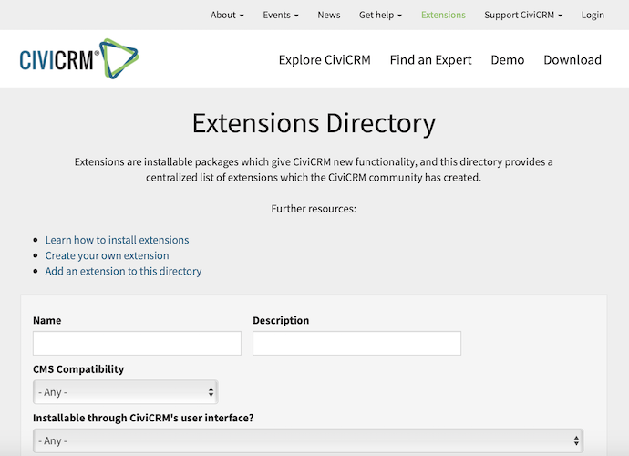
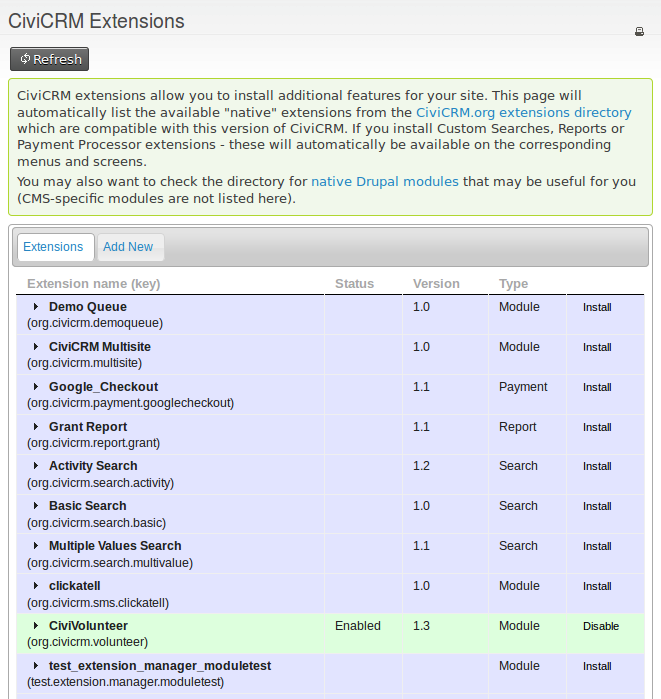

# Extensions

CiviCRM is designed to be highly customisable so it can be tailored to different organizations' needs. Extensions are one way to customise it: each provides a package of features or functionality for a particular use case. Different sets of extensions can make two CiviCRMs look and feel quite different.

Some core functionality, such as taking donations or managing memberships, is provided by *Core Extensions*. These are bundled with the CiviCRM core code but can be enabled or disabled as needed.

Many more extensions are available for download from the *Extensions Directory*. Members of the CiviCRM community typically write and maintain these extensions to provide functionality that multiple organizations may find useful, such as an integration with a particular payment processor or an alternative to the core email template editor.

Extensions can also be written for an individual organization or site. Someone might write a custom extension for their own CiviCRM, or an agency might write one for a client to package specific modifications or tweaks.

## Core extensions

The principle user-facing core extensions are:

- CiviContribute - online fundraising and donor management
- CiviMail - send bulk emails to your contacts
- CiviMember - manage memberships for your contacts
- CiviEvent - set up an event calendar and manage registrations
- CiviCampaign - set up Campaigns to track events, mailings, activities, and contributions against particular projects or goals; organise Surveys and Petitions.
- CiviCase - manage structured sequences of activities for contacts
- CiviGrant - take and process grant applications

These extensions are documented in later chapters of this guide.

## The extensions directory

The extensions directory is available at [https://civicrm.org/extensions](https://civicrm.org/extensions). It lists extensions written by members of the CiviCRM community and made freely available for download by other organizations. By default, extensions are listed in order of popularity, calculated by the number of sites that report using the module.

Extensions fall into two broad categories:

- **'native' extensions** work with any CMS.
- **CMS specific extensions** add integration between CiviCRM and the CMS. If you are familiar with your CMS, you may know these by another name: Drupal specific extensions are typically called **Drupal Modules**, and WordPress specific extensions are called **WordPress Plugins**.

Extensions approved for automated distribution can be installed directly from your CiviCRM installation.

## Installing extensions

When configured correctly, extensions can be installed directly into CiviCRM via the user interface. Go to **Administer &gt; System Settings &gt; Extensions**. You should see a list of extensions compatible with your version of CiviCRM. You may not see every extension listed in the extensions directory because some may not be compatible.

If you do not see a list of extensions here, your system may not be properly configured to manage extensions. Consult your system administrator if this is the case.

## Enabling, disabling and uninstalling extensions

When you first install an extension, it will be Enabled.

If you later decide you don't need the extension, you may Disable it. Disabling an extension should de-activate any functionality or options associated with it. A Disabled extension can be Enabled again to restore functionality and data.

Once you have Disabled an extension, you may choose to Uninstall it. Uninstalling should *remove data associated with the extension*. An Uninstalled extension will need to be re-installed. No data will be restored - it will be as if you freshly installed the extension for the first time.

## Writing extensions

Anyone is free to write an extension to enhance their CiviCRM installation or commission someone to do so. Writing an extension is a task for a developer, so a detailed discussion of how to write one is outside the scope of this book.

If you write an extension for your particular use case, you may wish to consider whether other organizations could benefit from it and whether to publish it and make it more generic. Publishing your extension and attracting users can bring feedback on improvements, bug reports, and code contributions that may enhance it.

## What about Components?

At time of writing, the major core extensions are technically also "Components".
The distinction between Components and Extensions is part technical/part historical
- but generally unimportant. Going forward, "Extension" is generally the preferred term.

<!-- Source: introduction/extensions.md -->
