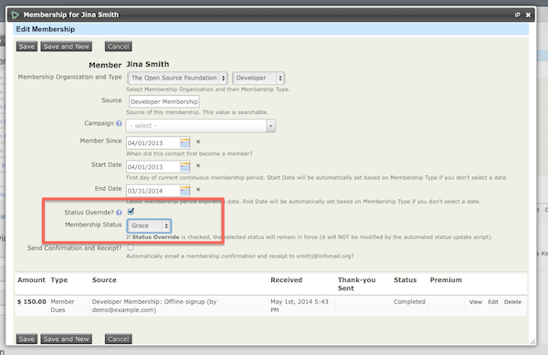
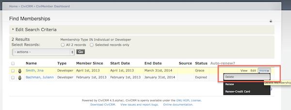

# Cancelling and expiring memberships

If a contact resigns or cancels their membership, change its status to Cancelled or another status that is not considered current rather than deleting it. This retains the contact's membership history and any contribution records attached to the membership.

If a contact's membership is in a grace period and you know they will not continue for another period, you can manually change its status to Expired rather than Cancelled, since they completed the membership period.

To cancel or manually expire a membership:

1. Search for the contact, click the **Membership** tab, then click **Edit** next to the membership record.
2. On the membership edit screen, check the **Status Override box** and select the appropriate **Membership Status**, such as Cancelled or Expired.

Manually expiring memberships may not be necessary. Depending on how the membership status rules are set up under **Administer &gt; CiviMember &gt; Membership Status Rules**, memberships automatically expire based on timeline criteria.

## Deleting memberships

Delete a membership only if it was entered in error. For example, if you made Jo Smith a member instead of Joe Smith, you would remove Jo Smith's incorrect membership and any linked contribution record.

Deleting a membership completely removes it and any linked contributions from the database. **This action cannot be undone**, so give permission to delete memberships only to trusted staff.

You can delete membership records in either of these ways:

- Search for the contact, click the **Membership** tab, click **More** next to the membership record, then click **Delete**.
- Click **Memberships &gt; Find Members &gt;**, enter your criteria, then select the membership records from the "Find Members" results screen and click **Delete**.

<!-- Source: membership/cancelling-and-expiring-memberships.md -->
