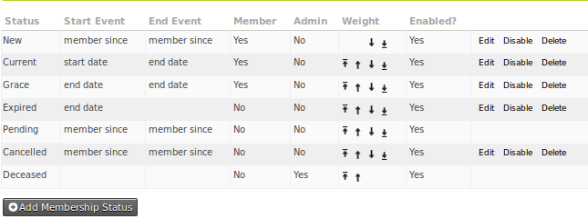
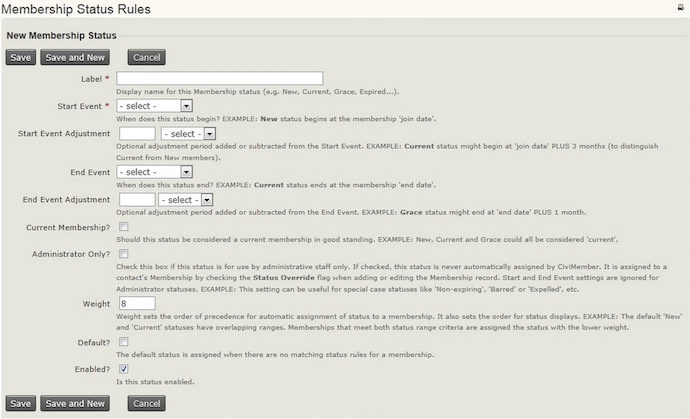

# Membership status rules

Membership status rules define the stages contacts move through during their membership. The rules use the membership's join, start, or end date.

## Membership dates

Memberships have three primary dates:

- **Join date**: The date the contact first signed up for a membership with your organisation. Unless changed manually, it retains that first value.
- **Start date**: The date the current *continuous period* of membership began.
- **End date**: The last day of the current membership.

## Default membership statuses

By default, members move through these statuses:

- **Pending:** Someone has requested membership but has not paid. You cannot change this status manually to New; you must update the associated contribution record. For example, if Joe Smith signs up using the pay later option, his membership status will not change to New until you change the contribution status of his related payment to Completed.
- **New**: The member has just signed up, or a pending payment has arrived. By default, this status lasts until three months after the membership start date.
- **Current**: New members move to this status after the New period. Current lasts until the membership end date.
- **Grace**: The membership period has ended without a renewal. The contact remains in this status for a period of time and is still counted as a member.
- **Expired**: The grace period has ended, and the contact is no longer counted as a member.
- **Cancelled**: An administrator has manually cancelled the membership, perhaps due to misbehaviour.
- **Deceased**: The deceased contact's record remains in the system, but the contact is removed from further communications. This status is set automatically from the contact's deceased flag.

## How rules and overrides determine a status

You can force a status by selecting **membership override** on a membership record and choosing a status. A membership with an override stays at that status rather than being updated according to the status rules.

Go to **Administer > CiviMember > Membership Status Rules** to see a summary of the existing rules.

CiviCRM checks for a status override first. If there is none, it checks the statuses in order from the top of the Status Rules page. For each status, it checks whether today's date falls between that status's start and end dates. It applies the first matching status.

## Adding or editing a status

When you edit or add a membership status, this form appears:

You can add statuses and edit existing statuses, except **Pending** and **Deceased**. For a new status, specify when it starts and stops relative to a membership event: the join date, start date, or end date. For example, 'one month after the membership start date' would use 'start date' and '1 month'; 'five days before the membership end date' would use 'end date' and '-5 days'.

Use the 'Current membership' tick box to specify whether contacts with the status are considered members. This produces Yes or No in the Member column of the status rules summary page.

For renewing contacts whose status defines them as members, the existing membership end date is extended by the duration of the renewal. Renewing contacts whose status defines them as non-members receive a new start date and an end date based on that start date.

## Keeping membership statuses updated

When a membership is added or renewed, its status is set automatically from the status rules. For example, a newly created membership is assigned "New" by default.

If statuses are not updating automatically, make sure the **Update Membership Statuses** scheduled job is enabled and runs at least once a day. See the [Scheduled Jobs](https://docs.civicrm.org/sysadmin/en/latest/setup/jobs/) chapter for configuration details, and consult your system administrator if appropriate.

<!-- Source: membership/defining-memberships-part2.md -->
