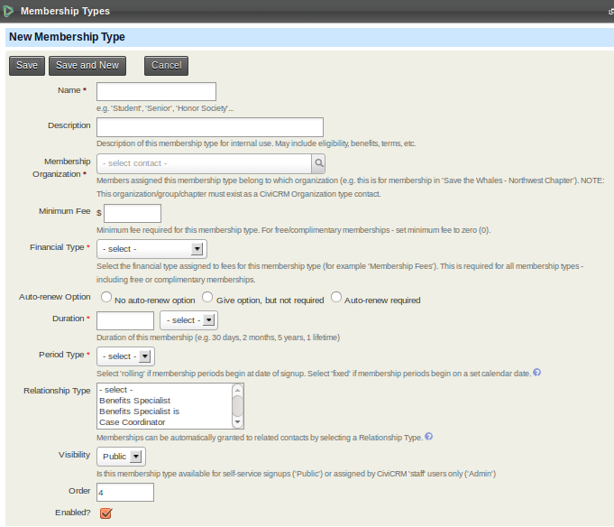
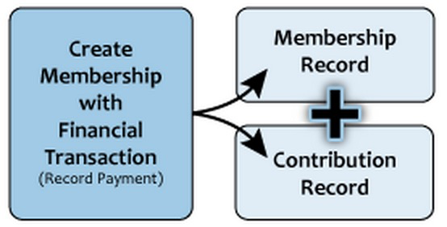
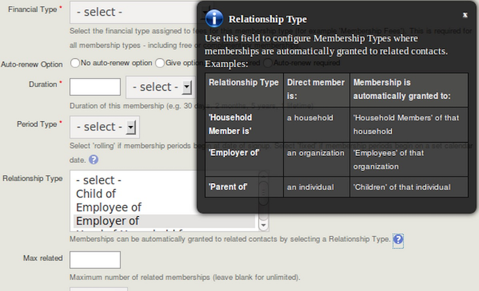

# Defining membership types

Membership types are a basic building block for membership management in CiviCRM. An organisation will typically set up a type for each membership it offers. One type may be enough for a simple membership structure; a more complex structure may need more. For example, an organisation might have 'regular', 'student', and 'honorary' memberships, or use membership types as subscriptions to free or paid publications.

The options on the membership type form can help you decide how many types your organisation needs and how to configure them. This page covers the most common set-up. Organisations with more complex requirements may need **membership price sets**, which are covered in [Membership price sets](membership-price-sets.md).

If you have trouble modelling your membership structure in CiviCRM, ask about the problem on Mattermost or Stack Exchange (see [Finding the Community Online](../the-civicrm-community/the-civicrm-community.md#finding-the-community-online)). There may be other ways to model your data or simple changes you can make to CiviCRM's behaviour.

## Membership type options

To open the membership type form:

1. Go to **Administer > CiviMember > Membership Types**.
2. Select **Add Membership Type**.

- **Name**: The name appears on public and backend pages, so choose one appropriate for both audiences. You can change it later, although you may also need to update membership receipts if they have been customised based on membership names.

- **Description**: This is optional. You can describe the membership and the types of contacts it is aimed at.

- **Membership organisation**: Specify the organisation that the contact will become a member of. CiviCRM can manage memberships for more than one organisation in a single instance—for example, the memberships of a tennis club, a football club, and a hockey club. Each organisation must already exist as a CiviCRM organisation contact. If you manage memberships for only your own organisation, you can choose the default organisation.

    Some organisations want contacts to hold two or more concurrent memberships of the same organisation. For example, an organisation focused on child health might offer parents a membership that includes a parenting magazine and health professionals a membership that includes a peer-reviewed journal and training-event discounts. A parent who is also a health professional might want both.

    CiviCRM's [Membership Up-Sell feature](renewals.md#membership-up-sell) expects a contact to have only one active membership with a single organization at any given time. A 'workaround' is to create 'dummy' organisations for the possible concurrent memberships. In the example above, you would create an extra organisation for health professionals. You do not have to expose the dummy organisation to members on the website; it is for administrative purposes only.

- **Minimum fee**: Enter 0 (zero) for a free membership. Otherwise, enter the minimum amount that must be paid for this membership type. It is a minimum because you can encourage people to pay more if they want to.

- **Financial type**: The default [financial type](../contributions/key-concepts-and-configurations.md#financial-types) is **Member Dues**, which is appropriate for many organisations. For more complex accounting needs, you can specify different financial types to account for membership payments in different ways. For finer-grained control, you can use [Membership Price Sets](membership-price-sets.md).

    You can override the financial type on specific public membership sign-up pages or when recording a membership in the back end.

    CiviCRM handles paid memberships by linking membership records to contribution records. The membership record documents a contact's *relationship* with the organisation; the corresponding financial transaction records the membership's monetary value.

    

    The membership record is stored under the membership tab, the financial record under the Contributions tab, and a link is created between them.

- **Auto-renew**: Auto-renew automatically submits a repeat transaction to the payment processor when the current membership expires. It is not available for all payment processors, so check whether yours is configured for recurring payments before selecting an auto-renew option. For information on payment processors, see [http://wiki.civicrm.org/confluence/display/CRMDOC/Payment+Processors.](http://wiki.civicrm.org/confluence/display/CRMDOC/Payment+Processors)

    You can offer or require auto-renewal, but only for memberships with a **Duration** of one year or less. Free memberships never auto-renew because auto-renewal relies on confirmation from a payment processor. For similar functionality, you can set a free membership's **Duration** to **Lifetime** and use a [scheduled reminder](../email/scheduled-reminders.md) to email those members, for example, annually.

- **Duration**: Enter the number of days, months, or years that the membership lasts each time someone signs up or renews.

- **Period type**: **Rolling** memberships start on the day the member signs up. **Fixed** memberships start on the calendar date you specify. Selecting a fixed period displays additional fields according to the **Duration**.

    For a **Duration** in **years**, two additional fields appear:

    - **Fixed Period Start Date** is the calendar date on which all memberships start, such as January 1st or April 15th.
    - **Fixed Period Rollover Date** determines the end date when someone signs up partway through the membership year. For a one-year membership with a **Fixed Period Start Date** of January 1 and a **Fixed Period Rollover Date** of September 1:
        - Someone signing up between 1 January 2018 and 31 August 2018 has a membership end date of 31 December 2018.
        - Someone signing up on or after 1 September 2018 has a membership end date of 31 December 2019—up to 15 months of membership for the one-year price.

    For a **Duration** in **months**, one additional field appears:

    - **Fixed Period Rollover Date** determines whether the membership duration starts at the beginning of the current calendar month or the next one. For a six-month membership with **Fixed Period Rollover Date** set to 15:
        - Someone signing up on days 1–14 January has a membership end date of 30 June.
        - Someone signing up on days 15–31 January has a membership end date of 31 July.

    For example, if **Duration =** 12 months, **Period type** = Fixed, and **Fixed Period Rollover Date** = 1, anyone joining during August 2018 has an expiry date of 31 August 2019.

- **Relationship Type**: A membership can be **inherited** from one contact to another. For example, a professional trade organisation might sign up a company as the primary member and extend membership benefits to its employees.

    Select the **relationship type** along which the membership inherits. The pop-up help screen gives examples of relationship types to select. Then enter a number in **Max related** to limit the inherited memberships linked to each primary member. In the company example, you could limit membership through employment to 10 employees.

    

    With inherited memberships, the primary member is distinguished from the members who inherit membership through their relationship with that member.

- **Visibility**: Choose **Public** to make the membership type available for inclusion on online membership sign-up forms. Choose **Admin** for types handled manually by an administrator, such as honorary and lifetime memberships.

- **Order**: Determines where the type appears in a drop-down list of membership types and on membership sign-up pages.

- **Enabled**: Untick this box for a membership type that is no longer offered or not yet available. This removes the type from the user interface without deleting membership data. You can re-enable it later.

## Collecting additional information about members

You can create one or more custom field sets to collect additional information about members. A set can apply to all memberships or to specific membership types. If the information varies by type, create more than one set and link each to the relevant membership type or types. See [Creating Custom Fields](../organising-your-data/creating-custom-fields.md) for details.

<!-- Source: membership/defining-memberships.md -->
