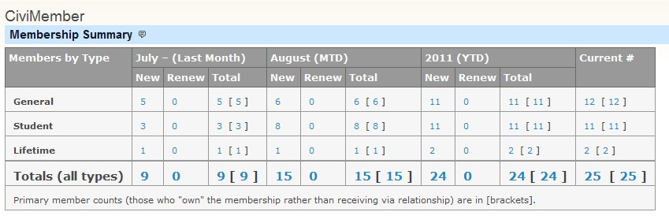
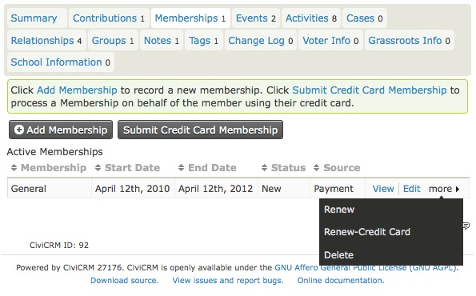
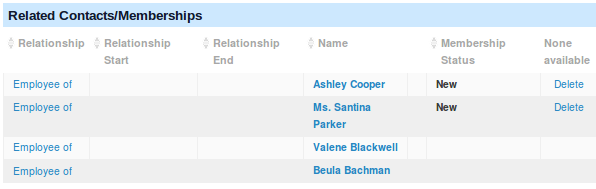
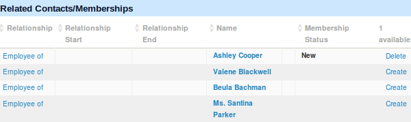
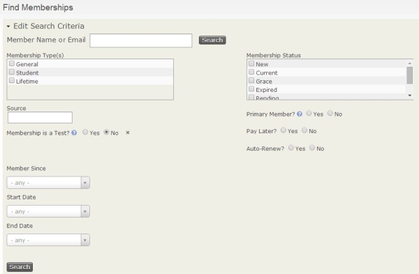
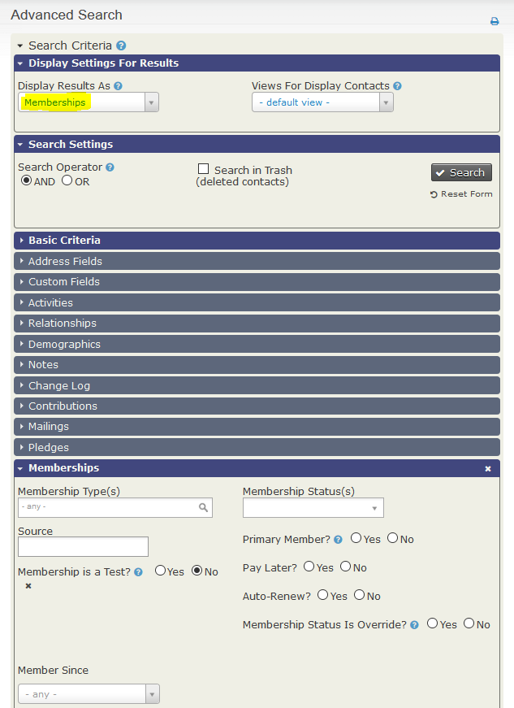

# Finding and viewing memberships

You can view recent memberships on the membership dashboard, view an individual contact's membership records, or search based on membership data.

## Viewing your memberships

### The membership dashboard

For a snapshot of recent memberships, go to **Memberships &gt; Dashboard**. The dashboard shows a summary of memberships by type and date range, and a list of recent member activity.

Click a summary number to view a list of members who have joined or renewed over the last two months or the year-to-date, or who are considered current according to the membership status definitions. From the list, you can take actions such as Delete, Edit, Export, and Send Email to Contacts.

### Viewing a contact's membership records

Find the contact you want to manage, then click the **Membership** tab to view a summary of their membership records.

!!! note
    If a contact's membership is "pending", the membership will show up when
    the tab is clicked but it will NOT be counted in the number on the tab.

Membership records appear with active memberships (those with a current status) first, followed by expired or canceled memberships.

You can edit existing membership records, renew a membership, or create a new membership record. If you have configured an online credit card payment processor for use in CiviCRM, you will see two options for creating or renewing a membership: one for handling an offline record (no real-time transaction taking place), and one for handling an online record (using a real-time credit card transaction). The online option can also be used to set up auto-renew if the processor supports this. The interfaces are similar, except that the credit card option includes payment processing and recording options.

If you are viewing the primary member contact record for a membership type that has inherited membership, you will see a list of the contacts who have inherited the membership.

In this case, a maximum of two inherited memberships are allowed for people who are employees of the primary membership organisation. If an available inherited membership is assigned to the wrong employee, click **Delete** for that contact. This frees up an inherited membership to assign by selecting **Create.**

## Searching based on membership data {:#searching}

CiviCRM distinguishes between contacts and memberships. For example, “How many members do we have?” could mean “How many contacts are members?” or “How many memberships have we granted to contacts?” If one contact has more than one membership, the counts differ: there are two memberships but one contact. Which count to use depends on what you need to know.

**Find members** searches based on membership data and returns membership data:

1. Click **Memberships &gt; Find Members** and enter your criteria.
2. Click **Search**.

**Advanced search** can search based on limited membership information combined with other contact information and return contacts. You can also choose membership from the **Display Results As** column to show members rather than contacts. For more information, see the [Searching chapter](../searching/searching.md).

1. Click **Search &gt; Advanced Search**.
2. In the **Display Settings For Results** accordion, set **Display Results As** to **Memberships** and enter your criteria.
3. Click **Search**.

The search results show some membership details. To take further action on all results or a smaller subset of selected records, use the **Actions** dropdown menu. Actions include **Email - send now** and **Export members**.

## Sending email to members

After searching your records, you can email selected contacts and include data field [tokens](../common-workflows/tokens-and-mail-merge.md) to personalize the message.

1. Click **Memberships &gt; Find Members** and enter your criteria.
2. On the "Find Members" search results screen, select the records you want to import.
3. In the **-actions-** drop down, select **Send Email to Contacts**.

<!-- Source: membership/finding-and-viewing-memberships.md -->
