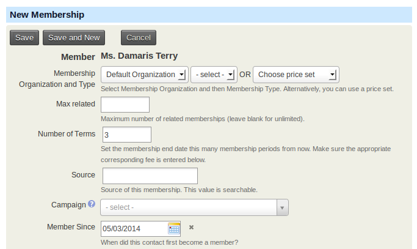
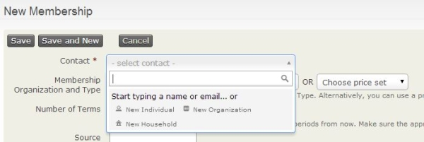
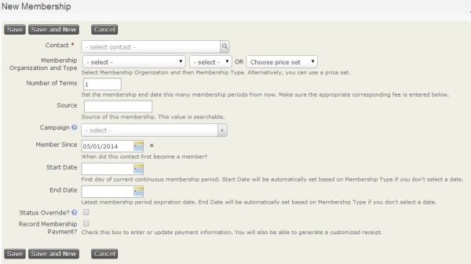
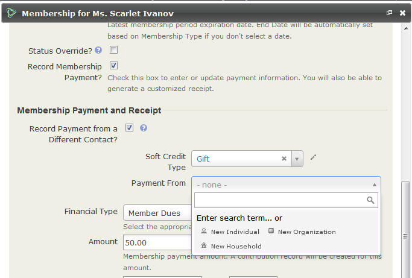

# Manual entry of memberships

Contacts can become members through self-service on a website, but memberships can also be processed manually. Appropriately permissioned users can create memberships one at a time, enter batches of membership payments, or import memberships.

## CiviMember access control

Use **Administer > User & Permissions > Permissions** to control access to CiviMember features:

- To find and view memberships, assign **access CiviMember** and **view contact** permissions for the associated record. If payments are involved, also assign **view contributions**.
- To create or edit membership records, assign **edit memberships** and **edit contact** permissions for the associated contact record. If payments are involved, also assign **edit contributions**.

More details on permissions can be found at [http://wiki.civicrm.org/confluence/display/CRMDOC/Default+Permissions+and+Roles](http://wiki.civicrm.org/confluence/display/CRMDOC/Default+Permissions+and+Roles).

## Creating a new membership record

You can create a membership from an existing contact's record or through the **Memberships** menu. The menu lets you create a new contact while adding the membership. From an existing contact's record, you can use **Submit Credit Card Membership** to process payment immediately if you have set up a payment processor that allows credit card transactions directly on your site. The **Memberships** menu does not offer that option, but you can record other types of payments, such as checks and cash.

### Via an existing contact record

From the contact's record, click the **Memberships** tab, then click **Add Membership**. If you have set up a payment processor that allows credit card transactions directly on your site, you can select **Submit Credit Card Membership** and process the payment immediately.

Many fields on the "New Membership" form will be auto-completed if left blank:

- **Membership Organization and Type**: Select the organization the contact has a membership with and the type of membership.
- **Choose Price Set**: If you have various fee structures for different classes of memberships, you can use [Membership Price Sets](membership-price-sets.md) by selecting Choose Price Set rather than Membership Organization and Type.
- **Number of Terms**: Enter the number of membership periods or terms. The membership end date will be set for that number of terms. This option is hidden when using membership price sets.
- **Source**: If left blank, the system will complete details about the record, including whether it was an offline or online transaction and who completed the record.
- **Campaign**: If the membership is connected with a larger campaign, select the campaign name. To learn more, see the *Campaign* section.
- **Member Since**: The date the membership record was created is auto-filled but can be overridden.
- **Start Date**: For a rolling membership, the current date is auto-filled. For a fixed-period membership, CiviCRM determines the start date from the membership type configuration. The date can be overridden.
- **End Date**: This is automatically calculated from the start date and membership type settings but can be overridden.
- **Auto-renew**: This field is shown only if you have chosen a Membership Type with auto-renew functionality set in the Membership Type and are using **Submit Credit Card Membership** to create the Membership.
- **Status Override?**: Check this box to manually define a status instead of the automatically provided status.

    !!! caution
        This setting will stop the status from automatically updating based on the membership status rules you have set up when [defining your memberships](defining-memberships.md).

- **Record Membership Payment?**: Check this box and complete the transaction fields to record the money paid. This creates a contribution record as well as the membership record. After recording the membership, you can see the related contribution record at the bottom of the membership record.

    - **Record Payment from a Different Contact?**: This is often used for gift memberships.
    - **Financial Type**: Select the appropriate financial type for the payment.
    - **Amount**: Enter the membership payment amount.
    - **Received Date and Time**: Enter when the payment was received.
    - **Paid By**: Select the payment instrument, such as cash or check. You can learn more about configuring Payment Instruments in the *Contributions* section.
    - **Check Number**: If the payment was received by check, enter its number.
    - **Transaction ID**: If you have a payment processor, CiviCRM stores an auto-generated transaction id. For manual transactions, you can enter a bank transfer ID or other identifier as applicable.
    - **Payment Status**: Select the status of the membership payment received. You can learn more about configuring Payment Instruments in the *Contributions* section.

- **Send Confirmation and Receipt?:** Check this box to email the contact confirmation of their membership.

    - **Receipt From:** Select the email address the confirmation receipt is from. If the address is not listed, you can add it under **Mailings > From Email Addresses**.
    - **Receipt Message:** Enter a special message for the member, or leave it blank to use the default confirmation and receipt message.

### Auto-renew memberships via a contact record

To manually create a membership that will auto-renew, go to the contact's summary screen, select the **Memberships** tab, and click **Submit Credit Card Membership**. If you select a Membership Type set up for recurring, a checkbox labelled **Membership renewed automatically** will be shown.

If you check Auto-renew, a recurring payment (subscription) request will be submitted to the selected payment processor. If successful, the membership will automatically renew on the last day of the membership period until the recurring payment is cancelled. Membership payment receipt emails will include a link for the member to cancel auto-renewal.

### Via the **Memberships** menu

1. Navigate to **Memberships > New Membership**, then select the contact or create a new contact.

    

2. Fill out the New Member form with the appropriate membership and payment information described under *Via an existing contact record* above.

    

## Gift memberships

When entering a membership manually, select **Record Payment from a Different Contact?** to record it as a gift. The person paying for the membership (gifter) can be an existing contact or a new contact created during the process.

The payment will be recorded on the gifter's record, with a soft credit for the membership on the gift recipient's record. The receipt will be sent to the gifter. You will need to send a separate email or letter to tell the gift recipient about their membership.

## Entering batches of membership payments

The **Batch Data Entry** feature in the **Memberships** menu can be used to enter batches of membership payments received on paper forms or similar. It works for new and existing contacts and includes verification of the total amount and item count against the payments recorded on your deposit slip(s).

Its batch entry grid has a copy feature for setting all fields to the same value. You can also create new contacts without leaving the batch entry screen.

Several CiviCRM reserved profiles determine which fields appear in the batch entry input grid. To collect information not currently included in those profiles, alter the profiles to reflect the fields you want to display.

You can read more about the [Batch Entry of Contributions or Membership Payments](../contributions/manual-entry-of-contributions.md#batch-entry-of-contribution-membership-or-pledge-payments.

<!-- Source: membership/manual-entry-of-memberships.md -->
