# Membership price sets

Membership price sets let contacts:

- Sign up for multiple membership terms at the same time.
- Sign up for more than one membership in a single transaction, such as national and local memberships.
- Select non-membership options, such as information booklets, when they sign up for a membership.

Here is an example of a membership price set offering all these options:

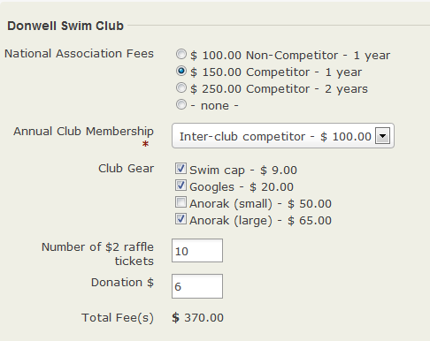

The Donwell Swim Club **price set** consists of five **price fields**: National Association Fees, Annual Club membership, Club Gear, raffle tickets and donation.

It offers two membership types:

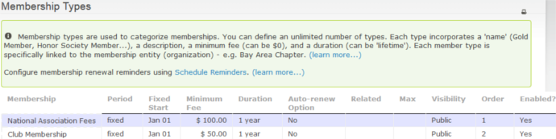

Define these membership types before creating the price set. See [Defining Memberships](defining-memberships.md). You must also define all the [financial types](../contributions/key-concepts-and-configurations.md#financial-types) you will need before creating the price set.

Membership price sets can be used on online join-up or renewal pages, or for new member sign-ups processed manually through the CiviCRM back office system. They cannot be used for renewals processed manually. Each membership must be renewed individually (see the *Renewals* chapter). You may also need to create a contribution price set for the non-membership items you offer.

You cannot combine memberships that can be auto-renewed with memberships that do not offer auto-renewal or with non-membership items.

Price sets can be configured in many ways. Test a price set thoroughly before using it on your live site to make sure it fits your situation.

## Create a price set

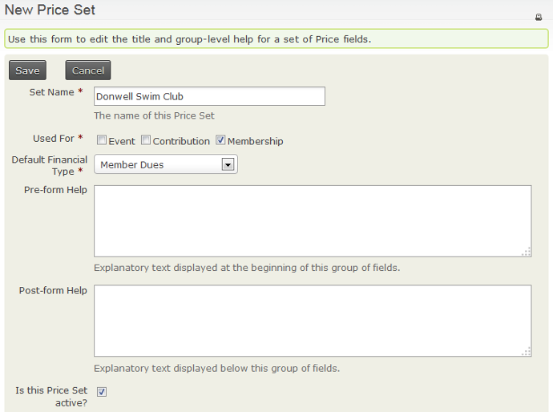

1. Navigate to **Memberships > New Price Set** or **Administer > CiviMember > New Price Set**.
2. Enter the price **set name**. It appears both to the public as part of the price set and to admin staff choosing between price sets, so make it descriptive for both.
3. Tick **Membership**.
4. Set the **Default Financial Type**. This choice has accounting implications; refer to the *Contributions* section for more information.
5. Add pre- or post-form help text if you want to.
6. Make sure the price set is active and **Save**.

You will be taken to a form to create the first **price field** for your **price set**.

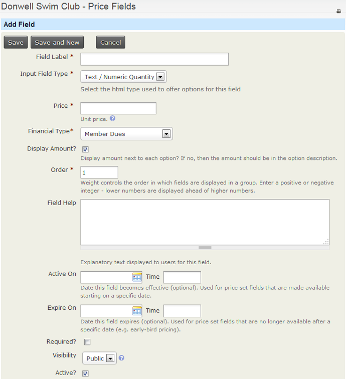

### Create a price field

1. Enter a name in **Field Label**. This name appears to the public.
2. Select the **Input Field Type**. Four input types are available:
   - **Text/Numeric Quantity:** Set a unit **Price**. The price set displays a text box for a quantity; the quantity entered is multiplied by the unit price to calculate the amount.
   - **Select:** Displays a dropdown box from which one option can be selected.
   - **Radio:** Displays options in a list; up to one option can be selected.
   - **Checkbox:** Displays options in a list; multiple selections are allowed.

   Each input type is used in an example below.

3. **Financial Type** is set to the **Default Financial Type** chosen when the price set was created. You can override it if required.
4. **Display Amount?** displays an option’s price next to its label. If the field label includes the option price, you can untick it. Otherwise, leave it ticked.
5. **Order**, **Field Help**, **Required** and **Active** are either self-explanatory or have help on the form.
6. **Active On** and **Expire On** can make a price field invisible until the **Active On** date, invisible after the **Expire On** date, or visible only between those dates. For example you could use these fields to bring in a price rise at 12:00am on 1 January 2019 by setting the price field with the old prices to **Expire On** 1/12/2019 12:00am and the price field with the new prices to be **Active On** 1/12/2019 12:00am.
7. Set **Visibility** to **Public** (visible on your website to those who can see the membership sign-up page) or **Admin** (visible only through the back end, and only to users with appropriate permissions).

## Multiple membership terms

The National Membership price field illustrates how to let contacts sign up for multiple membership terms at the same time using the **Radio** input field type.

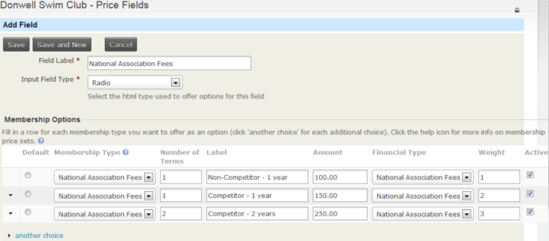

In **Membership Type**, select an option from the dropdown list of configured membership types. Selecting a membership type fills **Number of terms** with 1 and fills **Label**, **Amount** and **Financial Type** from that membership type’s definition. You can change all these values.

The National Association Fees membership type has a duration of 1 year and a minimum fee of $100. Setting **number of terms** to 2 gives 2 years of membership. If you have more than one option, change the **Label** so each option has a different label. You can increase the **Amount** to any value, allowing concession and standard fees for the same number of terms.

Because the price of each option is not included in its **Label**, **Display Amount?** needs to be ticked.

This configuration reduces the number of membership types you need: this price field needs only a 1 year National Association membership type with a minimum fee of $100, instead of three membership types. Members cannot auto-renew with this type of multi-term configuration.

## Membership of more than one organisation

In addition to National Association Fees, contacts must sign up for a membership with the swim club. This field uses the **Select** input field type.

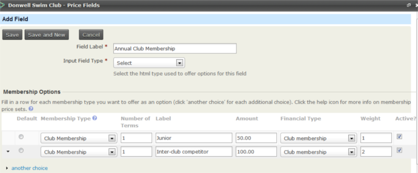

Selecting a membership type from the dropdown list fills **Number of terms** with 1 and fills **Label**, **Amount** and **Financial Type** from that membership type’s definition. You can change any of these values.

Because the price of each option is not included in its **Label**, **Display Amount?** needs to be ticked.

Together, these two price fields let someone sign up for a minimum of 1 and a maximum of 2 memberships. The memberships must be linked to two different organisations: a contact can have only one active membership with a specific organisation. See [Defining Memberships](defining-memberships.md) for more information.

## Non-membership price fields

You can configure price set fields to offer additional services, subscriptions or other non-membership options.

The example has three non-membership price fields. The first offers club-branded swimming gear. The **Checkbox** field type lets people choose more than one item.

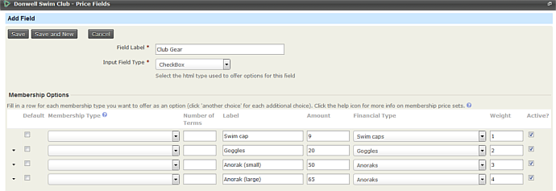

Because these are products rather than memberships, leave **Membership Type** and **Number of Terms** empty. Set **Label**, **Amount** and **Financial Type** for each option. Because the price of each option is not included in its **Label**, **Display Amount?** needs to be ticked.

The three price fields discussed so far contain the same fields, despite using different input field types. **Radio** and **Select** are interchangeable: both allow one option and can be used for membership or non-membership options. Use **Checkbox** when contacts can choose more than one option from a single price field. It can also be used for either membership or non-membership options.

The fourth input field type, **Text/Numeric Quantity**, can only be used for non-membership options. Usually, include the **unit price** in the **field label**, as in this example, or in the **field help**. In that case, **Display Amount?** should not be ticked.

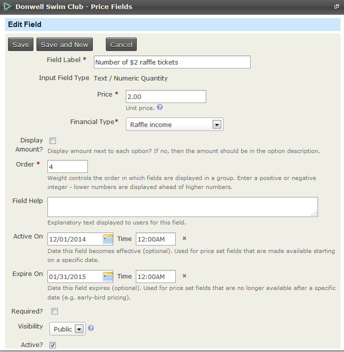

This displays as:

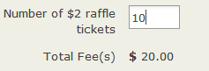

This price field is visible only between the **Active On** and **Expire On** dates, so raffle tickets can be purchased only during the selling period authorised by the relevant licensing authority.

The final price field allows people to give a donation. Its **unit price** is 1. The unit price is not included in the field label, although the currency symbol is, and **Display Amount?** is not ticked. This is the best configuration for "any amount" donations.

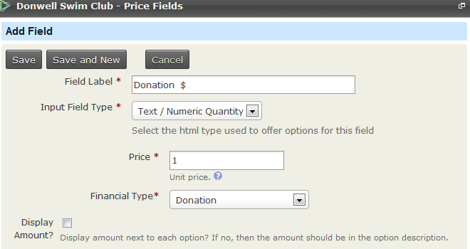

Here is how all the fields look on the final screen:

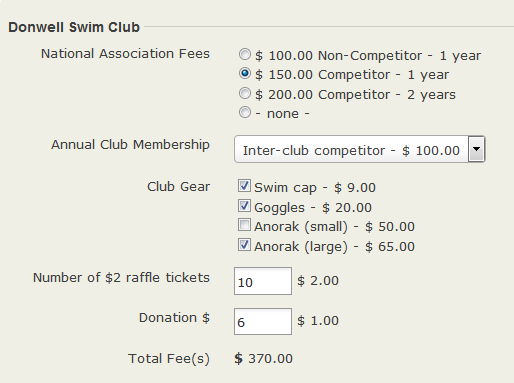

<!-- Source: membership/membership-price-sets.md -->
