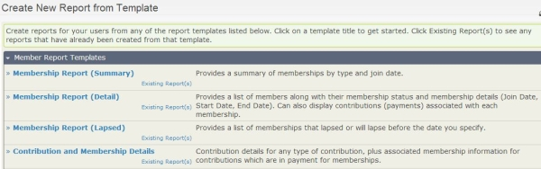

# Create a membership report

Use a membership template to create and save a report with criteria different from those offered by the built-in membership reports.

1. Click on **Reports &gt; Membership Reports &gt;** click the **New Member Report** button.
2. On the Create New Report Template screen, click one of the membership report templates and enter your criteria.

3. Click **Preview Report** to check your results.
4. If you like what you see, click **Create Report**, then enter the information you want to save this as a new membership report.

See [Reporting](../reporting/what-you-need-to-know.md) to learn more about working with reports in general.

<!-- Source: membership/membership-reports-part2.md -->
