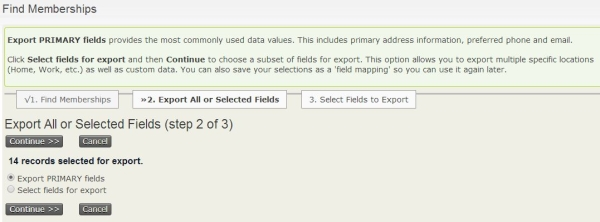
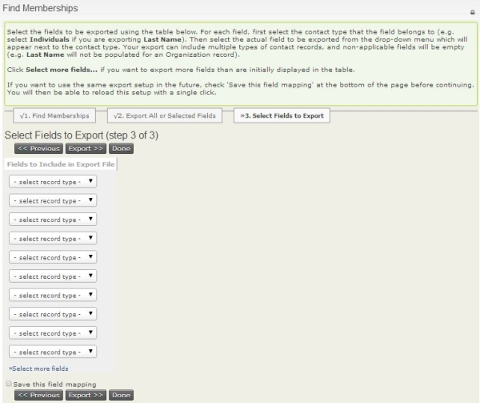

# Export membership records

You can export membership records for further analysis, document mail merges, or reports outside CiviCRM. You can export a default set of primary fields or choose fields specific to the membership record.

First, [search for the specific membership records](finding-and-viewing-memberships.md#searching) you would like to export.

1. Click on **Memberships &gt; Find Members** and enter your search criteria.
2. On the "Find Members" search results screen, select the records you want to import. In the **-actions-** drop down, select **Export Members**.
3. Select **Export PRIMARY fields** or **Select fields for export**, then click **Continue**.

- If you selected **Export PRIMARY fields**, a file called `CiviCRM_Member_Search.csv` will be created containing the membership records based on your search criteria.
- If you selected **Select fields for export**, include the fields you would like to export. Check **Save this field mapping** if you want to re-use this field mapping for a future export, then click **Export**. A file called `CiviCRM_Member_Search.csv` will be created containing the membership records based on your search criteria and the fields you selected to export.

<!-- Source: membership/membership-reports-part3.md -->
