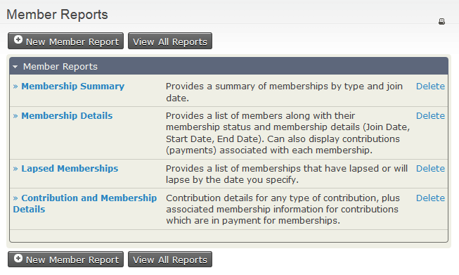
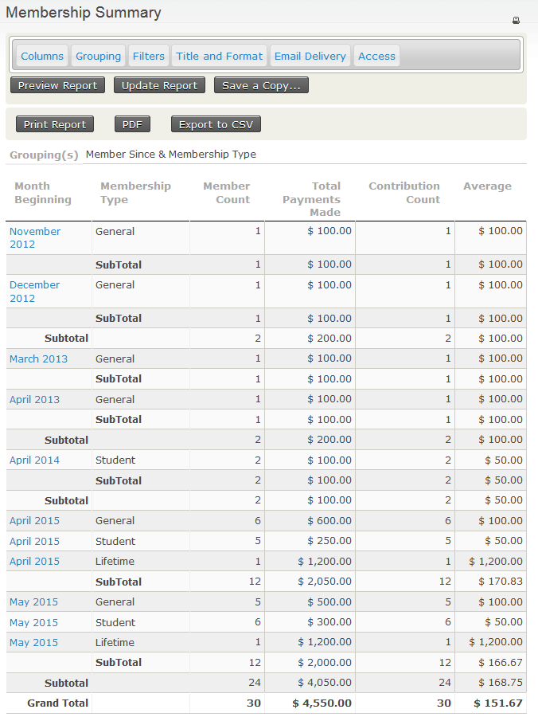
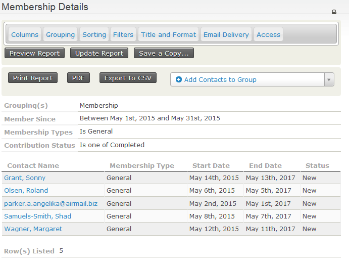
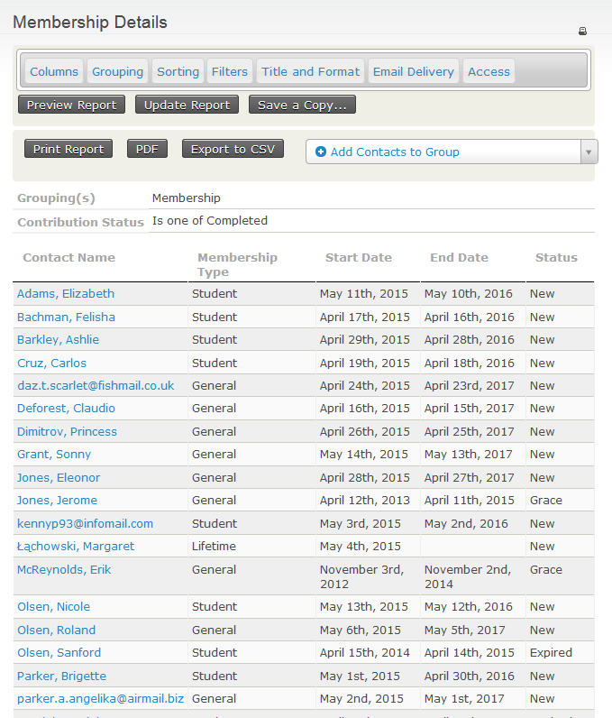
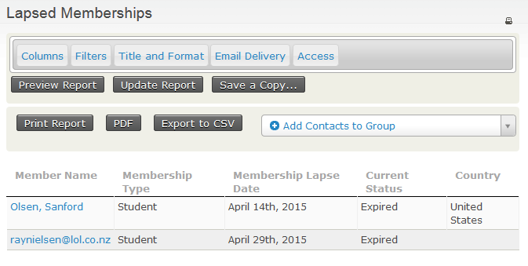
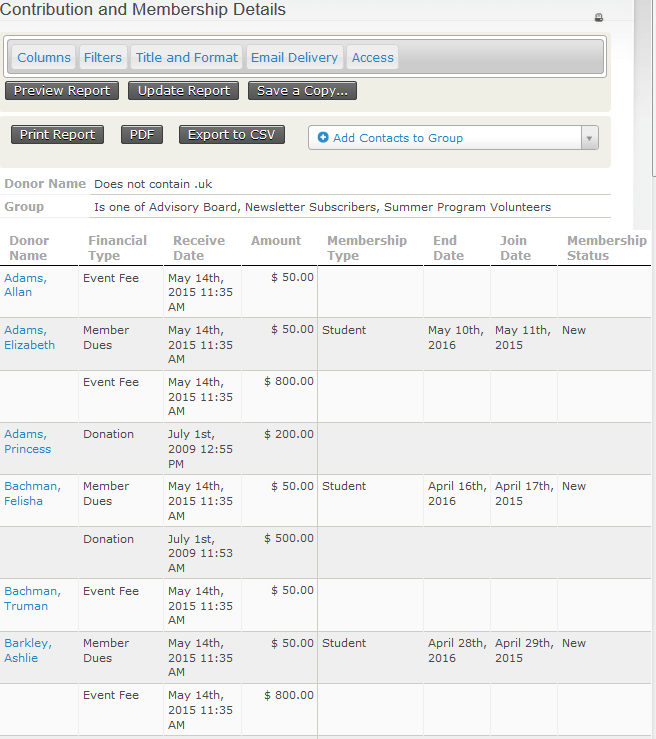

# Membership reports

There are several ways to report on and analyse memberships. The membership dashboard gives a quick summary of current memberships by membership type, including current member totals and totals for last month, this month, and the current year to date. You can also [search for specific membership details](finding-and-viewing-memberships.md#searching) using **Advanced Search** or **Find Memberships**.

## Viewing membership reports

CiviCRM comes with several membership reports:

The **Membership Summary** report groups information about members by a date frequency you specify, such as month, week, quarter, or year. For example, you can view the number of members who joined each month across a date range, membership types, or other custom data you collect about them.

Click a highlighted field to see the corresponding **Membership Detail** report for that row. For example, clicking **May 2015** for membership type **General** shows:

The **Membership Detail** report shows information for each membership record based on your selected criteria.

The **Lapsed Memberships** report lists memberships that lapsed or will lapse before the date you specify.

The **Contribution and Membership Details** report displays details of contributions and contributions connected to membership records, based on your report criteria.

<!-- Source: membership/membership-reports.md -->
