# Online membership sign up

This page explains how to create a membership sign up page, test it, and add it to your website. For background on concepts such as membership types and membership statuses, see [Defining Memberships](defining-memberships.md).

!!! tip "Alternative: use Contribution Forms"
    [Contribution Forms](../contributions/contribution-forms.md) provide a new way to take Contributions from visitors to your site. Contribution Forms are built with FormBuilder, which allows more flexibility to site admins to tailor forms to your specific needs. They also provide a number of more modern clientside payment integrations. At time of writing, only a few Payment Processors are supported.

## About membership sign up pages

A membership sign up page is an online contribution page with the ability to sign up for a membership. Membership sign up and contributing money have similar workflows, so membership pages can use contribution-page features such as premiums. Use a contribution page for online sign up even if the membership is free; see [Free memberships](#free-memberships) below.

Contribution-page options are grouped into tabs. Follow the instructions in [online contributions](https://docs.civicrm.org/user/en/latest/contributions/online-contributions/) to create a contribution page. Once you give it a name, the tabs appear at the top of the page as you continue setting it up.

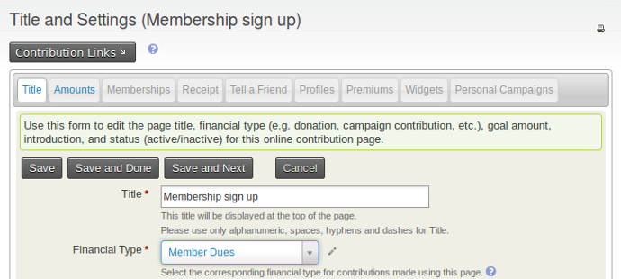

The tabs most relevant to memberships include Memberships, which contains most of the membership configuration, and Profiles, which lets you collect information about the people or organisations completing the form. For the full range of contribution-page options, see [online contribution pages](../contributions/contribution-pages.md).

### The Title tab

The Title tab is the first page you see when creating a membership page. Set the page title and basic information, such as the Financial Type, that will be recorded for memberships made through this page.

You can also add an introductory message to the membership page. This text can include images and other simple HTML.

### Organisational memberships

The Title tab has a check box that allows people to become members *on behalf of* an organisation. This is the recommended way to offer organisational memberships. When you enable it, you are prompted to select a [profile](../organising-your-data/profiles.md) to collect organisational information. Organisational sign up can be optional or required.

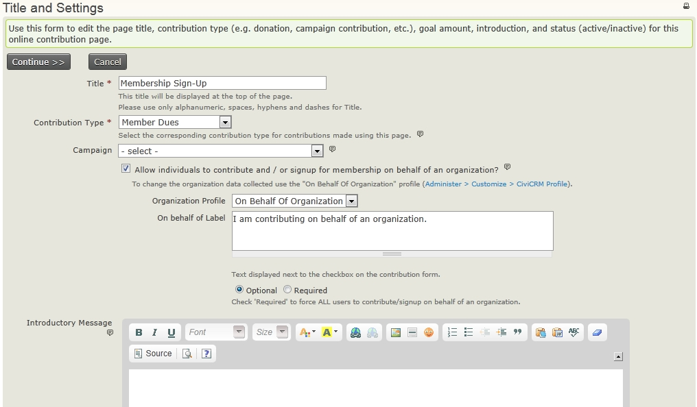

### The Amounts tab

The Amounts tab contains financial options, including the [payment processor](../contributions/payment-processors.md) used on the page. You can select more than one payment processor to give people a choice.

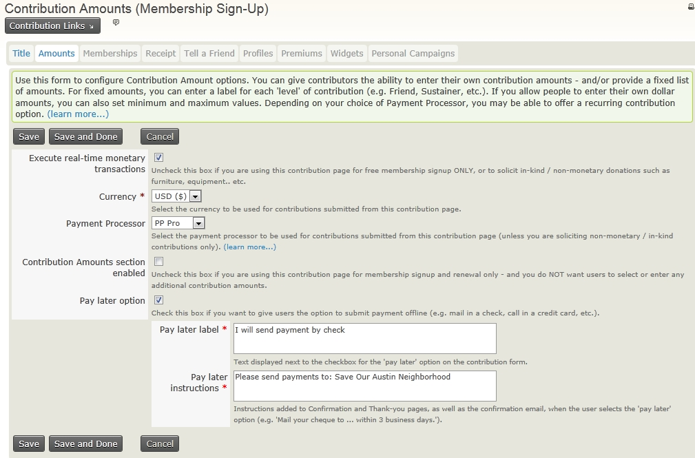

Configure membership fees on the Memberships tab, **not** the Amounts tab. If you want to collect membership fees without soliciting extra contributions, leave **Contribution Amounts section enabled** unticked. To solicit contributions in addition to membership fees, tick the box and add suggested contribution options or configure a contribution price set.

### Free memberships

For **free memberships**, leave the 'Execute real-time monetary transactions' box unticked and choose a membership type with a zero value minimum fee.

### The Memberships tab

Check **Membership Section Enabled** to use the contribution page for membership sign up and renewal.

The first few boxes let you add text for initial sign up and renewals. When a logged in user with a current or expired membership views the membership sign up page, CiviCRM automatically replaces it with a membership renewal page containing the text from the renewals box.

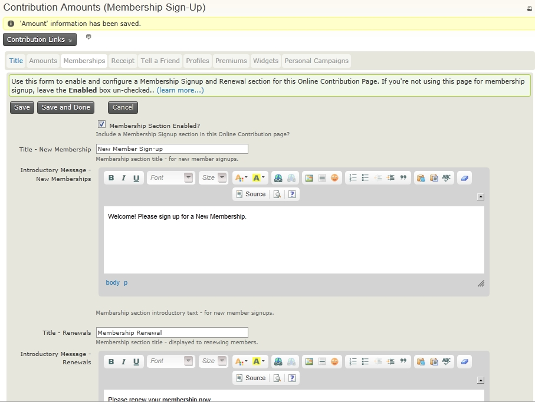

The options after the text boxes configure the membership types available on the form.

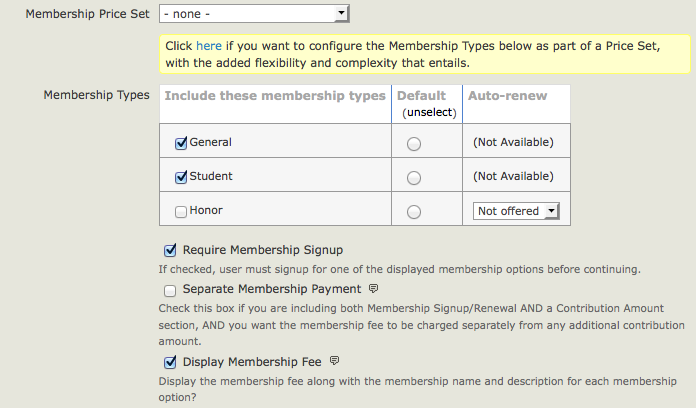

For a simple setup, select which membership types are available, which is the default, and which can be auto-renewed. Auto-renew requires membership types set up as auto-renew and a payment processor that supports automatic recurring payments.

If you enable auto-renew for a membership, users will see: "Please renew my membership automatically. (Your initial membership fee will be processed once you complete the confirmation step. You will be able to cancel automatic renewals at any time by logging in to your account or contacting us.)" Membership payment receipt emails will include a link for the member to cancel the auto-renewal.

You can make membership signup optional—for example, when you want to offer membership on a contribution page without requiring it. In that case, check "Contribution Amounts section enabled" on the Amounts tab. You can decide whether such payments are recorded separately from membership fee payments.

If the Membership Types table cannot provide what you need, use a [Membership price set](membership-price-sets.md). For example, a price set can:

- Allow users to sign up for multiple classes of membership, such as national and local memberships, at the same time.
- Let people sign up for multiple membership terms at the same time.
- Offer other options, such as a paid subscription in addition to membership signup.

### The Receipt tab

After a visitor completes the membership signup or renewal form, they are redirected to a thank-you page and can have an email receipt generated and sent to them. The Receipt tab, the fourth step in the wizard, lets you configure these options. You can customise the message added to the membership receipt and the email address it comes from. To customise the receipt email template further, use **Mailings &gt; Message templates**.

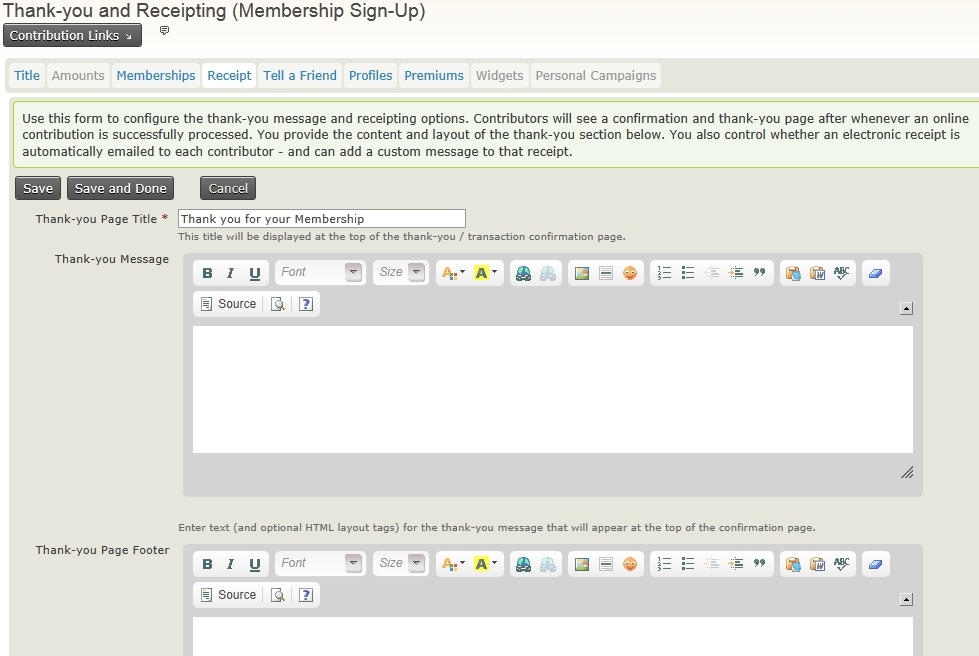

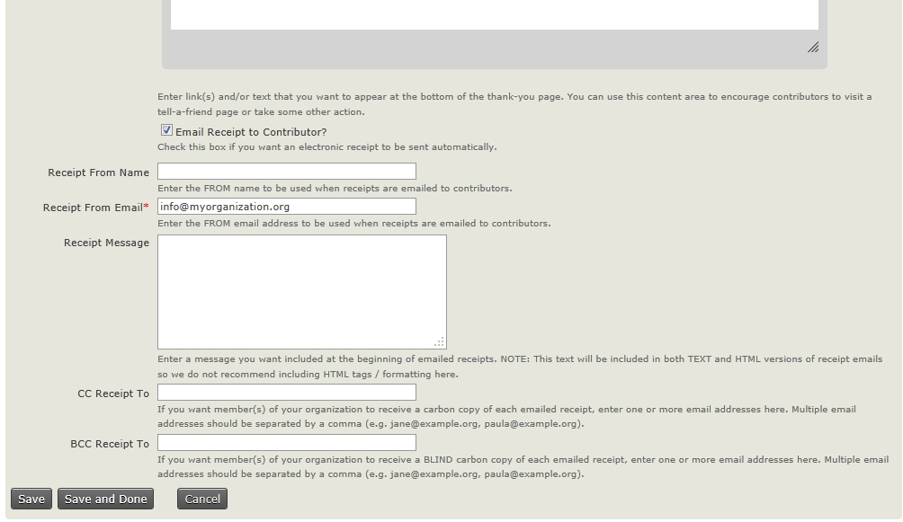

#### Email alerts for memberships

For real-time updates about who has processed a membership, add one or more staff email addresses to **CC Receipt To** or **BCC Receipt To**. Separate multiple addresses with commas.

!!! warning
    Make sure addresses in **CC Receipt To** and **BCC Receipt To** are **correct and do not bounce** or return an error email. CiviCRM interprets any return emails it receives as a bounce for the CiviCRM Contact who received the receipt, not for the CC/BCC address. This can put the Contact's email address **On Hold** and **cause future emails to not be sent**. [For more details see this issue report](https://lab.civicrm.org/dev/core/-/issues/1999).

### The Tell-A-Friend tab

You can add a tell-a-friend feature to the thank-you page. Members can email friends a link and information about your organisation. Friends who are told about the membership sign up are added to CiviCRM if they do not already exist; their source field shows that they were added via tell-a-friend.

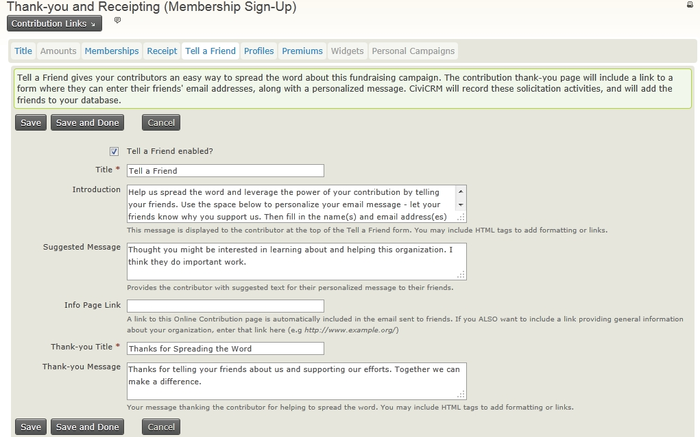

### Collecting information as part of membership sign up (the Profiles tab)

By default, contribution pages include only an email field. Add a profile to collect more information about members as they complete the sign up form, such as their address or interests. If the person signing up is logged in, CiviCRM populates their profile fields with available data. Don't add a membership profile: that information is collected automatically during online membership sign up.

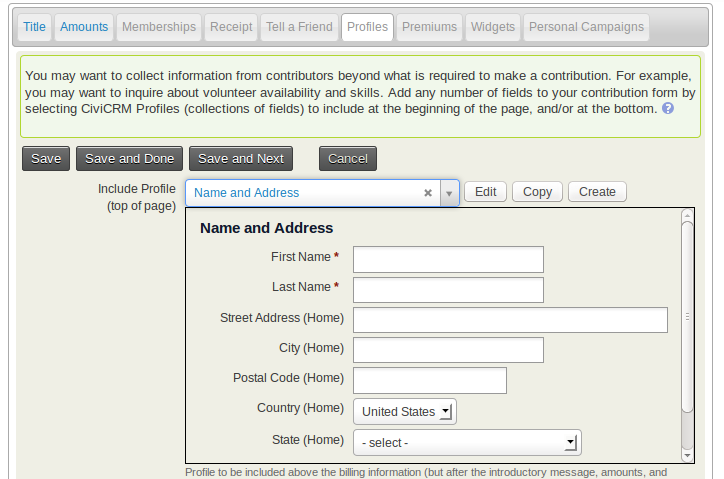

On the Profiles tab, you can select an existing profile. If you have permission, you can also edit an existing profile or create a new one for the page.

!!! warning
    If you edit an existing profile here, it will be changed in all places where that profile is used.

### Premiums tab

Premiums are thank-you gifts and incentives offered to people who donate to your organisation. They are commonly associated with tiered donation levels, such as a T-shirt for a $50 donation, but can also be used on membership pages. Before including premiums on a contribution page, configure them through **Contributions &gt; Premiums (Thank-you Gifts)**.

The Premiums tab controls introductory text, contact information, and other premium-related details.

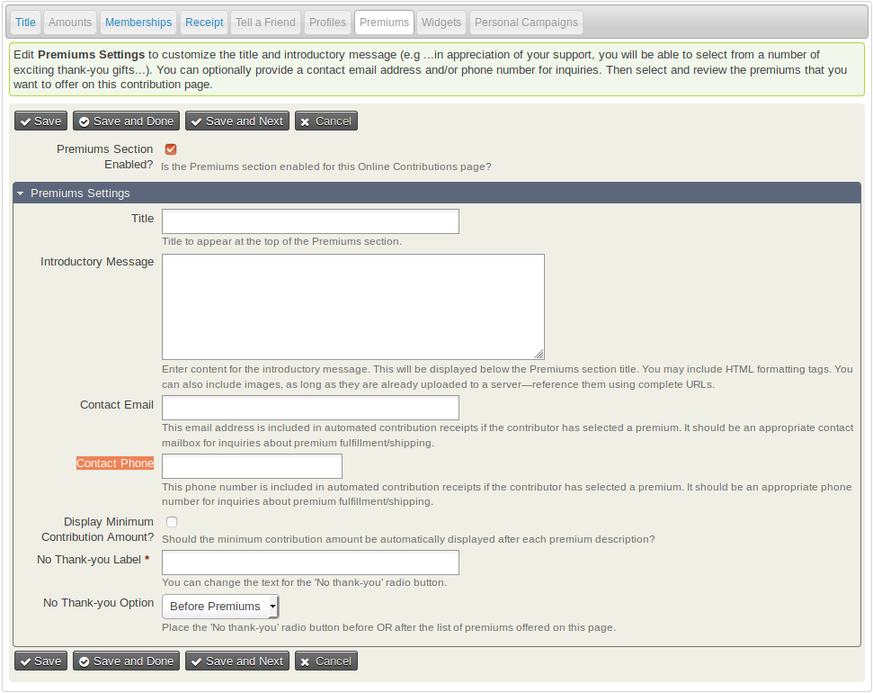

## Testing membership sign up pages

After configuring the page, test the sign up process. Go to **Contributions &gt; Manage Contribution Pages**, click **Links** next to your membership sign-up/renewal page, then click **Test-drive**. Membership data submitted in test mode is added to CiviCRM as test data. It is not included in membership stats or searches for members. To find and delete test memberships, click the **is test** check box in **Find Memberships**.

Go through the process several times as someone joining your organisation, using different combinations of fields. Check that the data appears as expected in CiviCRM. After testing and making any necessary changes, ask other staff or friends outside your organisation to test it.

When using the Test-drive Registration option, you see the same registration pages as a regular user, but the online payment isn't debited from your card. See *Payment processors* for information about dummy processors and card details for test transactions.

Periodically test and review the membership process. Members' use of the form can provide indirect feedback: if they do not enter data as intended, you may need to change it. You can also ask recent members how easy it was to join and how the form could be improved.

## Adding membership sign up pages to your website

Once you have made the contribution page, make it visible on your website using the method for your CMS.

Membership sign up pages inherit your website theme and should look reasonably nice out of the box. You can add images to the page's HTML text areas. Many organisations also improve the design of their membership pages to increase sign up rates. Design changes are outside the scope of this page, but a website designer familiar with your CMS and CiviCRM can help.

### In Drupal

Go to **Contributions &gt; Manage Contribution Pages**, click **Links** next to your membership sign-up/renewal page, then click **Live Page** to view the finished page. Copy the URL and include it in a content page or assign it to a menu item.

### In WordPress

Go to **Contributions &gt; Manage Contribution Pages**, click **Links** next to your membership sign-up/renewal page, then click **Live Page**. Copy the URL and insert it into an HTML link or menu.

Alternatively, use a plugin such as Page Links To create a URL 'slug', or click the WordPress shortcode icon to insert a form into any page or post.

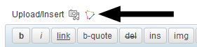

### In Joomla!

The most direct way to expose a membership signup/renewal page on the front of your Joomla! website is to create a menu item:

1. Navigate to a menu and create a new CiviCRM item.
2. From the list of menu options, choose Contributions.
3. In the basic parameters section, select the contribution page you want to expose from the dropdown menu.
4. Save the menu item and view the website to confirm the page's functionality.

## Permissions needed for online membership sign up/renewal.

Anonymous and Authenticated roles need the following CMS permissions to join or renew online:

- **Profile listings and forms:** Lets you collect core contact information (name, address, etc.) when people sign up.
- **Access all custom data:** Must be enabled to collect custom data.
- **Make online contributions:** Must be granted unless memberships are free and you do not want to accept donations during sign up or renewal.

<!-- Source: membership/online-membership-sign-up.md -->
