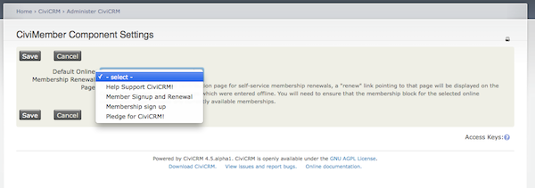

# Set a default online membership renewal page

When a membership is purchased using the online membership signup page (self-service), that user's Contact Dashboard will contain a "renew" link pointing to that page. However this link will not appear for members whose initial membership was entered manually unless you configure a **Default Online Membership Renewal Page** as follows:

1. If it does not already exist, create a membership page that includes all currently available memberships. You may need to use a [Membership price set](membership-price-sets.md) for this if the membership fees need to be allocated to more than one financial type.
2. Navigate to **Administer > CiviMember > CiviMember Component Settings.**
3. For Default Online Membership Renewal Page choose the membership page containing all your membership types

A "renew" link pointing to that page will then be displayed on the Contact Dashboard for any memberships which were manually entered.

<!-- Source: membership/renewals-part2.md -->
