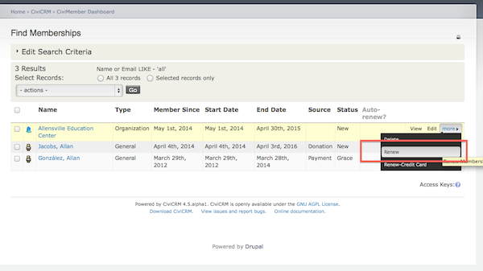
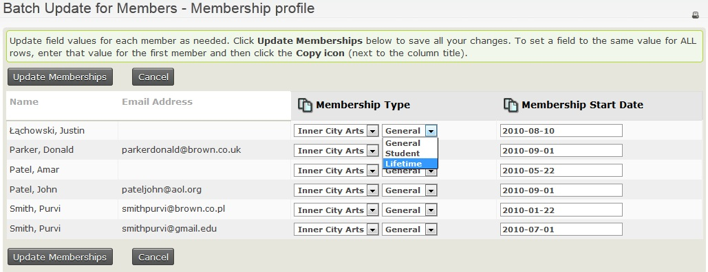

# Renew and update memberships manually

## Manually renewing a membership for a single contact

1. Go to the contact's summary page.
2. Click on the **Memberships** tab
3. Click **MORE** next to the membership record
4. Select **Renew** to enter cash, cheque or EFT payment or **Renew-Credit Card** to process the renewal through your online payment processor.

## Update multiple memberships

You can use the **Update multiple memberships** feature (previously called *Batch Update Members Via Profile*) to update multiple *existing* membership records (don't confuse this with the **Batch Data Entry** feature that is used for adding *new* memberships and member payments).

To update multiple memberships, create and configure a [Profile](../organising-your-data/profiles.md) that contains fields pertaining to membership information that you want to display and update.

To use the **Update multiple memberships** feature:

1. Find the memberships you would like to update by selecting **Memberships > Find Members**. Enter your search criteria and click **Search**.
2. From the *Find Members* results screen, select the membership records and select **Update multiple memberships** from the **-actions-** dropdown box and click **Go**.
3. From the *Update multiple memberships screen*, in **Select Profile**, select the profile you want to use from the dropdown box and click **Continue >>**.
4. From the *Update multiple memberships* screen, you can update the information that is displayed based on the profile you selected. You can use the "auto-copy" icon at the top of a column to copy and paste the value from the field of the first record of that column to the rest of the fields below in the column. Once you are done updating, click **Update Memberships**.

Below is an example of an *Update multiple memberships* screen that is using a membership profile configured to display the **Membership Type** and the **Membership Start Date** fields for use with **Update multiple memberships**.

<!-- Source: membership/renewals-part3.md -->
