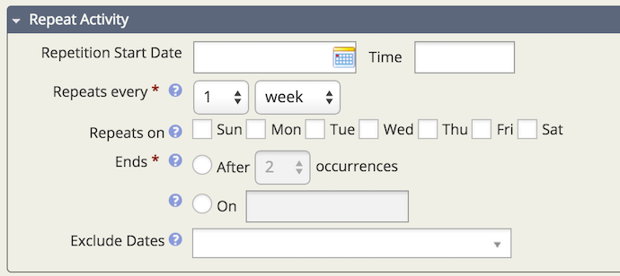
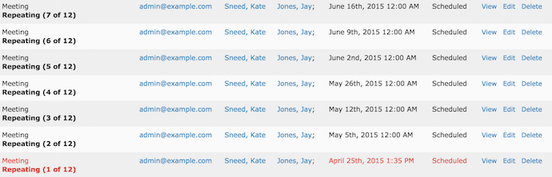
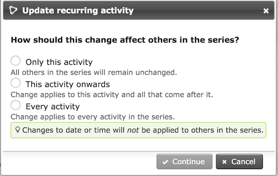
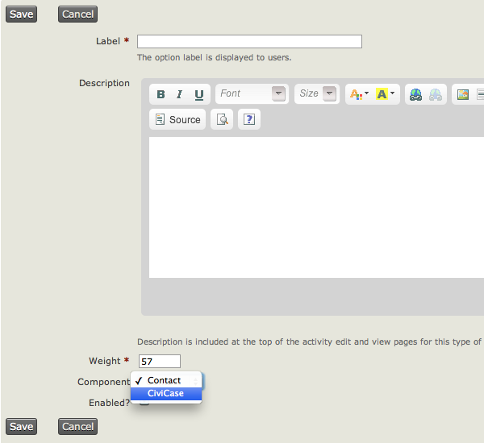
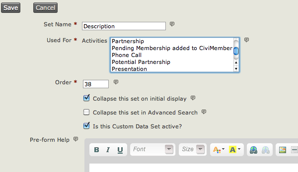

# Activities

Activities provide a unified place to record and view the history of interactions between your organization and your constituents, clients and partners. You can use Activities to track meetings, phone calls and other Activities that you set up. All of CiviCRM's components also use Activities to record things like when contributions are made, when people come to events and when people sign petitions.

All Activities happen at a specific point in time and involve at least one contact; many involve more than one. Activities can be assigned to staff or volunteers, and an email is automatically sent to the assignee.

If it is important to know who at your organisation carried out a task, record it as an Activity. You can record an Activity between a given contact and multiple other contacts by adding as many contacts as you like in the With Contact field on the Add Activity form.

Several types of Activities are included by default, but administrators can [create additional Activity Types](#types) to define specific things that your organisation does.

Activities have the following attributes by default:

- **date and time**: Activities always happen at a certain point in time
- **duration**: so you can collect all the time spent on a series of Activities
- **status**: is the Activity scheduled, completed, cancelled, etc.
- **added by**: the person who added this Activity, or the contact if they carried out the Activity themselves via the website
- **assigned to**: the person (usually within your organisation) that will carry out (or has carried out) the Activity
- **with contact(s)**: the contacts in your database that are the subject of the Activity.

## Activities and groups

There can be some overlap between the use of Activities and groups. For example, you could record a membership packet being sent to a contact as an Activity or simply add the contact to a group "received membership packet".

Recording it as an Activity would probably be better: you can record when the membership pack was sent, who sent it and any notes about what the person requested. You could also use the Activity to schedule sending membership packs by setting the date to a future day and time and setting the status to "scheduled".

## Activities and events

An event is something that a contact attends, such as a meet-up, a training, a dinner or fundraising event. An Activity can be any type of interaction a contact has with your organisation, from a meeting or a phone call to a donation.

## Activity status options

The default set of status options is:

- Scheduled
- Completed
- Cancelled
- Left Message
- Unreachable
- Not Required

Administrators can [create additional status options](#statuses).

## Repeating activities

You can set an Activity to repeat on a certain day and time with a specific end date and include dates to exclude from the repetition.

Once you are in the **Activity Screen**, reoccurring options can be set under **Repeat Activity.** The options you can set are:

- **Repetition Start Date and Time**
- **Repeats Every**: Hour, Day, Week, Month, Year
- **Repeats On**: Sun, Mon, Tue, Wed, Thr, Fri, Sat
- **Ends**: After a specific number of occurrences or on a specific date
- **Exclude Dates**: Multiple dates can be selected

After saving the Activity, a confirmation screen will appear displaying all the dates for which an Activity will be created. A new Activity will be created for each repetition, and these can be individually edited and deleted.

When you edit one repetition of an Activity, you will be given the option to apply the change to that Activity only, that Activity and all future Activities in the series, or every Activity in the series. Changes to the date or time are NOT applied to other repeating Activities.

## Administering activities

### Creating new activity types {:#types}

You can define Activity Types at **Administer > Customize Data and Screens > Activity Types**. You can also add custom fields to Activity Types to allow specific data to be collected.

For example, you might create 2 new Activity Types called **Training** and **Interview.** You can then set up a custom field set associated with Activities that includes information such as **funder** and **project**. This would enable you to produce reports of all the Activities undertaken for a particular funder or as part of a particular project.

You could also create a custom field used for a specific Activity Type. For example, you could classify **meetings** as a **staff meeting**, **client meeting**, **other organisation's meeting etc**. For more on creating custom fields, refer to the Custom Fields chapter. For details on producing reports, see the Reporting section.

Go to the Activity Type Options page **Administer > Customize Data and Screens > Activity Types** and click Add Activity Type.

Assign your new Activity Type to the "Contact" component if you want it to be available from the Actions button when viewing a contact record. Assign it to "CiviCase" if these Activities are only for use inside a case.

### Setting up custom field sets for activities {:#custom-fields}

When setting up custom data sets, you will need to specify what the custom data will be used for. One of the options here is Activity and, if you wish, you can further specify which type of Activity. This means that these custom data fields will be available when recording Activities.

### Creating new activity statuses {:#statuses}

If you need to add more options, you can do so from **Administer > System Settings > Option Groups**.

Before you add too many status options, remember that all status options show up on all Activity Types. Think carefully about what you need to add.

<!-- Source: organising-your-data/activities.md -->
