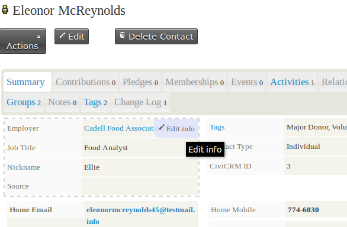

# Add, edit and delete contacts

## Adding contacts

The simplest way to add a single contact is through the navigation menu at the top of a non-public page. To create an Individual, go to Contacts > New Individual:

The Contacts menu lets you create every kind of contact and contact sub-type. Contact creation forms have basic information, such as name and email, at the top. More specific fields are grouped below in accordions by type or subject, such as address fields, communication preferences and any custom fields added for that contact type.

For every contact type, you can use **Check for Matching Contacts** to help avoid duplicates. After entering the information you have in this section, click **Check for Matching Contacts.**

*To add an Individual, first name and last name OR email address are required. To add an Organization or Household, just Organization/Household name is required. You can fill in as many other fields as you like and make changes later using the edit screen.*

### Useful things to know when adding contacts

**Address:** You can add multiple addresses to a contact record—for example, home, work and a different billing address.

A checkbox lets you share an existing contact's address or create a new contact. If you select new contact, you need to select its contact type; a pop-up box then appears for adding the record. When a person uses another contact's address, the address can only be edited from the &quot;master contact's&quot; record.

The countries available in the dropdown depend on those made available at **Administer > Localization > Languages, Currency, Locations** under Available Countries.

You may not need every address field. Available address fields can be edited at **Administer > Localization > Address settings.** The &quot;Address Name&quot; field can label an address—for example, &quot;Summer Home&quot;. It is hidden by default but can be enabled from that screen.

**Tags and Groups:** You can specify which tags and groups to add the contact to. You may only add to existing groups and tags with existing tags. For more on creating them, see the Groups and Tags chapter of this book.

Once you have filled out the form, choose one of three buttons:

- Save saves the contact record and takes you to the contact screen.
- Save and New saves the contact and clears the form so you can add another.
- Cancel discards the entered information and returns you to your CiviCRM dashboard.

## Editing contacts

To edit information directly on the summary screen, hover over the upper-right corner of the block you want to change and click **Edit Info**.

To edit a lot of information for one contact, click the edit button above the tabs to open the entire contact for editing.

On the rare occasions when two admin users both open the edit screen for the same contact and then both save it, the second user is notified of the first user's edit and given a chance to manually &#39;merge&#39; the edits.

## Deleting contacts

There is a button to Delete the contact at the top right. A deleted contact does not disappear completely: it moves to the trash, where it can be recovered later using the search in trash feature of **advanced search**. See &quot;searching&quot; under the &quot;working with your data&quot; chapter for more information).

Deleted contacts move to the &quot;trash&quot; by default and can be restored later. There are several ways to delete contacts:

- **Single contact:** Open the contact's record and click the &#39;delete contact&#39; button at the top of the page. Alternatively, search for the contact and, near the end of its row in the results, click &#39;More&#39; and select &#39;Delete Contact&#39;.
- **Multiple contacts:** Run an advanced search and check each record you want to delete, or use the header checkbox to *select all*. In the &#39;actions&#39; drop-down menu, choose &#39;Delete Contacts&#39; to send them to the trash (if enabled), or &#39;Delete Permanently&#39;. On the warning page, click &#39;Delete&#39; to continue or &#39;Cancel&#39; to return to the previous screen.

<!-- Source: organising-your-data/contacts-part2.md -->
