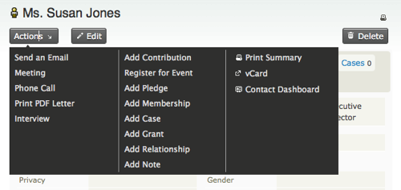
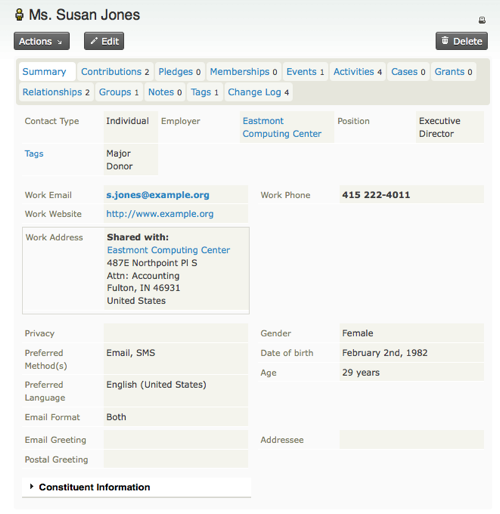
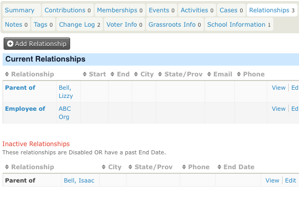
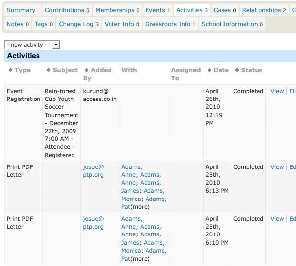
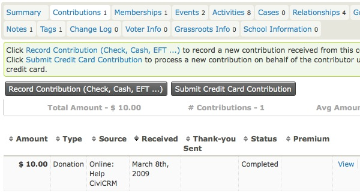
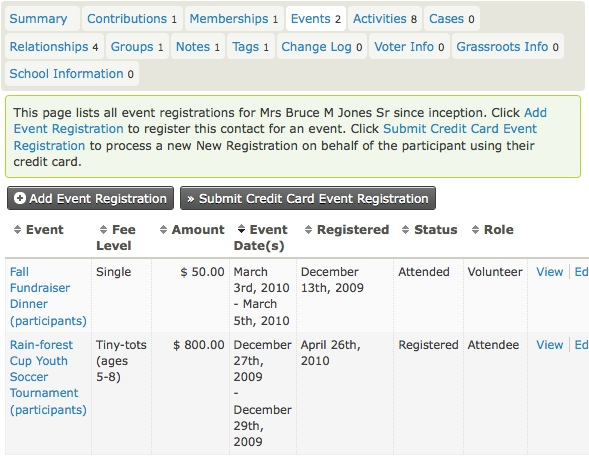
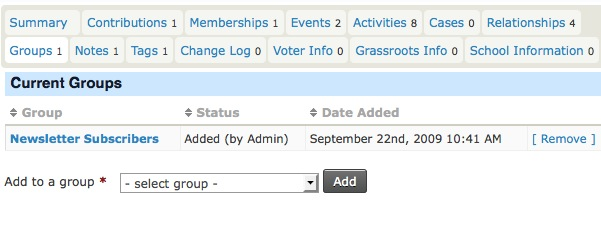
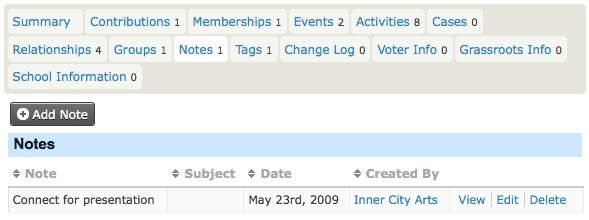

# Contacts

Contacts are the basic building block of CiviCRM. Relationships, activities, groups and contributions all connect to contacts in some way.

CiviCRM comes with three contact types:

- **Individuals** — people
- **Organisations** — for example, companies or other non-profit organisations
- **Households** — typically families that share a physical location

Each contact record has a set of **core fields**, including:

- Names, such as first and last name for individuals and organisation name for organisations
- Greeting and addressee fields for different communication methods
- Contact methods, such as email addresses, phone numbers and website addresses
- Addresses, or physical locations
- Communication preferences: methods contacts prefer, and methods they do not want used

You can define **contact subtypes** based on the out-of-the-box contact types. You can add custom fields that extend all contacts, particular contact types or particular subtypes.

## A quick look at contacts

Contact information is organised into tabs. The first tab is the **summary tab**, which shows basic information. Other tabs show different aspects of the contact and help organise the data collected over time.

Which tabs you see depends on enabled components and your permissions. For example, you will only see the memberships tab if the CiviMember component is turned on and you have permission to see memberships. You can also define extra tabs to display custom data collected about contacts.

Below we look at the most important parts of the contact screen
(including most of the contact with pointers to other parts of the book
where appropriate.

### Contact actions

Above the tabs is the **Actions** button, a shortcut for actions involving this contact. For example, you could add a note or record a new contribution, meeting or other activity.

### Summary tab

The summary tab shows names, addresses, contact details and contact methods. Some fields, such as first name, last name and nickname, are for individuals. Others, such as organisation name, are for organisations.

#### Individual fields

An individual's name can have a prefix, first name, middle name, last name, suffix and nickname; you do not have to use every part. Prefixes and suffixes are selected from a drop-down list. If the value you want is missing, you can add options at **Administer CiviCRM** > **Customize Data and Screens** > **Dropdown Options** > **Individual Prefixes (Ms., Mr...)**.

#### Addresses

You can record one or more addresses for a contact. Each address needs a different **location type**, such as work or home. One address can be marked as primary for postal mailings. You can choose the primary location explicitly or let it default to the first address entered.

You can share addresses between contacts—for example, between an individual and the organisation where they work. When creating or editing the &quot;work&quot; address for an individual, check the &quot;Share Address With&quot; box. If the employer is already in your database, select them from the quick search box that appears. Otherwise, select &quot;New Organisation&quot; from the &quot;create new contact&quot; drop-down to create the employer's organisation record. Shared addresses are synchronized in both directions: if one changes, the other is automatically updated.

If a person pays by credit card, the details used for Billing Address in credit card payments are stored in the Billing location for the contact.

If you have a mapping provider enabled, you can click the map icon next to an address to see the contact's location on a map.

#### Phone numbers

You can store multiple phone numbers for each contact. Phone numbers have locations, such as work or home, and types, such as landline, fax or mobile. Phone numbers added as type mobile are available for sending SMS.

#### Email addresses

You can store multiple email addresses for each contact. One can be explicitly marked as the address that receives bulk mailings, such as e-newsletters and announcements sent using CiviMail. Bouncing emails are automatically marked as being on hold when sending emails via CiviMail. See the [Email](../email/what-is-civimail.md) section for more information.

#### Communication preferences and privacy options

You can define preferred communication methods and privacy options, such as not contacting someone by email. Privacy options are respected by certain functions: for example, mailing labels are not printed for contacts with the &#39;do not mail&#39; option, and emails are not sent to contacts with the &#39;do not email&#39; option.

The privacy options in a CiviCRM contact record are:

- **Do not phone** — The end user has elected not to be contacted by telephone.
- **Do not email** — The end user has elected not to be contacted by email.
- **Do not mail** — The end user has elected not to be contacted by postal delivery (snail mail).
- **Do not SMS** — The end user has elected not to be contacted by text messaging service to their mobile device.
- **Do no trade** — The user has elected not to share their information with other organizations; you may not share or sell it to other parties.
- **NO BULK EMAILS (User Opt Out)** — This is set when a user selects the Opt Out action in a CiviMail Email.

#### Greetings and addressee fields

By default, greeting and addressee fields are calculated from a contact's name fields. For example, the postal greeting for an individual called &#39;Jenny Soper&#39; is &#39;Dear Jenny&#39;.

Default greetings can be configured globally at **Administer CiviCRM** > **Communications** > **Email Greeting Formats** or **Postal Greeting Formats** or **Addressee Formats**. You can also select a different format for a contact or customise it on a contact-by-contact basis.

#### Demographics and deceased / closed contacts

For Individuals, you can record birth date, gender, whether they are deceased and when they died.

For Organizations or Households that no longer exist, you can record that they are &quot;closed&quot; by clicking to edit the block that contains Nickname and Legal Name.

### Relationships tab

Relationships connect contact records. Each connection can be named to describe its nature, and a contact can have many relationships with other contacts. The example below lists Current Relationships and Inactive relationships.

You can read more about when to use relationships in the *relationships* chapter of the *organising your data* section.

### Activities tab

The Activities tab lists interactions with a contact, including built-in activities such as event attendance, contributions and phone calls, as well as custom activities you have added. It also lets you record activities. Clicking an icon at the top of the screen (Send an Email, Meeting, Phone call) opens a screen for entering the details.

For more information, see the [Activities](activities.md) section in this chapter.

### Mailings tab

This is only visible if at **Administer > CiviMail > CiviMail Component Settings** you have unselected **Enable CiviMail to create activites on delivery**. In that case, each bulk email is recorded on the mailings tab instead of the activities tab. This improves the speed at which the activies tab loads if your organisation sends bulk emails to large mailing lists.

### Contributions tab

The Contributions tab shows financial contributions made by a contact. It also summarises the contact's contribution activity: total amount over time, total number of contributions and average contribution amount.

You can record offline contributions with the Record Contribution button, or record a credit card transaction on behalf of the contact with the Submit Credit Card Contribution button—for example, when a contribution was made by phone. Both buttons lead to forms where you can select the Financial Type in addition to the normal contribution information collected from public contribution pages.

Read more in the Contributions chapter of this book.

### Memberships tab

The Memberships tab displays a contact's memberships. You can add memberships and submit credit card payments for memberships that require a fee. You can also renew or delete a membership from the &quot;more&quot; link on each existing membership.

Read more in the Membership chapter of this book.

### Events tab

The Events tab displays events related to the contact, such as events they have registered for, attended or volunteered at.

You can register the contact for an event and use the Submit Credit Card Event Registration button if payment is required. The related payment then appears in the first row of the contact's Contributions tab.

You can also click the Edit link to change event information as it relates to the contact—for example, changing their status from &quot;registered&quot; to &quot;attended.&quot;

Read more in the Events chapter of this book.

### Groups tab

The Groups tab shows the groups a contact belongs to. Groups can be used for mailing lists and permissions (**ACL**s), among other purposes.

You can add or remove the contact from groups and see a history of groups they have unsubscribed or been removed from.

The Status column displays who added the contact to a group. Whether users can add themselves is a setting you can configure when creating a group. When a group's visibility is set to &quot;Public Listings&quot;, users can join through **Profile** forms. A later section discusses using Profiles for mailing list sign-ups.

For more information, see [Groups and Tags](groups-and-tags.md).

### Notes tab

The Notes tab holds ad-hoc information about a contact. Generally, you would use custom fields for information you plan to collect about contacts. Notes are unstructured, so use this tab with care unless you know that you and other users will remember to look there. Both the subject and content of a Note are free-text fields; the subject does not have to be selected from predefined options.

You can set &quot;Author Only&quot; privacy for a note. Only its author or someone with &quot;view all notes&quot; permission (via your CMS) can then view or edit it.

### Tags tab

Tags are one way to categorise contacts; Custom Data and Groups are other methods. You can configure tags for your organisation, search on them and create Smart Groups based on them.

The tags next to Keywords belong to the Keywords Tagset. A Tagset is a grouping of tags that you can create. Tagsets are non-hierarchical. You can create a tag in a tagset by typing it into the field, or select an existing matching tag from the list that appears.

For more information, see [Groups and Tags](groups-and-tags.md).

### Change log tab

This tab gives limited information about changes to a contact record. It shows when the change was made and who made it, but not what changed.

!!! tip
    Administrators can use the Contact Logging Report for detailed information about changes to contact records: who, what and when.

<!-- Source: organising-your-data/contacts.md -->
