# Creating custom fields

Custom fields let you collect information beyond what CiviCRM allows by default. For example, you could add checkboxes to organisations to track the clients they serve. You can also restrict custom fields to certain types of an object: if you have a contact type Student, you might add a field listing the subjects they study.

Custom fields are always stored in custom field sets. Adding custom data therefore has two stages:

1. Create a custom field set—a container for related fields.
2. Add custom fields to the set. You may find it helpful to read about custom fields first, but you must create the set before creating its fields.

A field is one unit of information entered into the database, such as someone’s primary spoken language or high school graduation date. A custom field set groups related fields, such as fields about a particular activity type, event participation, or contributions.

## Custom field sets

Each custom field set has a scope as wide or as narrow as you choose. For example, you might associate a set called “nationality” with all contact types, “immigration status” with a specific contact type such as Individuals, or another set with a component such as CiviMember or CiviEvent, or with Relationships or Groups.

The scope of a custom field set is one of the few decisions that is irreversible: you will not be able to change it after creating the set. Consider what you want to associate the set with before you start.

Ask these questions when planning a set:

- How will its fields be used?
- Which types of contacts or records are they appropriate for?
- Do they have broad applicability, or are they relevant to a specific Contact Type, Event, Financial Type, etc.? For example, a person’s entree choice at a dinner event belongs on the *Participant* record, not the *Individual Contact* record. It describes their participation in that event; they might make a different choice at another dinner.

Choosing the appropriate scope helps keep application screens relevant and free of unnecessary fields. A field for “color of eyes,” for example, belongs on the Individual contact type rather than the generic Contacts option, because it is irrelevant to Organization and Household contacts. If custom data is specific to a particular event registration page, create it for an Event type Participant for that event.

Consider grouping fields by topic, too. If 12 of 20 fields associated with Individual contacts relate to an online membership directory, you might put those 12 in one set and the more general Individual details in another.

To create a custom field set and custom fields, go to **Administer** > **Customize Data** **and Screens** > **Custom Data**. On this screen, you can give the set a title, specify the records it will be used for, select display characteristics, and enter help text.

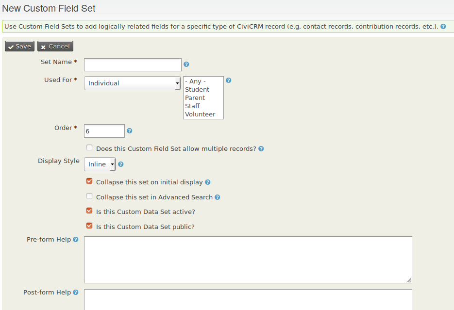

### Set name

For a custom field set displayed inline, this name appears as the field set’s legend. If the set uses the tab display style, the name appears as the navigation tab label.

### Used For

Use this option to make fields appear only where they are relevant. The following are some of the options; you can add custom fields to more than 20 different entities.

- **Activity:** Fields assigned to all activities or to a specific activity type, such as Meeting or Phone Call.
- **Addresses:** Creates an address block, allowing the administrator to create additional address-related fields.
- **Contacts:** Fields assigned to all contacts.
- **Contributions:** Fields assigned to all contributions or to a specific Financial Type, such as Donations or Event Fees.
- **Events:** Fields assigned to all events or a specific event type, such as Conference or Fundraiser. These fields apply to an event, not to the participant registration record.
- **Grants:** Fields specific to grants.
- **Groups:** Fields displayed in Group settings. These fields are not searchable.
- **Household:** Fields specific to the Household contact type.
- **Individual:** Fields specific to the Individual contact type.
- **Memberships:** Fields assigned to all membership records or to a specific membership type.
- **Organization:** Fields specific to the Organization contact type.
- **Participants:** Fields on the participant registration record. The options are general fields for all registration records, role-type fields for a specific participant role, and event participant fields for a specific event.
- **Pledges:** Fields specific to pledges.
- **Relationships:** Fields assigned to all relationship records or to a specific relationship type, such as “Spouse of” or “Employee of.”

!!! note "Adding custom fields to even more entities"
    It is also possible to [add custom fields](../../../../../dev/en/latest/step-by-step/create-entity/#121-making-our-entity-available-for-custom-data) to entities that are not listed under Used For, or to your own custom entities. Enabling custom fields for unsupported entities might not show those fields in forms for the entity, but they will be available in SearchKit.

!!! warning "Not editable if data exist"
    You may *only* make customizations to this field if *no data* has been recorded with it. Until you record data, you may change **Used For** using the **More > Settings** option for the set on **Administer > Customize Data and Screens > Custom Fields**.

### Order

This controls the order in which custom field sets appear when you have more than one. Lower numbers, such as 1 and 2, appear above higher numbers, such as 8 and 9.

### Multiple record fieldsets

By default, a custom data set has a one-to-one relationship with the entity it is attached to. For example, one field set for a person’s physical attributes could contain their height and eye colour and be attached to one Individual record.

Some information requires multiple records for one contact. A person might have multiple educational degrees, for example, so an educational history set with fields for subject, institution, and grade should allow multiple records. Multiple record fieldsets provide this option.

You can add multiple record field sets only to contacts, not to other entities. To use the option, select “Does this Custom Field Set allow multiple records?” Bear in mind:

- Multiple data applies to the whole field set, not to individual fields.
- Multiple data can only be added to Contacts. It **cannot** be added to Activities, Contributions, etc.
- Multiple data cannot currently be exported.
- Before modelling something as a multiple value custom field set, consider whether it could or should be an activity. An educational degree, for example, could be an activity with custom data added.

### Display options

The display style tab is visible only for custom data fields attached to contacts. You can display contact field sets **inline** on the summary screen or in their own **tab**. The choice depends on factors such as how often you need the data and how large the set is. You can switch display styles later.

You can also set a custom field set to be “collapsed” on initial display. When the page first loads, only the title appears and the fields are hidden. This can reduce the space taken up by infrequently used sets. A similar “collapsed” property is available for custom data in Advanced Search.

The two tab display options are **Tab with table** and **Tab**.

**Tab with table** provides a concise overview of the set’s data. You can add new records and edit existing ones in pop-up windows. Under **more**, “copy a record” lets you copy a record, change one or two fields, and save it as a new record—useful when consecutive records share many values.

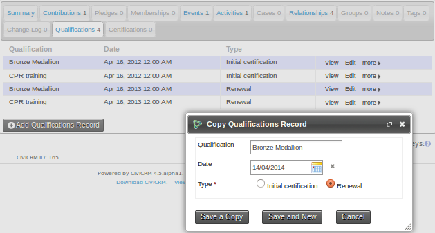

**Tab** displays data in a format similar to the inline style.

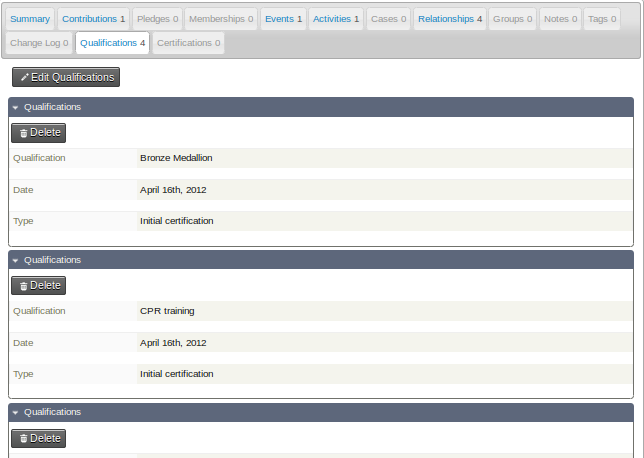

### Is this Custom Field Set active?

If a custom field set is active, its fields can be viewed and changed. Otherwise, the fields remain in the CiviCVRM system but are hidden from the user interface. This can be useful when migrating from an existing database system.

For example, membership records imported from an MS Access database might each have a unique ID (key) with no direct benefit in CiviCRM. You could create a custom field for that value, import the records, then disable the field by leaving the Activate option unchecked. This keeps the value for historical reference while hiding it from view.

Although users cannot see the field, its value remains stored and can be referenced later—for example, to investigate a discrepancy in archived data or compare it with a printed record.

Once the custom field set is active, you can make individual fields inactive in the form defining those fields.

### Is this Custom Field Set public?

If a custom field set is marked as public, its fields appear on public-facing pages. Fields intended for an event information page, for example, should belong to a public set; fields containing administrative information about an event should belong to a set that is not public.

This setting applies to every Custom Field in the Custom Field Set. Individual fields cannot be marked as public or not.

### Pre-form Help and Post-form Help

Text entered in Pre-form Help appears above the form field; text entered in Post-form Help appears below it. Use help at this level for instructions about the entire set.

## Custom fields

After creating a custom field set, click **View and Edit Custom Fields**, then **New Custom Field**, to create fields within it.

After configuring a field, click **Save** to save it and return to the field listing for the current set, or **Save and New** to save it and begin another field.

Except for the data and input field type selection, you can modify the configuration options after creating a field. You can also preview individual fields or the whole set while defining them. Previewing is particularly useful for checking the layout of radio button and check-box fields with many choices.

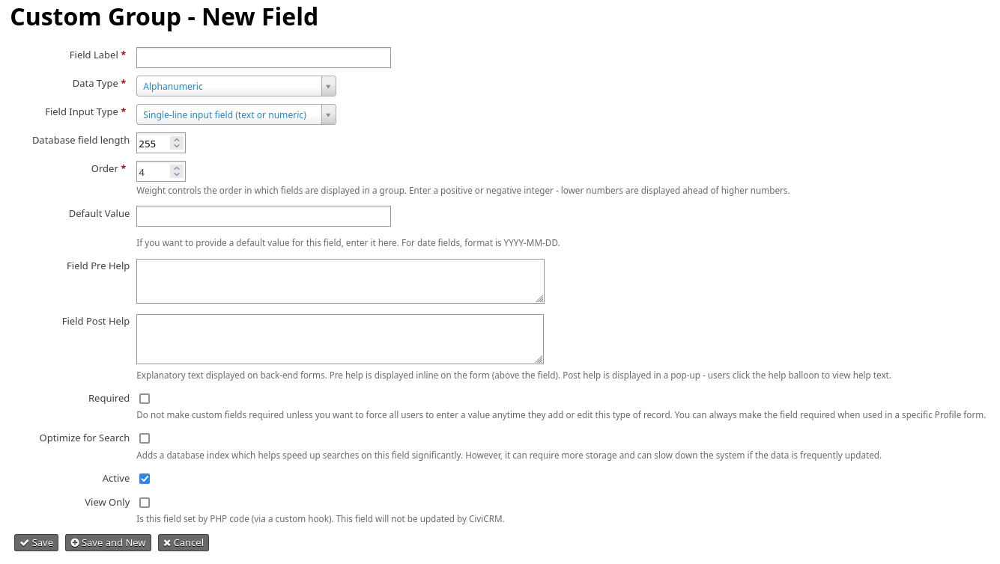

### Field label

This is the text displayed next to the field and used as its label when you export data. You can overwrite the Field Label when using a field in a profile, allowing an administrator-facing name here and a more user-friendly name in the profile.

### Type

When you create a custom field, CiviCRM provides a dropdown list of data types. The menu on the left in the following image selects the format of the data to store; the menu on the right selects how the user interacts with the field.

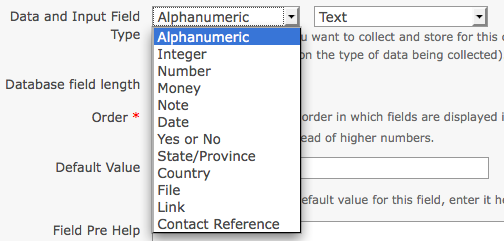

The field types are:

- **Alphanumeric** (text and number fields):
    - Text: a simple area for entering text.
    - Select: a dropdown box limited to one selection.
    - Radio: a list allowing one selection, with all options visible at once.
    - Yes and No: a radio list with two contrasting options.
    - Check-box: a list allowing multiple selections.
    - Multi-select: a list in a single box, allowing multiple selections using control+click.
    - Advanced Multi-select: two side-by-side lists between which items can be moved.
    - Autocomplete select: a widget that completes a selection when the user’s typing uniquely identifies it.
- **Note:** A longer, multiple-line text box, available as:
    - plain text; or
    - rich text, with a WYSIWYG editor that allows HTML.
- **Integer:** A whole number, displayed as a:
    - text box;
    - select box; or
    - radio list.
- **Number:** A number that can include decimals, such as 3.175, displayed as a:
    - text box;
    - select box; or
    - radio list.
- **Money:** Similar to a number, but treated according to the local currency configured in CiviCRM’s administrative pages. Displayed as a:
    - text box;
    - select box; or
    - radio list.
- **Date:** A date, optionally with a time, entered using a calendar widget. You can set the range of years selectable before and after the current date.
- **State/Province:** Geographical locations configured in CiviCRM’s Localization settings (**Administer > Configure > Global Settings > Localization**), offered as a select box or multi-select box.
- **Country:** Geographical locations offered as a select box or multi-select box.
- **File:** A browser for selecting and uploading a file.
- **Link:** An active internet hyperlink.
- **Contact Reference:** An autocomplete widget for an existing CiviCRM contact.

Experimenting with different field types can help you understand their behaviour. Their differences also affect how you use them: for example, check-boxes support OR and AND searches in Advanced Search, whereas multi-select does not.

### Display in Table?

This check box appears only when creating a field in a multi-record field set displayed as **tab with table**. It is checked by default. If you unselect it, the field does not appear in the table. This can help keep a large dataset from making the table too wide for the screen.

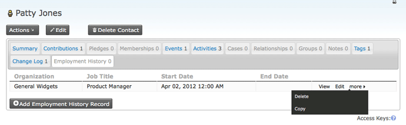

Fields hidden from the table remain available when you add a record or view, edit, or copy a row.

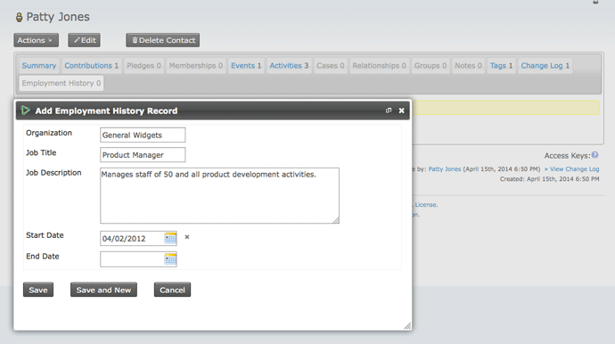

### Database Field Length

This specifies the number of characters the field can contain. Normally, leave it at the maximum. For extremely large field sets, a shorter length might improve performance and reduce storage space, but it will not make a difference for most users.

### Order

This controls the order of fields within the set. Set it in the field edit form or use the up/down icons in the main field listing table. By default, new fields appear at the bottom of the list.

### Default Value

Where applicable, you can designate a default value. It appears or is selected automatically when users open a form containing the field.

### Pre-form Help and Post-form Help

A field name should ideally make clear what to enter. Where it does not, or where you want to guide how the field is used, enter help text. Pre-form Help appears above the form field; Post-form Help appears below it.

The text appears wherever the field is used on administration pages and becomes the default help text when the field is assigned to a profile (see the *Profiles* section in this chapter). The person creating the profile can remove or change that text without changing the original custom field definition.

### Required

When selected, this requires a value before the form can be submitted. If no value is provided, an error message directs the person to complete the required fields.

To require a field only in a particular profile, leave this box unchecked and check the Required field within the profile instead.

### Optimize for Search

When selected, this creates a database index on the field, significantly speeding up searches on it. An index can also require more storage and slow the system if the data is frequently updated. It is recommended for fields often used as search or smart group criteria, such as identifiers or values selected from a list. For frequently updated text fields that are seldom used in exact searches, such as notes or comments, an index will most likely slow the system and use disk space inefficiently.

The behaviour of this field changed in CiviCRM 5.75. Before then, it was called “is searchable?” and also determined whether the field appeared in Advanced Search and Reports. From 5.75, all fields are available in Advanced Search and Reports.

### Active

As with the active check-box for a custom field set, this determines whether the field is enabled or disabled when CiviCRM displays it to the user.

### View Only

This makes a field visible but uneditable. It can be used:

- To retain imported data for users’ reference without letting them modify it.
- To store data entered through a method set up by your developer rather than directly through the user interface.

### Multiple choice options

For fields with selectable options—such as Select, Radio, Check-box, Multi-select, and Advanced Multi-select—you can use an existing option set created for another custom field or create a new one. You can enter values while creating the field or later. The option’s label appears on the form; its value is stored in the contact record.

If several fields share an option set, you will be notified when a change to it will affect those fields.

When creating a set, you can initially enter up to ten options in a table. After saving the field, use **Edit Multiple Choice Options** to add an unlimited number of further choices. Go to **Administer** > **Customize > Custom Data > View and Edit Custom Fields > Edit Multiple Choice Options**. You can return to this screen later to change an option’s label, order, or active status, or to add choices.

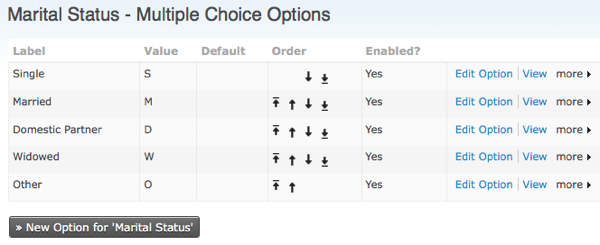

You can mark one choice as the default option. Inactive options are hidden when the field is presented.

### Managing custom field sets

To list all fields in a set, go to **Administer > Customize Data and Screens > Custom Data** and click **View and Edit Custom Fields** for that set.

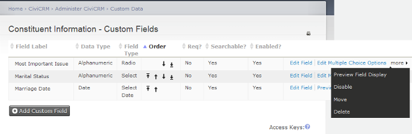

You can edit field settings, edit multiple choice options where applicable, preview, disable, or delete fields. You can also **Move** a field to another data set. Fields can be moved between sets used for all contacts or contact sub-types; otherwise, they can only be moved between data sets of the same type.

### Multiple choice options headings

You can add headings to a multiple choice option list, as in this example:

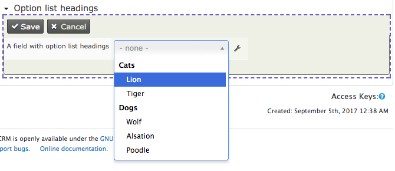

To add headings:

1. When configuring the field, choose “Select” or “Multi-Select” as the input type.

    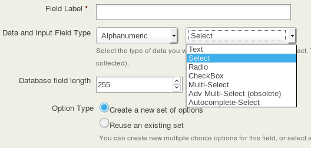

2. When configuring the field’s options:
    - Set the Label for each heading to the text displayed to the user.
    - Set its Value to text prefixed by “crm_optgroup_”.

    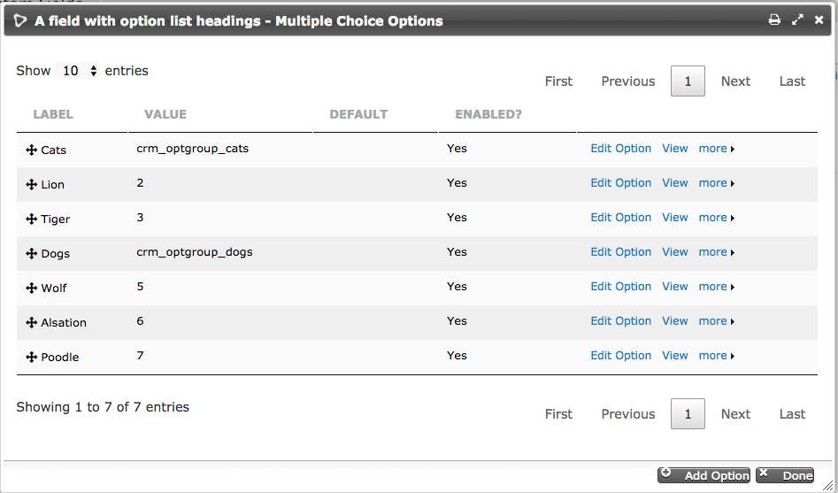

## Choosing between fields, groups and tags

Data fields, groups, and tags are three ways to associate information with contacts. Before creating a custom data field for every attribute, consider the alternatives. They provide functionality you may otherwise miss; using fields for information better stored as groups or tags can slow the system. Appropriate use of groups and tags can also make records easier for administrative staff to maintain.

These distinctions can help you choose:

- Store data with a wide range of values, such as a person’s address or biography, in an alphanumeric custom data field.
- Custom data fields can be grouped and displayed on their own tab on a contact’s record.
- Groups group contacts: for example, board members, staff, and volunteers might belong to separate groups. If you use Drupal, you can assign permissions based on group membership. A Smart Group automatically adds or removes contacts based on a characteristic.
- Contacts must be assigned to a Group to receive a particular CiviMail mass mailing. For example, a press release could go to a group of selected contacts, including a Smart Group.
- Tags and Groups can both have a hierarchy. A group or tag labelled ‘Regions’ could have a subgroup or subtag for each geographic region your organisation covers (see “Case study in hierarchical tags” later in this section).
- Tags support more powerful searches than data fields or groups. Visitors can search multiple tags using both AND and OR operators. Data fields support only lists of words, effectively an AND operator, except for check-box fields, which support OR operators.
- The tag interface lets a visitor add and remove tags without reloading the page in edit mode.
- Custom data fields can be assigned to a specific record type, such as households only. Once defined, tags are assigned to all types.

## Custom field set storage limitations

A large number of custom field sets, or sets containing many fields, may cause problems when searching, exporting data, or running reports. There is no specific limit given here: the appropriate number of sets and fields depends on the data you collect and the server hosting your installation. If in doubt, discuss it with your system administrator or CiviCRM service provider.

<!-- Source: organising-your-data/creating-custom-fields.md -->
