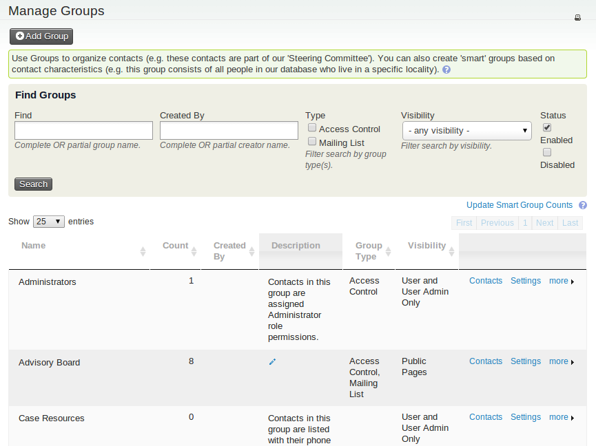
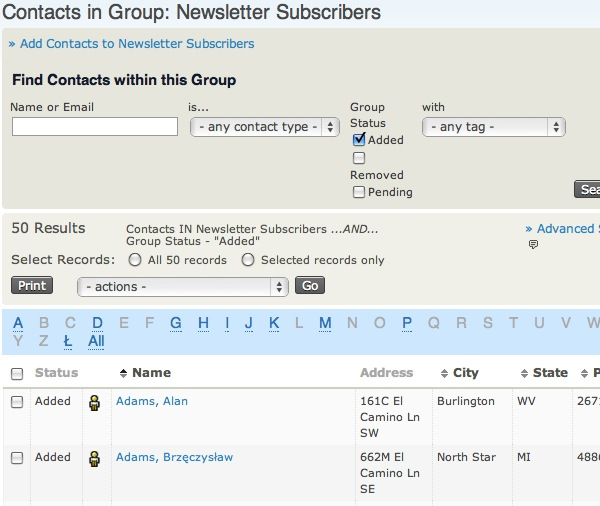
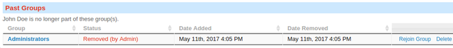
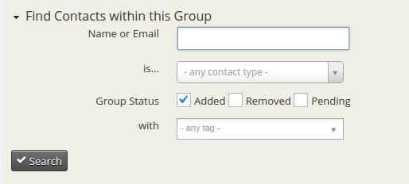

# Manage groups

## Group settings and functionality

Give each group a clear name and a description that explains its purpose to other database users. These help users recognise groups in contexts such as CiviMail, particularly when your organisation has many groups. If a group is created for a particular person, consider naming its owner in the description so someone can later check whether the group is still used or can be deleted.

Groups can have these standard types:

- **Mailing List** is used when you plan to use the group as a mailing list in CiviMail. It is available for regular and Smart Groups.
- **Access Control** (Drupal only) assigns CiviCRM access permissions to a set of contacts. Only regular groups can have this type.

You can create additional group types to reflect your needs. This can be useful if your organisation has hundreds of groups, because group type is a filter on the Manage Groups screen. To create a group type, go to **Administer&gt;System Settings&gt;Option Groups** and select Group Type.

### Visibility

Visibility determines permissions for joining and removing contacts from groups. Select “User and User Admin Only” if membership is controlled only by authorised CiviCRM users. Select “Public Pages” to let contacts join and remove themselves through Registration and Account Profile forms.

### Parent/child groups

To create a hierarchy, create one or more parent groups and assign other groups to them. When a user sends a mailing to a parent group or searches for contacts in it, contacts in its child groups are automatically included.

For example, an organisation with a national office and 5 regional offices could put each region's constituents in a separate group. If a National group is the parent of all the regional groups, the national office can mail the National group and include contacts in those regional groups.

### Group IDs

CiviCRM assigns each group a unique numeric ID. A group ID can be used for various operations, such as defining a URL for group sign-ups.

## Add contacts to groups

You can add contacts to groups:

- through the Tags and Groups section of the Contact Details edit screen;
- through a contact's Groups tab;
- by using the “Add Contacts to Group/Tag contacts” batch action after conducting a search; or
- by clicking a group's Contacts link in **Navigation Menu &gt; Contacts &gt; Manage Groups**.

The first two methods also let you remove individual contacts. The last two let you add multiple contacts at once.

Individual contacts can be added to a Group in the contact edit screen or through the Groups tab. To add multiple contacts, conduct a search and select Add Contacts to a Group from the More Actions menu. Alternatively, go to Manage Groups, select Members for the relevant Group, then use Add Members to this Group at the top of the screen.

Contacts can also be added to a group by filling out a Profile.

## Managing Groups

To view and manage all groups, go to: Navigation Menu &gt; Contacts &gt; Manage Groups.

Use the Find Groups form at the top of the Manage Groups screen to search by name, type, visibility, and whether a group is enabled or disabled. You can also scroll or browse the list below the form, which includes regular and Smart Groups.

From the list, you can:

- add contacts by clicking the Contacts link in a group's row;
- edit a group by clicking Settings;
- disable or delete a group using the links in the “more” pop-up menu; and
- see how many contacts are currently in each group.

## Finding contacts in a group

Each group's Contacts page has a form for finding contacts in that group. You can search by name, email address, contact type, group status (added, removed, or pending), and tags.

## Groups and ACL

Access Control Lists (ACL) provide finer-grained permissions than Drupal's Permissions and Roles. The online CiviCRM documentation explains the concept at [http://wiki.civicrm.org/confluence/display/CRMDOC/Access+Control](http://wiki.civicrm.org/confluence/display/CRMDOC/Access+Control%20).

Set up the required Groups, Custom Data Groups, Profiles, and Roles before using them in ACL.

!!! note
    ACL support for Joomla was introduced in Joomla version 1.6.

## Removing versus deleting contacts from groups

CiviCRM keeps a history of group membership. If you **Remove** a contact from a group, you can see when they were removed and by whom. For example, this can help you track former volunteer-group members or explain when an email subscriber opted out of a newsletter.

If a contact was removed in error, **Rejoin Group** adds them again. Every group record has a status: **Added**, **Removed**, or **Pending**. You can search for group members by status—for example, to list former Advisory Board members.

To search, navigate to **Contacts &gt; Manage Groups**. Find the group and select **Contacts** in the right-hand column. Expand the search criteria to find the option to search by status.

You can also **Delete** a contact from a group. This eliminates any record of the contact being in the group.

<!-- Source: organising-your-data/groups-and-tags-part2.md -->
