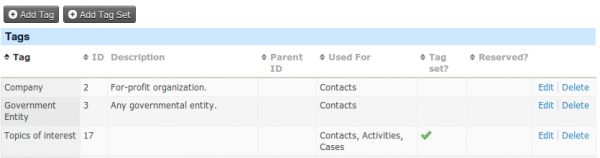
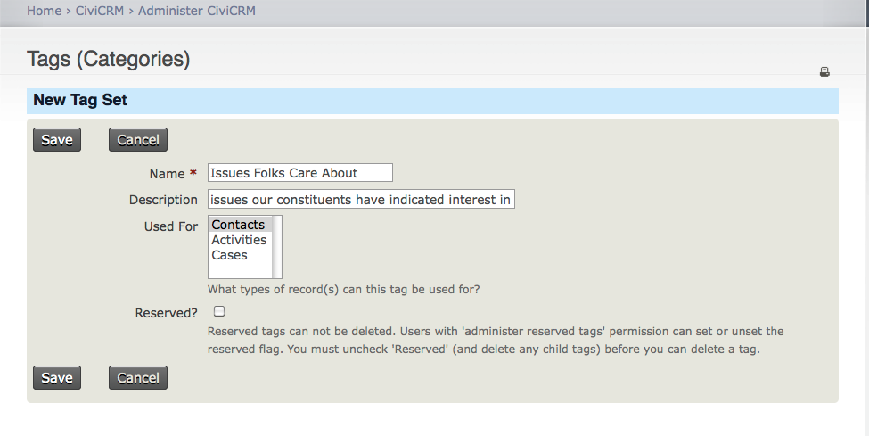
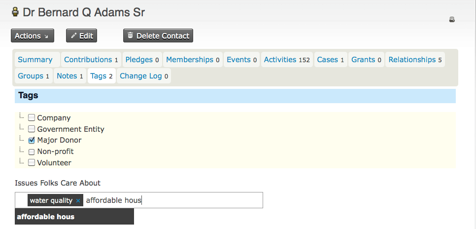

# Manage tags and tag sets

## Working with tags

To view tags, go to: **Contacts &gt; Manage Tags (Categories)** in the navigation menu.

You can edit or delete a tag using the corresponding link in its row. To create one, click Add Tag on the Manage Tags (Categories) screen or go to Contacts &gt; New Tag in the navigation menu.

Give each tag a clear, unique name and a description that explains its purpose. Tags can form a hierarchy: select a Parent tag from the dropdown list to make a tag its subtag.

Tags can be designated for contacts, activities and/or cases. A tag designated for contacts is available for all contact types and subtypes; it cannot be designated for only one contact type.

Every user can create more tags if needed. Important tags can be locked so that users without the “administer reserved tags” permission cannot modify or delete them. This permission is available in Drupal only.

You can assign tags to contacts, activities, and cases:

- while creating or editing the record;
- from the Contact Summary Tags tab; or
- by using the Tag Contacts batch action after conducting a search.

The first two methods also let you remove tags.

## Tag sets

Tag sets are a free-form way to tag contacts. They resemble regular tags but differ in several ways:

- They act as a “bucket” for grouping tags. For example, an Issues People Care About tag set might contain “affordable housing”, “racial justice”, and “water quality”.
- They let you create tags on the fly without visiting the Manage Tags page.
- Adding them creates an additional search field in the Basic Criteria section of Advanced Search.

To create a tag set, go to **Contacts &gt; Manage Tags (Categories)** in the navigation menu and click Add Tag Set. Give the tag set a name and description, and indicate whether it applies to contacts, activities, or cases.

Selecting Reserved makes a tag set more permanent: someone without Administrator permission cannot delete it. Read more about permissions in the *Permissions and Access Control* chapter of the *Initial Set Up* section.

You can now use the tag set to tag a contact, activity, or case record.

When you create a new tag set, a new field shows up on the edit pages of the entity's activities or cases as well as in the Tags tab for contacts. For example, if you create a tag set called “Issues Folks Care About” an associate it with Contacts, you will see the tag set next time you go to the Tags tab of a contact's record.

This is an autocomplete field. As you type, CiviCRM displays matching tags from the tag set below the field. Select an existing tag, or type an entire new tag and press Enter. The tag appears in a box within the field. Clicking X untags the contact, case, or activity record you are editing.

Tags created in a tag set also appear in the normal **Contacts &gt; Manage Tags (Categories)** list, where you can view and edit them. They are available only within their particular tag set.

### A note about searching on tags and tag sets

Each tag set adds a field to the Basic Criteria section of Advanced Search. You can search only for tags that already exist in that tag set.

The All Tags field finds records with regular tags or tagset tags containing a complete or partial word or phrase. For example, entering ‘Donor’ finds contacts with any tag containing that word.

Read extensively on using Advanced Search in the Searching section.

<!-- Source: organising-your-data/groups-and-tags-part3.md -->
