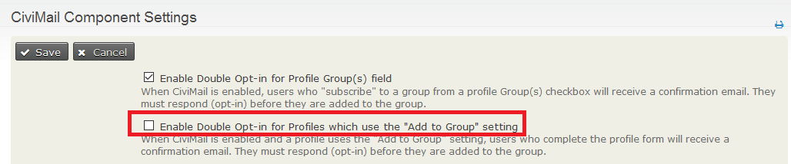

# Creating and managing Profiles

Create a Profile and choose its basic and Advanced Settings first. Then add fields and choose their settings. Most settings apply only to particular uses, so you can skip settings that do not apply to your Profile.

## Create a Profile

1. Go to **Administer &gt; Customize Data and Screens &gt; Profiles** and click **Add Profile**.
2. Set **Profile Name** to a meaningful name.
3. For **Used For**, choose from Standalone Form or Directory; Search Views; Drupal User Registration; and View/Edit Drupal User Account. You can check more than one box. Checking Search Views limits your field choices to Contact and Contact type records only.
4. Set **Order** if needed. Lower numbers place Profiles before higher numbers when a page includes more than one Profile. The field is filled in automatically when a Profile is created.
5. Use **Pre-form Help** and **Post-form Help** for guidance that appears before or after the Profile.
6. Leave **Is this CiviCRM Profile Active?** checked to make the Profile available for insertion into forms and for the Batch Update function. It is checked automatically. To take a Profile out of use later, edit it and uncheck the box.

## Advanced settings

Click the gray advanced settings bar to show these fields. Not every setting applies to every Profile.

### Limit listings to a specific group

This setting matters when a Profile displays information on your website, such as in a searchable membership directory.

1. Select the Group whose information you want to make publicly viewable or searchable. For a directory of active members, for example, create a Smart Group of members with a status of New, Current, or Grace.
2. Choose that Smart Group in this field. Smart groups are dynamic: when new memberships are added, the corresponding contact will automatically be included in the directory.
3. If you do not choose a Group, CiviCRM will, by default, allow a search to expose every record in your database. In most cases, you will not want website visitors to see who is in the whole database.

### Add new contacts to a group

Any *new* contacts who fill out the Profile will be added to the selected Group. For example, people who complete a volunteer sign-up form could be added to a Volunteers Group.

By default, contacts receive no confirmation that they have been added to the group and are not asked to validate their email address. To send an email to contacts who complete the form, go to **Administer &gt;&gt; CiviMail &gt;&gt; CiviMail Component Settings** and check **"Enable Double Opt-in for Profiles which use the "Add to Group" setting"**. Contacts must respond (opt-in) before they are added to the group.

If you want to offer more than one group, consider using the groups profile field.

### Notify when profile form is submitted

For a Profile used as a sign-up form, enter an email address to receive a notification whenever the form is submitted. For example, a volunteer coordinator could receive an email for each volunteer sign-up. Separate multiple addresses with commas.

### Redirect URL

For a standalone Profile form, **Redirect URL** sends people to a specified web page after submission, such as a thank-you page. It does not apply when the Profile is embedded in an event sign-up or contribution form. If left blank, people are directed to a page displaying the information they entered.

### Cancel redirect URL

This works like Redirect URL but applies when people cancel their form submission.

### Include reCAPTCHA?

This applies when anonymous users fill in Profiles. CAPTCHA is spam-blocking software that asks a visitor to enter text displayed in a graphic, preventing automated web-crawling spiders from completing the form. The source highly recommends including it.

To use this feature, set up a free reCAPTCHA account and enter configuration information in CiviCRM. Go to **Administer &gt; Customize Data and Screens &gt; reCAPTCHA Settings**; that page includes sign-up instructions.

### Drupal user account registration option

For Profiles used on public pages, this setting determines whether people can or must sign up for a website account in addition to submitting the form. It can be used when people become members or register for an event.

### WordPress user account registration option

WordPress also allows CiviCRM Profiles to create accounts as described above. Within WordPress **Settings &gt; General**, "Membership [ ] Anyone can register" must be clicked.

### What to do upon duplicate match

For Profiles used on public pages, this setting controls what happens when submitted contact data matches an existing record. You must choose an option; "Issue warning and do not save" is the default. Profile matching uses the **Unsupervised** deduplication rule. See *Deduping and Merging* in *Working with Your Data* for more about deduplication rules. If multiple contacts match, the first matching record is used.

- **"Issue warning and do not save"** is ignored when a Profile is embedded in an online contribution, membership sign-up, or event registration form. In those cases, the transaction is linked to the matching contact. Otherwise, the user sees a message that a record already exists and cannot submit the form.
- **"Update the matching contact"** adds new form information to the contact record and overwrites existing values in fields included on the form. For example, an address entered on the form replaces the address already in the database.
- **"Allow duplicate contact to be created"** creates a new contact for every submitted form, regardless of potential matches. All submissions are saved without overwriting data, but duplicate records may need to be deduped later. See *Deduping and Merging* in *Working with Your Data*.

### Proximity search

For a searchable directory, this adds a search block with a start address and a search radius. Choose None if it is irrelevant, Optional to offer it, or Required to make users enter both values.

### Enable mapping for this profile?

For a searchable directory, this adds a map to the search results.

### Include profile edit links in search results?

For a searchable directory, this adds a link in results listings to edit Profile fields in the returned contact records. Only users with permission to edit those contacts see the link.

### Include Drupal user account information links in search results?

For a searchable directory, this adds a link to a resulting contact’s Drupal user account information, such as their My Account page. The link appears only for contacts who have a website user account.

After saving the Profile settings, add its fields. If the form will use custom fields, make sure they have already been created.

## Add fields and choose field settings

Not every field setting applies to every use of a Profile.

1. Click **Add Field**.
2. For **Field Name**, choose the record type from the **- select -** dropdown, then choose the field from the secondary dropdown.
3. For **Field Label**, use the prefilled default or rewrite it for your audience. For example, you might rename Postal Code to Zip Code. This label appears wherever the Profile is used.
4. Check **Required?** to require the field whenever the Profile is used—for example, to require First Name, Last Name, or Email in a form submission. This is not relevant to Search Views usages [known as Search Results in 4.1 and previous].
5. Check **View Only?** to let users view but not edit the field. Fields marked View Only are not included when the Profile exposes search results. This setting is not relevant when the Profile is used only to collect information.
6. Set **Visibility** according to the Profile’s use:
   - For a searchable directory, set fields you want on the search form to Public Pages or Public Pages and Listings.
   - For sign-up forms, use User and User Admin only, so other visitors to the form cannot view database data.
   - For Search Views, use Public Pages or Public Pages and Listings.

   Either Public Page choice reveals two more settings:
   - **Searchable?** applies only to searchable directories. Check it to include the field on the search form.
   - **Results Column?** applies only to Search Views (known as Search Results in 4.1 and previous). Check it or the field will not appear in the Search View.

7. Use **Field Pre Help** and **Field Post Help** to guide people completing forms. Field pre help appears inline. Field post help will create a small speech bubble which when clicked appear in yellow.
8. Use **Order** to control the order of fields in the Profile. Lower numbers appear first.
9. Leave **Active?** checked so the field appears when the Profile is used.
10. Click **Save and New** to add another field, or **Save** when you are finished.

## Manage existing Profiles

View and edit Profiles at **Administer &gt; Customize Data and Screens &gt; Profiles**. Use **Fields** to add fields or edit field settings, and **Settings** to change Profile settings. Under **more**, you can see how Profiles will appear, obtain links and embed code, or copy a Profile as the basis for another.

<!-- Source: organising-your-data/profiles-part2.md -->
