# Using Profiles

These instructions cover the Profile uses described in the overview.

## Standalone forms with Profiles

In Drupal and Joomla!, you can use either of these methods after creating a Profile:

- **Link to the page CiviCRM creates.** At **Administer &gt; Customize Data and Screens &gt; Profiles**, click **more** beside the Profile and choose **Use Profile-Create Mode**. You can publish the resulting link in an email, on a blog, or elsewhere.
- **Embed the form’s HTML.** At **Administer &gt; Customize Data and Screens &gt; Profiles**, click **more** beside the Profile and choose **HTML Form Snippet**. Copy the code on the next screen and paste it into a page on your website.

WordPress offers a third method:

1. When creating or editing a post, click the CiviCRM button to insert a CiviCRM shortcode.

   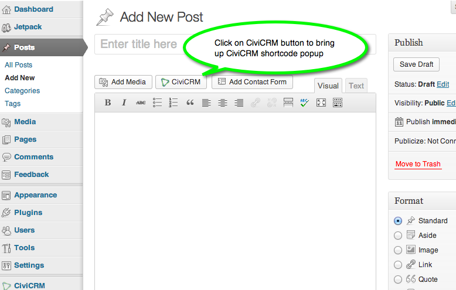

2. On the popup form, select Profile as the frontend element.

   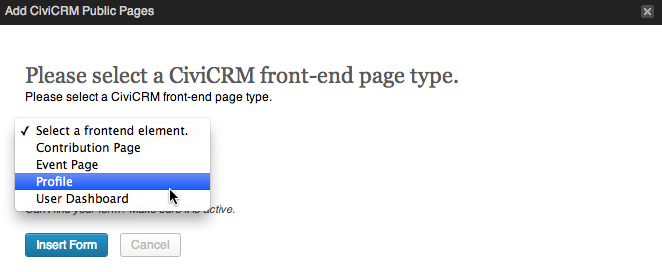

3. Use the second select widget to choose the Profile. Select the form’s purpose—create, edit, or view—and click Insert Form.

   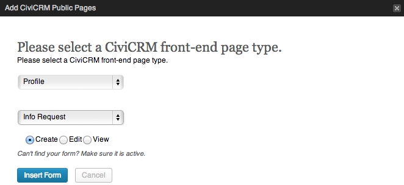

## Multi-value fields in Profiles

Multi-value custom field sets hold more than one set of custom data per contact. Work experience is an example of repeating data. You can expose these fields through Profiles.

The screenshot shows a Profile collecting names and work experience. Its multi-value custom data is displayed in a way that supports adding, editing, and deleting multiple instances.

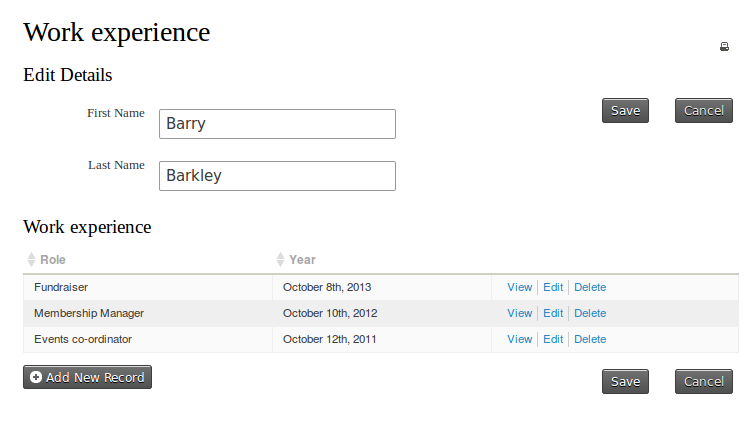

## Making directories with Profiles

1. Create a Profile. Consider these Advanced Settings for directory use:
   - **Enable mapping** gives visitors the ability to map directory contacts using Google or Yahoo! maps and obtain directions to a record’s address dynamically. Mapping must already be enabled under **Administer &gt; System Settings &gt; Mapping and Geocoding**.
   - **Include profile edit links:** adds a link in directory listings for editing data in the Profile’s fields. Only users with permission to edit the contact see it. It is not commonly needed for a membership directory.
   - **Include Drupal user information** (Drupal only) adds a directory link to a contact’s Drupal user account information, such as their My Account page. The link appears only for contacts with a website user account.

   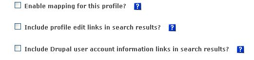

2. Add the directory’s fields. You control which fields are searchable, appear in search-result columns, and appear on the record detail View page.

   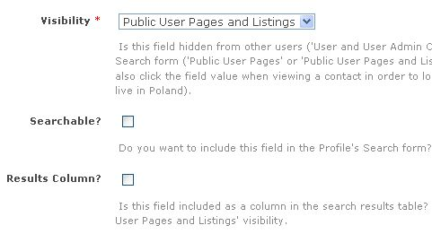

   Configure these field options:

   - Set **Visibility** for every directory field to **Public Pages** or **Public Pages and Listings**. With Public Pages and Listings, a field value in detail view is a link that runs a follow-up search for records with the same value. For example, clicking a City value searches for records in that city as though the visitor had selected it on the Profile search screen.
   - **Searchable** determines whether visitors can search by the field. In common directory uses, almost every field is searchable.
   - **Results Column** determines whether the field appears as a column in the results list. For example, selecting it for a website field puts that field in the results table. Without it, the field still appears in the record’s view mode. With it, the field appears both in the results column and in detail view.

The following images show the directory search form, the results listing with fields whose Results Column option is checked, and the detail page reached through a view link. The detail page shows all Profile fields.

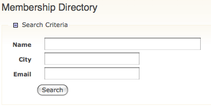

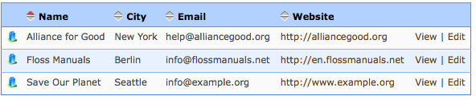

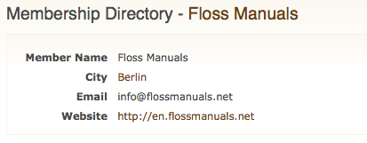

### Linking to your directory

- **Drupal:** Link to the directory search page using `http://www.myorganization.org/civicrm/profile?reset=1&amp;gid=N`, where N is the ID of the Profile directory.
  - Add **&amp;force=1** to that URL to show a result set directly.
  - Add **&amp;force=1&amp;search=0** to hide the search criteria and show the result set directly.
- **Joomla!:** In Menu Manager, create a front-end menu item. Select CiviCRM, choose the profile search option, and select the specific Profile in the parameters pane.
- **WordPress:** This feature is not yet implemented.
- **Prepopulated searches:** You can prepopulate search criteria in the URL. The options are described at [http://wiki.civicrm.org/confluence/display/CRMDOC/Linking+Profiles](http://wiki.civicrm.org/confluence/display/CRMDOC/Linking+Profiles).

## Updating multiple records at the same time

You can **Update multiple memberships** from a **Find memberships** search or from advanced search results when **Display results as** is set to **Memberships**. Use a Profile containing only membership fields.

Similarly, updating multiple contacts, contributions, activities, or participants requires search results of that record type and a Profile containing only fields of that type. The **Update multiple ...** functions can update up to 100 records at a time.

### Example: Update a diving skill field

Suppose you have a custom contact field called "Diving Skill Level". After an Intermediate Diving course, you want to set "Diving Skill level" to "Intermediate" for everyone who attended.

1. On the Advanced Search screen, set the appropriate filters in the Event accordion. Leave **Display Results As** set to **Contacts**, because you are updating a contact custom field. Click **Search**.
2. Go to the "Update multiple contacts" screen.

   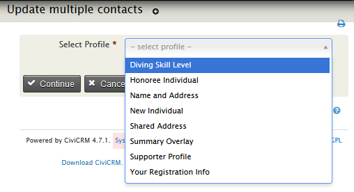

3. Choose the Profile from the drop-down list and click **Continue**.
4. On the next screen, update values as needed in the grid. Each row shows a contact’s name and the fields in the Profile.

   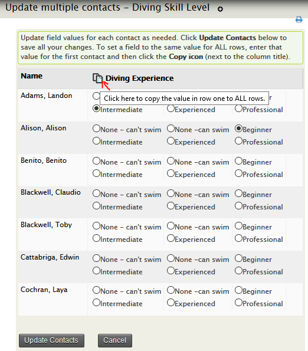

5. To give a field the same value in every row, enter it for the first contact. Then click the Copy icon—the image of two documents beside each column title—to copy the value to all displayed records.
6. Click **Update Contacts** to save the changes, or **Cancel** to cancel them.

### Batch update limitations

- You cannot batch-update different Contact types, such as individuals and organisations, at the same time.
- To update participant fields, start from a Find Participants search and include only participant fields in the Profile.
- You can batch-update up to 100 records at a time. If a batch of 100 takes a long time, four batches of 25 may be quicker.

## View/edit user account /new user registration with Profiles

For websites with logged-in users, a Profile can collect additional information during account registration. You can also invite or require people completing a Profile form to sign up for a user account.

### Include a Profile during user registration

1. Create a Profile used for User Registration.

   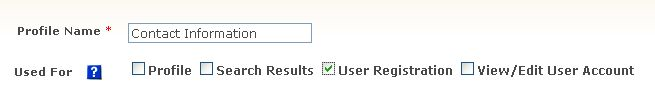

2. Add the fields people should complete during registration, using the field-adding process described on the creation page. Set field visibility to Public User Pages.

### Include Profiles in Drupal’s My Account screen

You can embed one or more CiviCRM Profiles in Drupal’s My Account screen so logged-in users can review and update their information there.

1. Create a Profile, or open an existing Profile and click Settings.
2. Select View/Edit User Account in Used For.
3. Click Save.
4. Add the fields people should be able to edit from their Drupal My Account page.

!!! warning
    The Profile must include only fields related to the Individual contact type.

### Enable new account creation during Profile sign-up

To let constituents create a Drupal or Joomla! account while completing a Profile, use the "User account registration option" under **Customize Data and Screens &gt; Profiles**: click **Settings** against a Profile. Anonymous users will then be invited or required to create an account; logged-in users see only the Profile fields.

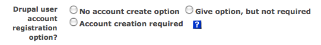

The Profile must include a Primary Email Address field for this feature to function properly. The feature also works when the Profile is embedded in an online contribution or event registration page, so anonymous visitors can be invited or required to sign up for an account when registering for an event.

## Including Profiles in forms in CiviCRM components

You may want to include selected fields on event registration and contribution pages. Profiles for those forms can include participant fields for event registrations or contribution fields for contribution pages. For instructions on including Profiles in contribution pages, event registration pages, and membership sign-up pages, see the *Set-up* chapters of *Contributions*, *Events*, and *Memberships*.

<!-- Source: organising-your-data/profiles-part3.md -->
