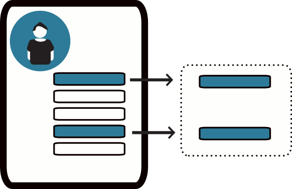
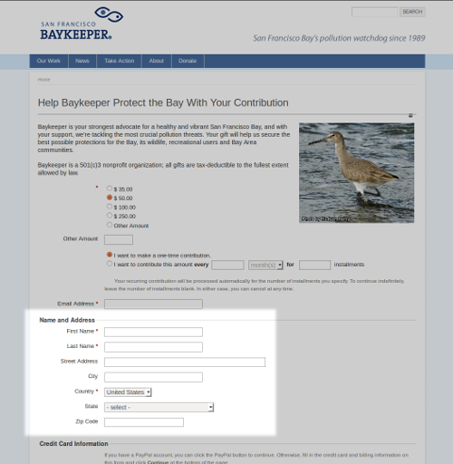

# Profiles

A Profile is a collection of fields from your database. Profiles can collect data, such as on a sign-up form, or display data, such as in a member directory. They can be used internally to simplify data entry for staff and externally to display up-to-date information from the database.

You can add core and custom fields to a Profile, including multi-value custom fields. Two other available fields are Groups, which provides a set of checkboxes—one for each public group—and tags, which includes all public tags.

A Profile lets you select the fields relevant to a particular purpose. The diagram shows how existing fields become part of a Profile.

## Different uses for Profiles

The following are ways to collect, display, and work with data using Profiles. Instructions for creating and using them are on the accompanying pages.

### Collecting information on public pages

A Profile can collect information from constituents on a standalone page or as part of a contribution, membership sign-up, or event registration page. You can add more than one Profile to a page, choose required fields, and add text to help people complete the form.

Examples include:

- A volunteer sign-up form with predefined fields for first name, last name, and mailing address, plus a custom field for volunteer interests.
- A Profile with custom fields for food preferences, added to registration pages for events where food will be served.

This Profile collects address information on a donation page.

### Displaying information on public pages

A Profile can display database information on public pages, so information need not be entered separately in the database and on the website.

For example, a membership-based organisation can provide a searchable membership directory that updates when a new member joins. An organization can also list donors’ names on a web page as contributions are made.

Native Americans in Philanthropy (NAP) wanted a membership directory that members could search to connect with each other. Previously, NAP created and mailed an expensive annual print directory; some information was already out of date when members received it. A searchable Profile on its website saved resources and gave members a way to connect.

### Customising your user interface

Profile forms can simplify manual data entry by showing volunteers or interns only the fields they need to complete. This can make entry easier and reduce errors.

A Profile can also select fields for advanced search results. For example, a Profile containing a phone number field and a custom volunteer interests field could provide an on-screen call list for a volunteer coordinator.

Details on this use are available in the *Customizing the User Interface* chapter in *Initial Set-up*.

### Updating multiple records at the same time

Profiles can supply fields for updating multiple records at once. After an event, for example, you might mark registrants as Attended or No-show. You might also update the Thank-You Sent field for a week’s donations.

Actions for updating multiple records are available from the **Actions** dropdown for most search results: Search, Advanced Search, Find Contributions, Find Memberships, Find Participants, and Find Activities. They are also available from event participant lists generated from the Manage Events screen.

**Update multiple ...** displays search results with the fields in your Profile, letting you change and save their values on one screen.

### Managing email lists

A Profile can provide a form for signing up to receive emails. Groups used to track different email lists can appear as checkboxes. When website visitors submit the form, they are added to the email lists they checked.

Details are in the *Set-up* chapter of the *Email* section of this book.

## Planning your Profiles

A Profile has settings for the Profile as a whole and for each field you add. Some Profile uses limit which fields you can include, and some combinations of fields are not allowed. Plan what the Profile is for and what it needs before creating it; you may also need some trial and error.

Use these guidelines when choosing fields:

- Profiles used for Search Views can contain only fields from Contact records and the different Contact types, such as Individual.
- Contact fields are available in all Profiles, but you cannot mix fields from different Contact types, such as Individual and Organization.
- For fields such as Street Address or Email that apply to more than one Contact type, choose fields from Contacts rather than a specific type. The Organization field menu, for example, contains only fields that do not also apply to other Contact types.
- Except in Search Results Profiles, you can combine Contact fields with fields from **one and only one** other record type: Activity, Participants, Contributions, or Membership.
- If you combine fields from unsupported record types, you will get an error when you try to save the field.

## Other sources of information about Profiles

Read more about Profiles in these chapters:

- *Customizing the user interface* in *Intitial Set-up*
- *Set-up* in *Email*
- *Set-up* in *Contributions*
- *Set-up* in *Events*
- *Set-up* in *Memberships*

## Alternatives to Profiles

Other approaches may suit some Profile use cases. The available alternatives depend on your CMS and skills, and each has advantages and disadvantages.

### Drupal specific alternatives

- The Drupal Views module can make sophisticated displays of CiviCRM data, such as a list of members on a public website.
- Drupal Webform-Integration can work with multiple contacts, events, memberships, and relationships. It also offers pagination, draft-saving, advanced spam-control, conditional fields, and flexibility in how forms are displayed. See the Drupal Integration chapter or [the Webform CiviCRM Integration page](https://drupal.org/project/webform_civicrm).
- You can add fields directly to Drupal user accounts without an embedded Profile. These fields will not be available in CiviCRM but will be more available in Drupal.

### The API

With basic coding skills, you can use the API to display data flexibly on your website. See the [*Developer Documentation wiki*](http://wiki.civicrm.org/confluence/display/CRMDOC/Develop) for an introduction.

<!-- Source: organising-your-data/profiles.md -->
