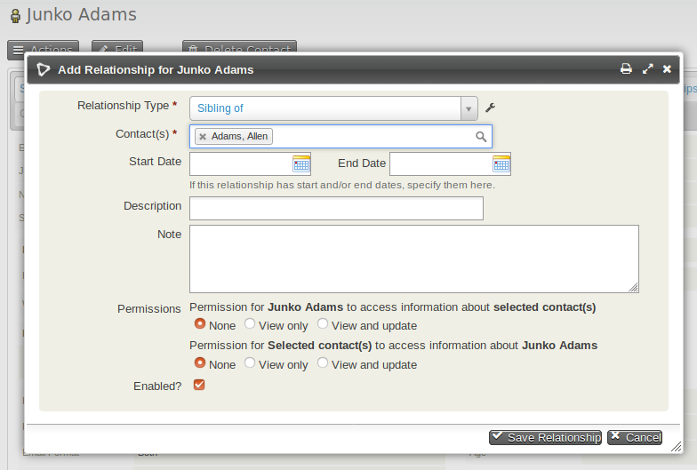

# Relationships

CiviCRM allows you to represent connections between contacts by creating relationships. For example, if a mother and son are both in your database, you can look at either record and see that they are related.

You can also track relationships between organisations, or between individuals and organisations. Entering an organisation in the Current Employer field of an individual contact's record automatically creates an "Employee of" relationship from the individual to the organisation, and an "Employer of" relationship from the organisation to the individual.

## Creating relationships between contacts

1. Navigate to one of the records that you want to relate.
2. Click **Add Relationship** from the **Actions** button on the contact summary, or from the Relationships tab.
3. Select the Relationship Type. In this case it would be "Sibling of".
4. Begin to type the last name of the related person(s). If you discover that a contact you want to connect is not yet in the database, you can create a new contact from this screen.
5. Optionally enter further information:
   - **Start Date** and **End Date** if the relationship is time limited.
   - **Description** — short text that shows on the relationship summary screen.
   - **Notes** — longer text shown when viewing the relationship.
   - **Permissions** — allows other users of the database to view or update the related contact.
   - **Enabled** — shows the relationship is active.
6. When you have made the changes you want, click **Save Relationship**.

### Relationship permissions

If a relationship is created between two contacts User 1 and User 2 and the **Permissions** box is set to allow User 1 'View' access to User 2, then when User 1 is logged in they can view details about User 2 using a [Profile](profiles.md) in View mode. If the permission is set to 'View and Update', User 1 can also update details about User 2 with a profile in Edit mode.

This functionality can be extended using the [Related Permissions extension.](https://github.com/eileenmcnaughton/nz.co.fuzion.relatedpermissions)

## Connecting employees and employers

A quick way to connect employees (stored in CiviCRM as individuals) to employers (stored as organisations) is to use the Current Employer field within an individual's record. This sets the current employer field in the contact record and creates a relationship between the contacts.

1. Navigate to the record of the individual who you want to connect to an organisation.
2. Click the **Edit** button.
3. Begin typing the organisation name into the Current Employer field. As you type, matching names of organisations that already exist as contacts in CiviCRM will appear in a dropdown autocomplete list below the Current Employer field. If the organisation is already a contact in CiviCRM, you can select it from the dropdown list by pressing the down arrow key or by clicking on it. If the organisation does not already exist as a CiviCRM contact, enter the full organisation name.
4. After the organisation's full name is entered in the Current Employer field, either press the Enter key or click the Save button. If the organisation is a pre-existing contact, an Employee/Employer relationship will be created between the individual and the organisation. If the organisation does not already exist, a new organisation contact will be created and the relationship will be created between the individual and the organisation. You can click the Relationships tab to view your newly created relationship Employee of and see any existing relationships.

### Other ways employees and employers can be connected

Employees and employers can be connected using the Current Employer field on CiviCRM Profiles and CiviCRM Contribution Pages.

When the Current Employer field is shown, the user can enter the name of their Employer; it is not presented as a select list to preserve privacy.

When the form is processed, CiviCRM will check the Current Employer field and attempt to match an existing Organisation contact before creating a new one, thus reducing **potential duplicates**.

The **first check** is performed using the **Deduplication Rule, Organisation Unsupervised**. If a matching Organisation contact is found, this contact is used and no new contact is created.

The **second check** is to compare if the Individual contact has an existing Current Employer with the same name as provided on the form. If matching, this contact is used and no new contact is created.

Lastly, if no match is found, a new Organisation contact is created and the **Employee Of Relationship** created to link the Individual and the new Organisation contact.

## Adding contacts to organisations

1. Select the desired contacts from your search results as described above.
2. Select **Add relationship - to organization from the dropdown** from the Actions menu.
3. On the **Add Contacts to Organization** screen, select the **Relationship Type** from the dropdown menu.
4. Enter part of the desired organisation name in the **Find Target Organization field**, then click **Search**.
5. Organisations that match your search will appear in the **Mark Target Contact(s) for this Relationship** section below the Search and Cancel buttons. If the organisation you're looking for appears in this list, click the radio button next to that organisation and then click the **Add to Organization button** below. If the organisation you're looking for does not appear in this list, try entering something different into the **Find Target Organization** field and clicking **Search** again. If you are still unable to find your desired organisation it may not exist; click **Cancel**, add a new organisation, and try again.
6. After you've successfully chosen an organisation and clicked the **Add to Organization** button, you should see a message stating that the number of participants that you selected have been added to the organisation.
7. Click **Done** to return to your search results.

## Adding contacts to households

1. Select the desired contacts from your search results as described above.
2. Select **Add relationship - to household** from the dropdown **Actions** menu.
3. Select the **Relationship Type** from the dropdown menu. CiviCRM will not stop you from adding multiple contacts as **Head of Household** for a single household, but this may cause problems later on in any situation where you are expecting **Head of Household** to refer to only one individual per household. Therefore, the **Household Member of** option may be the better choice in most situations.
4. Enter part of the name of the household to which you are adding contacts (such as a last name shared by household members) in the **Find Target Household** field, then click **Search**.
5. Households that match your search will appear in the **Mark Target Contact(s) for this Relationship** section below the Search and Cancel buttons. If the household you're looking for appears in this list, click the radio button next to that household and then click the **Add to Household** button below. If the household you're looking for does not appear in this list, try entering something different into the **Find Target Household** field and clicking **Search** again. If you are still unable to find your desired household it may not exist; click the **Cancel** button, add a new household, and try again.
6. After you've successfully chosen a household and clicked the **Add to Household** button, you should see a message stating that the number of participants that you selected have been added to the household.
7. Click **Done** to return to your search results.

<!-- Source: organising-your-data/relationships.md -->
