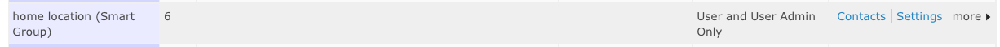
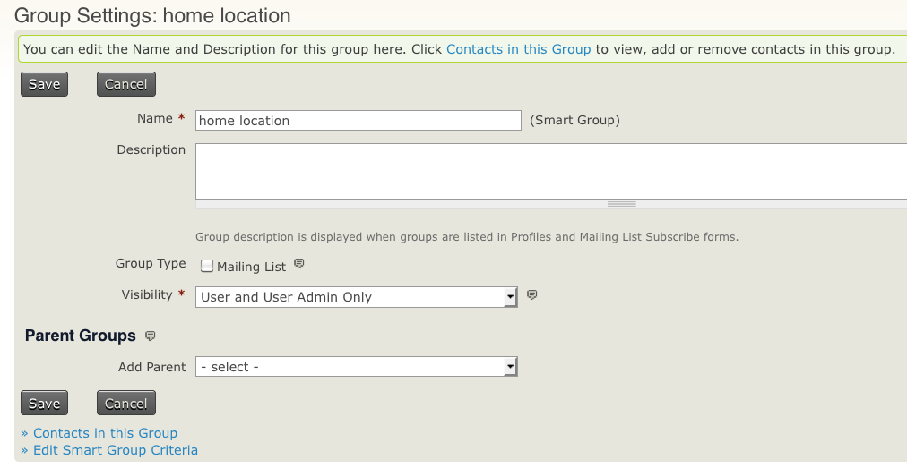
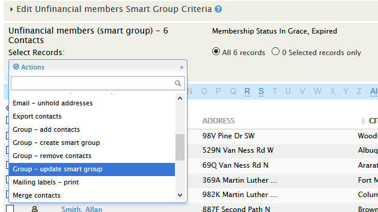

# Smart groups

Smart groups are 'saved searches'. They are useful for keeping track of contacts who meet certain criteria, such as 'all members based in Europe'. To create a smart group, search using your desired criteria and then choose 'Create smart group'. Once the smart group is created, each time you ask to see its contacts, CiviCRM will carry out a search and show you the contacts who meet the criteria you specified.

Smart groups can be useful in many situations. Consider how you might use them in your work.

## When might I use a smart group?

### Smart groups and profiles: a membership directory

You could use a smart group with a profile to display a directory of members on your website. Create a smart group that includes members of your organization, then create a profile with the fields you want to display in the directory. Configure the profile to show only contacts in that smart group.

When a contact becomes a member—for example, by filling in your membership form and paying online—they will automatically be added to the smart group and published in your members directory.

### Smart groups as mailing lists: an events newsletter

Suppose anyone who has registered for or attended an event should receive an events newsletter. You can create a smart group that includes those people and designate it as a mailing list. The group will then be available in CiviMail for sending the newsletter.

As people register for or are marked as having attended an event, they will automatically be added to the smart group and subscribed to the newsletter. Smart groups respect people's subscription preferences: if people unsubscribe from the newsletter, they will be removed from the smart group.

## Creating smart groups

You can create smart groups from the search results generated by many of CiviCRM's search forms. For example, a smart group of donors who have not yet been sent a thank-you letter can help you manage the work of thanking donors. As you send letters, their recipients will automatically leave the group, keeping the list of people to write to up to date.

You can use advanced search to create this group. If you do not have contributions in your CiviCRM installation, you could try it on the demo site [- http://demo.civicrm.org](http://demo.civicrm.org).

1. Go to **Search > Find Contacts > Advanced Search**.
2. Scroll down to the **Contributions** section.
3. Check **Thank-you date not set**? and choose **Donation** from the **financial type** drop-down menu.
4. Click **Search** at the bottom of the page.
5. Select all records.
6. From the **Actions** drop-down menu, select **Group - create smart group**.
7. Give the smart group a name and description. Optionally, designate it as a mailing list and give it a parent group. Click **Save Smart Group**.

You can also create a smart group from SearchKit. From any search that returns contacts, click **+Add** on the left hand side and then select **Smart Group**.

Your smart group will appear in all the usual places where you see groups. Try editing a contact in the group so that they no longer match its criteria. You'll see that they are removed from the group. If the contact is not removed immediately, smart group caching may be turned on; see [Smart group caching](#smart-group-caching).

## Changing criteria for smart groups

You may want to refine the criteria that select contacts for a smart group. For example, you may want a group of all *current* members to include *new* members as well. You can do this from the Manage groups screen.

1. Click **Manage Groups**. To edit a particular smart group's search criteria, click **Settings** next to that group.

   

2. On the group settings screen, click **Edit Smart Group Criteria** at bottom left.

   

3. On the screen showing the search results, click the bar at the top to display the criteria used to define the smart group. Update the criteria.
4. Once you're happy with the results, select all records and choose **Update Smart Group** from the Actions list.

   

Your smart group is now based on the new criteria.

## Adding and removing smart group members manually

By default, smart group membership is determined by the criteria in the smart group settings. You can override those criteria by manually adding or removing contacts. To add contacts, use the same workflows you would use for a standard group.

The **Groups** tab on a contact record does not offer a **Remove** button for smart groups as it does for standard groups. To remove someone manually:

1. Go to **Contacts > Manage Groups**.
2. Select **Contacts** in the right-hand column of the chosen group to view its current contacts.
3. Find and check the box next to the contact you want to remove.
4. Use the **Actions** dropdown and select **Group - remove contacts**.
5. Confirm the removal. The group record will now appear under **Past Groups** for that contact.

CiviCRM will override the smart group criteria based on manual additions or removals, even if a contact's eligibility under those criteria changes.

After a contact has been removed from a smart group, an option to **Delete** their smart group record appears under the **Groups** tab on their contact record. If you **Delete** the record, the contact will again be subject to inclusion based on the smart group's criteria.

## Smart group caching

For performance reasons, smart groups are often cached: the contacts who meet the criteria are saved in memory for a certain amount of time. This speeds things up because CiviCRM does not need to run the search each time you use the group. The improvement may be small for a simple query involving few contacts, but significant or even necessary for a complex query involving many contacts.

The downside is that you may need to wait up to 5 minutes for the query to be updated. Depending on how you use smart groups, this may not be an issue.

The default expiry time for a smart group in newer versions of CiviCRM is 5 minutes. You can adjust the smart group query cache 'timeout'—the amount of time the cache is considered a valid reflection of the smart group—in **Administer > Customize Data and Screens > Search Preferences**.

When a group is accessed, CiviCRM checks whether its cache is older than the timeout allows. If the timeout has passed, CiviCRM rebuilds the group and resets the timeout to `now + cache timeout setting`. Setting the timeout to *0* turns off the cache altogether.

<!-- Source: organising-your-data/smart-groups.md -->
