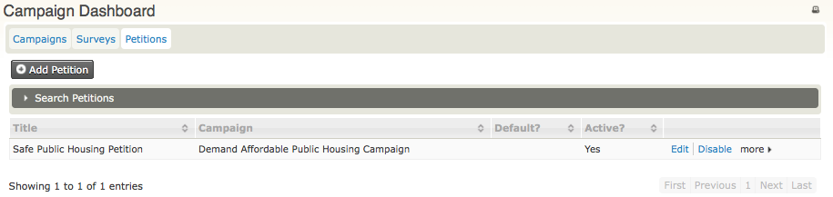
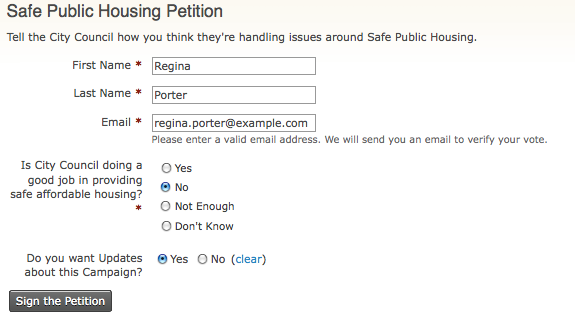
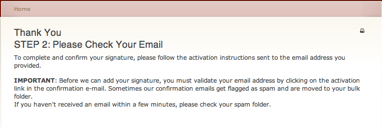
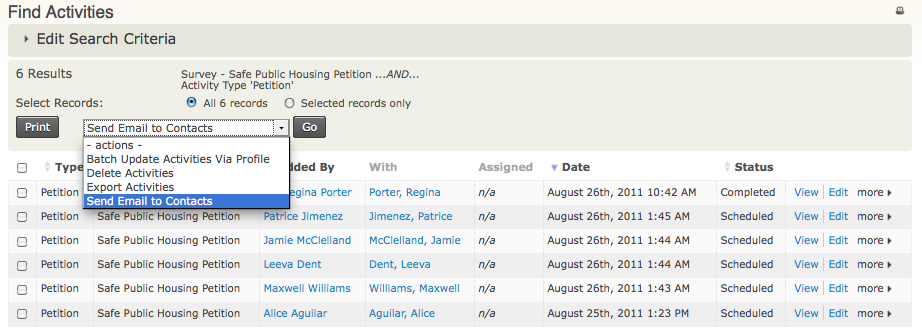
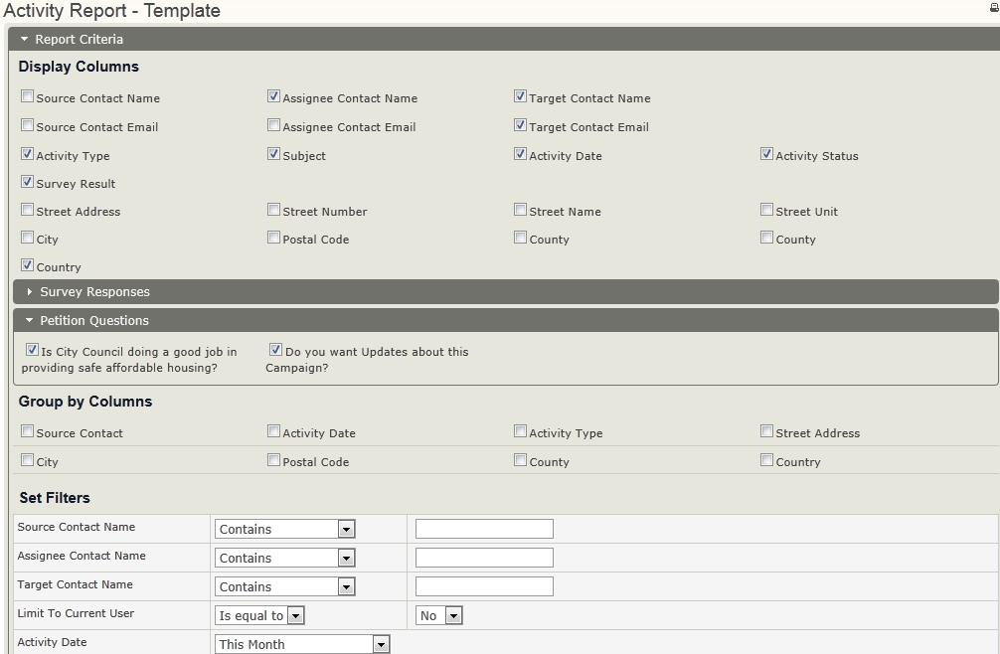
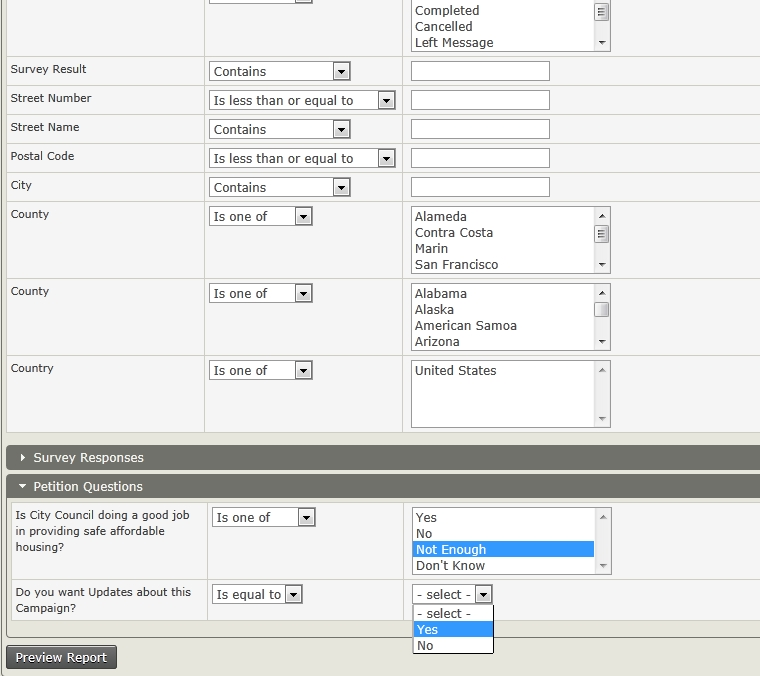

# Everyday petition tasks

This page describes everyday tasks for conducting and managing petitions.

## Manage your petitions

To view, manage and edit your petitions, click **Campaigns &gt; Dashboard &gt; Petitions**.

## Send out a petition for signing

When your petition is ready, you will want to publicise the URL where people can sign it.

1. Go to **Campaigns &gt; Dashboard &gt; Petitions**.
2. Click **More &gt; Sign** next to the name of your petition.
3. You will see your petition; copy the URL and use this link to email to your existing contacts, or add to your web site for individuals to sign your petition.

## Collect responses online

Once you have publicised the URL for your petition, people will be able to complete the form, answer the questions and submit their response.

After completing the form and clicking **Sign the Petition**, they will see the following message prompting them to check their email and verify their email address:

## Collect signatures

To view who has signed the petition:

1. Click **Campaign &gt; Dashboard &gt; Petitions**.
2. Click **More &gt; Signatures** next to the name of your petition.
3. You can then choose to view the petition activity for an individual, or select contacts and perform activities such as sending an email to the contacts, or a batch update via profile.

## Review results with Activity Report

To review all or some of the results from a petition, use the Activity Report.

1. Go to **Reports &gt; Create Reports from Templates &gt; Activity Report**.
2. In the **Display Column** area, select any fields you would like to view on the report, such as Target Contact Email.
3. Expand the **Petition Questions** area and select the criteria you want to see, such as specific responses to a petition question.
4. Click **Preview Report** to view the results. You can also export the survey report information to a CSV file to do more detailed reporting of the results.

<!-- Source: petition/everyday-tasks.md -->
