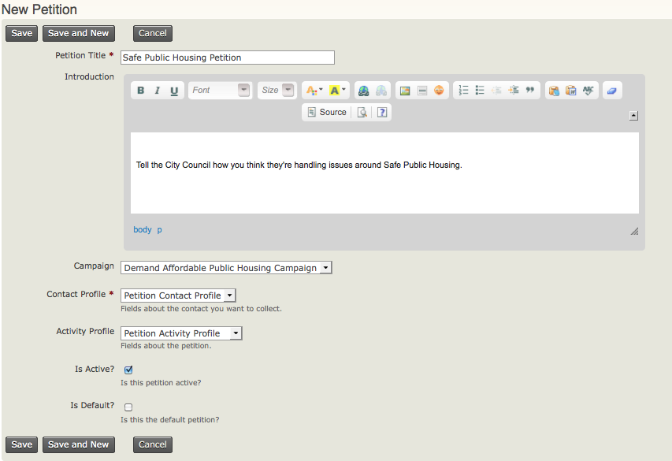

# Set up a petition

The CiviCampaign component must be enabled before you can use Petition. See [Campaign](../campaign/what-is-civicampaign.md) for information about this.

## Set CMS permissions

Set the appropriate CMS permissions for the roles that can sign the petition. If you plan to make the petition public, grant permission to anonymous users.

1. Go to your Drupal, Joomla!, or WordPress Access Control page, which is linked from **Administer > Users and Permissions > Permissions (Access Control)**.
2. Grant **Sign CiviCRM Petition**, **Profile Create**, and **Access all Custom Data** to the roles you require. For a public petition, grant these permissions to anonymous users and authenticated users ("Guest" in Joomla! or "Subscriber" in WordPress).

## Create two custom profiles

To create a petition, you must create two custom profiles: one to capture signers' contact information and one to capture their responses to petition questions. The responses to the petition questions are recorded in the activity record of type Petition for each individual who signs the petition.

1. Go to **Administer > Customize Data and Screens > Profiles** and add a profile with the contact fields you want to collect, such as First Name, Last Name, and Email. You may want to make some fields required so you can communicate with signers later. You must collect at least an email address: the Petition feature sends signers an email prompting them to verify their email address, and only verified email addresses can be counted.
2. Go to **Administer > Customize Data and Screens > Custom Fields** and add a set of custom fields for responses to the petition questions. From the **Used For** drop down menu, select **Activities**. For the **Activity Type**, select **Petition Signature**.
3. Under **Administer > Customize Data and Screens > Profiles**, add a profile for petition responses. Select **Activity** from the Field Name drop down menu, then select from the custom fields you created.

For both profiles, you may want to select these options in the **Advanced Setting** area:

- For **Drupal user account registration option?**, select **No account create option** if you do not want all petition signers to have a Drupal account created.
- For **What to do upon duplicate match**, select **Allow Duplicate Contact to be Created** if you do not want anonymous users to update an existing contact record's information. You will then need to periodically dedupe records.

For more about custom field sets, see [Creating Custom Fields](../organising-your-data/creating-custom-fields.md) in [Organising Your Data](../organising-your-data/overview.md). For more about custom profiles, see [Profiles](../organising-your-data/profiles.md).

## Create a new petition

Once you have created the two profiles, create the petition:

1. Go to **Campaigns > New Petition** and enter the following information:
   - **Petition Title** (required): Enter the name of your petition.
   - **Introduction**: Enter text describing what your petition is about. Potential signers will read this, so create a message that encourages them to sign.
   - **Campaign**: If your petition is one strategy or activity of a campaign, select the name of the campaign.
   - **Contact Profile** (required): Select the profile that will collect signers' contact information.
   - **Activity Profile**: Select the activity profile that will collect petition responses.
   - **Is Active?:** Check this box to make your petition active.
   - **Is Default?**: Check this box to make your petition default.
2. Click **Save** to save the petition information.

<!-- Source: petition/set-up.md -->
