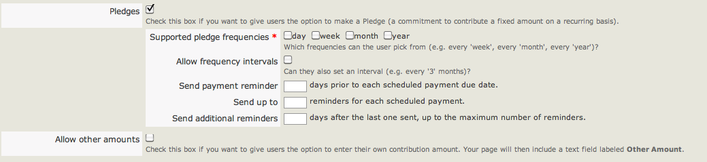
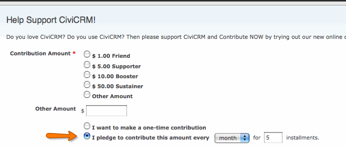

# Set up pledges on contribution pages

You can let constituents make pledges for future donations through an online CiviContribute donation form. Donors can choose how often to donate—for example, twice a year or twice a month for five months.

Some payment processors will not allow this kind of automation, and payments may arrive in a non-electronic form such as cheques. You can record future income against a current source, such as an event or email campaign, and manually change a payment’s status from 'Pending' to 'Complete' when it arrives if the payment method does not support this. Pledges also provide an automated way to remind donors of their commitment.

For more information about pledges, including how to create them internally on behalf of constituents rather than through an online form, see the chapter *Pledges*.

## Enable pledges

After creating a contribution page (see [Creating Contribution Pages](../contributions/contribution-pages.md)), edit its settings, go to the **Amounts** tab, and tick **Pledges**. The following options will appear.

- **Supported pledge frequencies**: Choose whether donors can pledge daily, weekly, monthly or annual donations.
- **Allow frequency intervals**: If checked, donors can specify a gap between payments, such as once every 5 days, 5 weeks, 5 months, or five years.
- **Send payment reminder**: To send donors a reminder before a scheduled payment is due, enter the number of days beforehand to remind them, for example, via email.
- **Send up to**: Specify the maximum number of reminders an individual will receive for one scheduled payment.
- **Send additional reminders**: Set the interval between reminders in days, for example, 5 days before the next reminder is sent.
- **Allow other amounts**: Check this box to let individuals pledge an amount of their choosing. You can also specify the minimum and maximum payment they can make.
- **Fixed Contribution Options**: Use the table below to enter up to ten fixed contribution amounts. These appear as radio button options showing both the label and dollar amount.

When you have finished, choose **Save**, **Save and Done**, **Save and Next** or **Cancel**.

## Check pledges

Once enabled, the option to make a pledge appears on the online form. Several reports and a dashboard are available to check and monitor current pledges. To access the dashboard, go to **Contributions** > **Pledges** > **Dashboard.**

<!-- Source: pledges/set-up.md -->
