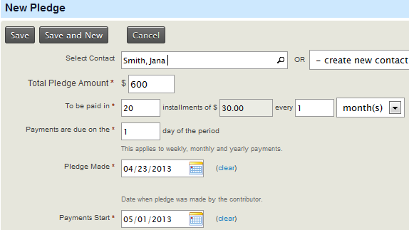
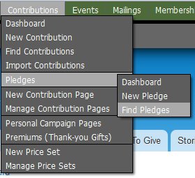
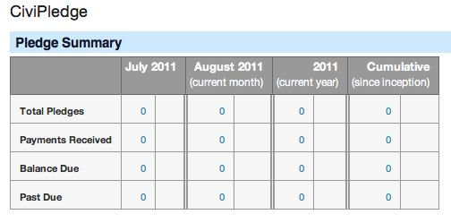

# Create and manage pledges

## Enable CiviPledge

Before using CiviPledge, you must enable it for your installation if you have not done so already. Go to **Administer &gt; System Settings &gt; Enable CiviCRM Components**, click the checkbox CiviPledge, and click **Save**.

## Create a pledge

To create a New Pledge on behalf of a constituent, navigate to **Contributions** &gt; **Pledges** &gt; **New Pledge**. An individual may also do this themselves through an online contribution form; see the [Contributions](../contributions/what-is-civicontribute.md) section.

The options available are:

- **Pledge by** **Select contact**: type the name of an existing contact, or create a new one before setting up the pledge (a new window will open)
- **Total Pledge Amount**: enter the total amount to be donated
- **To be paid in**: specify the number of instalments and time period for payment, if greater than one
- **Payments are due on the**: choose the day on which a payment is due during that instalment cycle (e.g. the second day of the week/month/year)
- **Pledge Made**: select the date on which the pledge was promised
- **Payments Start**: set the date the scheduled payments will start
- **Send Acknowledgment?**: if outgoing mail is configured, and an email address is available for that contact, check this box to send a notification email
- **Acknowledgement Date**: the date the individual was notified of the pledge's creation (automatically populated if an email was sent)
- **Financial Type**: choose the Financial Type of the contribution (e.g. Donation or Event Fee) to denote what the pledged money is meant for
- **Campaign**: if available, you may assign the Pledge to a Campaign if the money is intended to go towards that fundraising effort
- **Self-service Payments Page**: give donors the ability to make a payment online by selecting an online Contribution Form to collect the money through
- **Honoree information**: you may also enter Honoree information if the individual elects to dedicate the pledge to someone, and set payment reminders

## Payment reminders

One or more payment reminders can be emailed to the donor before the scheduled payment date. If a 'Self-service Payments Page' has been selected (see below), the reminder will include a link for the contributor to make their payment online.

For reminders to be sent:

1. The Process Pledges (process_pledge) scheduled job must be enabled to update pledge payment statuses and send payment reminders. Alternatively, a cron job can be scheduled to run this specific task apart from other scheduled jobs. Refer to the *Scheduled Jobs* chapter for more information.
2. The donor must have a valid email address and must not have the "Do Not Email" flag checked.

Once these prerequisites have been met, you can choose the payment reminder schedule for an individual when creating a New Pledge. The settings are:

- **Send Initial Reminder**: enter the number of days, prior to the payment date, that a reminder will be sent
- **Send up to**: specify the maximum number of reminders an individual will receive for one scheduled payment
- **Send additional reminders**: set the interval between reminders by the number of days, e.g. 5 days before the next reminder is sent

## Self-service payments

A donor can be given the option to make a scheduled payment online if a Contribution Page (with Payment Processor) has been created. To do this, select a Contribution Page from the drop-down menu 'Self-service Payments Page' when creating a New Pledge. If reminders have been enabled for the pledge, a link to this page will be included in the body of the emails.

## Find pledges

To search for existing Pledges, go to **Contributions &gt; Pledges &gt;  Find Pledges**. You may search by Pledger Name, Email Address, or any discrete feature of the Pledges themselves (e.g. Payment Start Date, Pledge Status and Honoree information).

The search results page displays a summary of the Pledges found. View, Edit and Delete options are available for each record at the end of the rows. If the Status of a Pledge is 'in progress' or 'Pending', there is also an option to Cancel the Pledge.

## View the pledges dashboard

You can view a list of recent Pledges and a summary table of Pledges recorded over the current month and past year on the pledges dashboard. This can be reached through the Contributions menu: **Contributions &gt;
Pledges &gt; Dashboard**.

<!-- Source: pledges/what-you-need-to-know.md -->
