# Set up CiviReports

This page describes how to create a report from a template and make it available to users. It assumes you understand why you want to use CiviReport and that a supplied CiviCRM report template can produce the report you need.

If the template you need does not exist, you or your developer should refer to [creating custom reports](https://docs.civicrm.org/dev/en/latest/framework/civireport/) in the Developer Guide for information about creating new templates.

## Choose a report template

Report templates are general reports that you can customise to create specific report instances. You can then make those instances available to users.

The **Create new report from templates** page is in the **Administer &gt; CiviReport** menu. It lists available templates by component, with a brief description of each template’s intended scenario. If a template already has report instances, you’ll see a link to view **Existing Reports**.

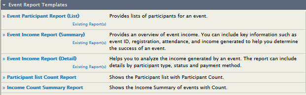

Click a report template name to open its configuration screen. Configuring a report has two steps:

1. Select your **report criteria** to decide what information the report displays.
2. Define the **report settings** to choose a title, set permissions and add the report to a menu. The report settings tabs do not appear until you have previewed the report.

## Select report criteria

When you create a report, two or more tabs let you define the information it displays. The available tabs depend on the template. The most common are:

- **Columns** (all reports)
- **Grouping** (summary reports)
- **Sorting** (detail reports)
- **Filters** (all reports)

The options within these tabs vary by report.

### Columns

Use the check boxes to select the data displayed for each record. In most reports, at least one display column is *required* and cannot be unselected. For example, **Contact Name** and **Membership Type** are required fields in the membership detail report.

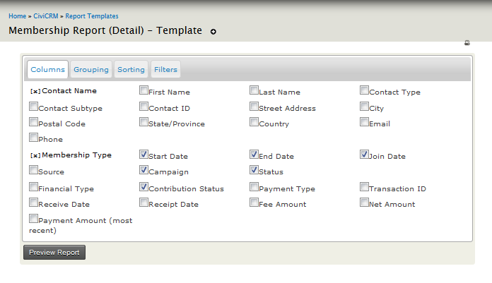

### Grouping

Grouping is not available in every report. It is useful for summarising data instead of displaying each individual row, or for comparing different types of data. For example, you can compare donations per year.

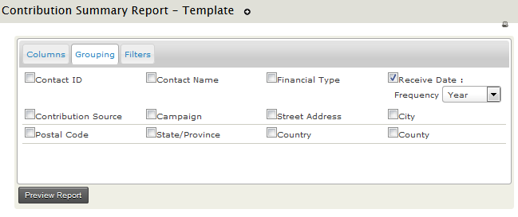

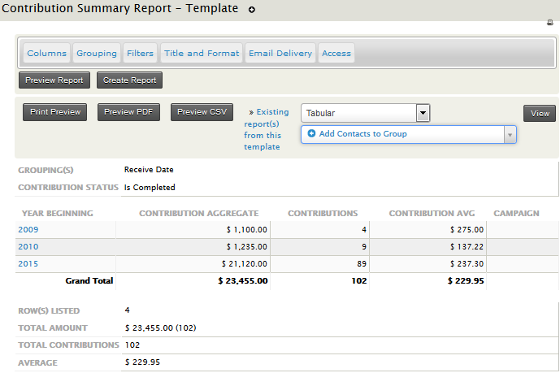

You can specify more than one grouping criteria. Results will then be nested based on both groupings. Not all combinations will make sense for your data, so you may need to experiment with Group By Columns.

Some Groups By Columns interact with Display Columns and cannot be selected at the same time. The system will warn you if you make an invalid selection.

### Sorting

Sorting is not available in every report, but can be useful in &quot;detail&quot; reports, as shown below.

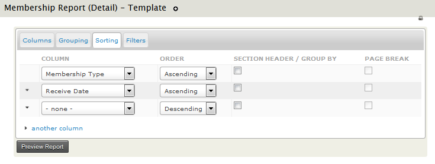

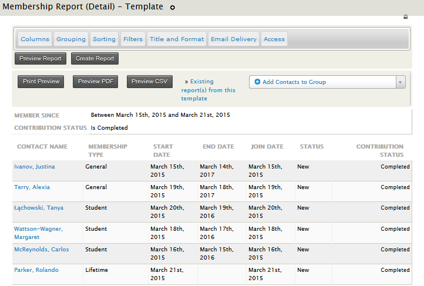

### Filters

Filters specify which records to include. For example, a Membership Detail report without filters shows all membership records. You could filter it to show members of a specific membership type who joined last year. Most filters are self-explanatory; the date range filter is described below.

#### The date range filter

Most reports have a date range filter. You can use:

- An absolute date range, such as &quot;1st Jan 2010&quot; to &quot;31 July 2010&quot;.
- A relative date range, such as &quot;Previous Year&quot;.

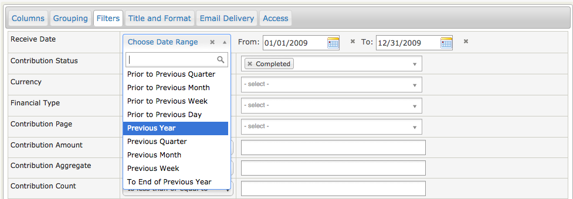

Relative date ranges are useful for reports you run regularly:

- **This year** gives all records from the start of the current year.
- **Previous quarter** gives all records from the previous quarter.
- **Last 12 months** gives all records between one year earlier than today&#39;s date and today.

The &quot;Last ...&quot; ranges are particularly useful with Group By Columns. Combining Ending Year with Group By Month gives a report that summarises data by month for the previous 12 months.

The report below shows the total amount of contributions received in the past 12 months, as well as each month&#39;s total.

Once you have selected your criteria, click **Preview Report**. The report settings tabs will then be visible. If the results are not what you wanted, return to the appropriate tab and modify the criteria. You may need to make several modifications.

## Define report settings

When you are happy with the criteria, save them as a new report so that it can be run again. You must preview the report before the settings tabs become visible.

1. On the **Title and Format** tab, give the report a title and description that help others understand its use, such as &quot;Student members joined so far this year&quot;.

   A standard header and footer are included with each report and appear at the beginning and end of PDF or downloaded versions. They are written in HTML. To display the actual report title, replace &quot;CiviCRM Report&quot; between &lt; title&gt; and &lt; /title&gt;. You can include a logo by adding an &lt; img&gt; tag. You can also change the printed report’s appearance by including a custom CSS file instead of print.css.

   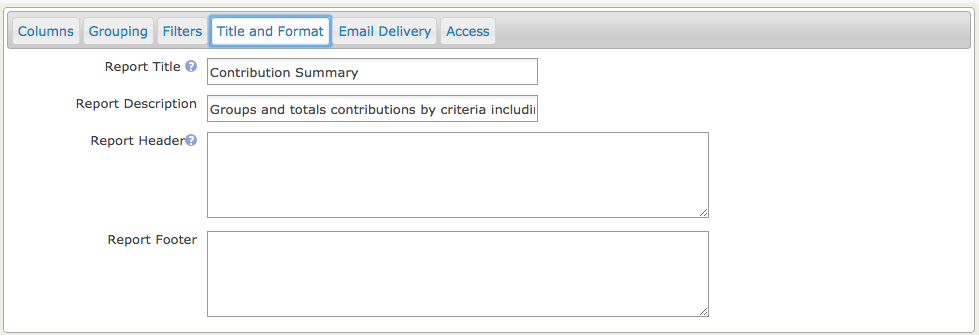

2. On the **Email Delivery** tab, fill in the Subject, To and CC fields in the Email Delivery Settings to have the report emailed to you or someone else regularly. You can enter one or more email addresses in the To and CC fields; separate multiple addresses with commas.

   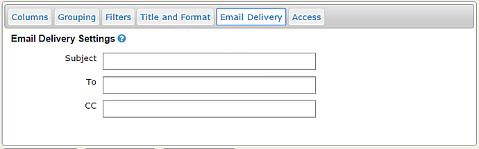

   To send report emails, you must also enable the **Mail Reports (mail_report)** scheduled job. Alternatively, a cron job can run this task separately from other scheduled jobs. Specify the report instance and, optionally, its format in the scheduled job configuration. See [Scheduled Jobs](../initial-set-up/scheduled-jobs.md) for more information.

3. On the **Access** tab, choose where else the report appears in the navigation menu. All reports are included in **Report &gt; Report listing**. Checking **Include Report in Navigation Menu?** displays the Parent Menu field, where you can select the parent menu for a second link to the report.

   That link can open either &quot;View Results&quot; or &quot;Show Criteria&quot;. &quot;View Results&quot; opens the results page and is appropriate, for example, for a report using a relative date filter such as &quot;Number of new contributors last calendar month&quot;. &quot;Show Criteria&quot; lets you change the criteria before running the report.

   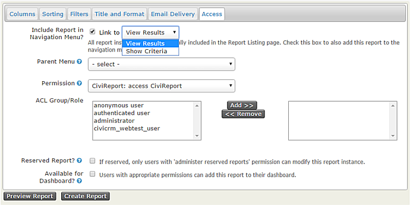

   You can also use the **Access** tab to set permissions to view or edit individual reports. This can simplify the interface for junior users and restrict sensitive reports. For example, you might select &quot;access CiviContribute&quot; for a contribution report so that only people who can see contribution data can access it.

   Alternatively, you can limit access to particular ACL role(s). Refer to *Permissions and Access Control* in the *Initial Set Up* chapter.

   A **Reserved Report** can only be altered by someone with the **Administer Reserved Reports** permission.

   Checking **Available for Dashboard?** lets users with appropriate permissions add the report to their dashboard by clicking **Configure Your Dashboard** on their dashboard.

Once the criteria and settings are correct, click **Create Report**. The report will appear in **Reports &gt; All Reports** and in any navigation menu you defined on the Access tab.

## Edit or copy an existing report

To permanently change an existing report’s criteria, open the report, make the changes and click **Update Report**.

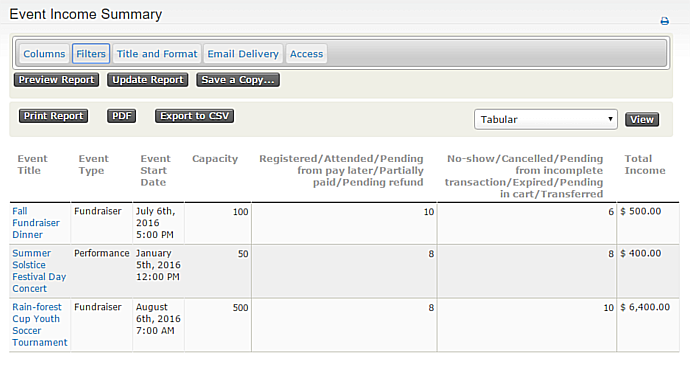

You can also create reports with the same columns but different filters. For example, an events manager might need an Event Income Summary report for all events, while a fundraising manager might have access only to a report for Fundraiser events. Open the initial report, change its filtering criteria and click **Save a Copy...**. You will be prompted for a title and description for the new report.

## CiviReport permissions

Four permissions are specifically associated with reports:

- **CiviReport: access CiviReport** — The user can view the CiviReport menu, but can view only reports set with the access CiviReport permission.
- **CiviReport: access Report Criteria** — The user can change report search criteria.
- **CiviReport: administer reserved reports** — The user can edit all reserved reports.
- **CiviReport: administer reports** — The user can manage report templates.

<!-- Source: reporting/set-up.md -->
