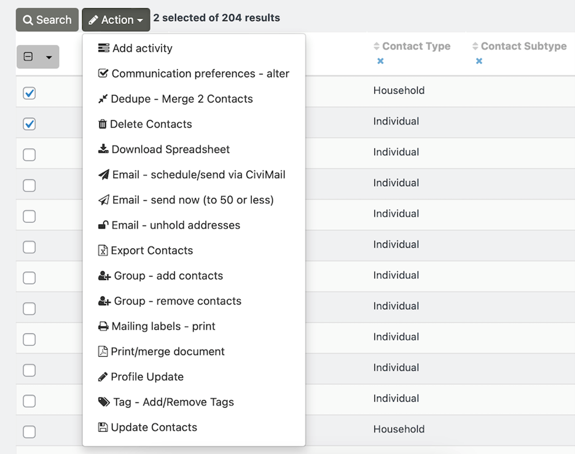
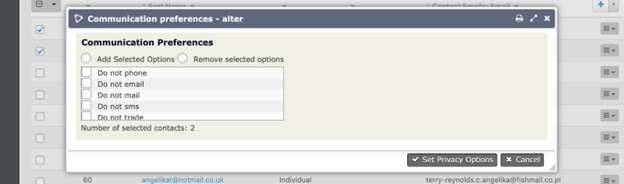
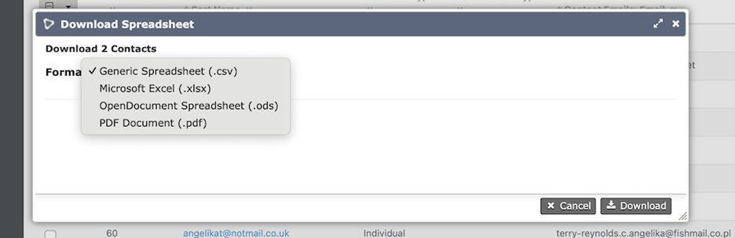
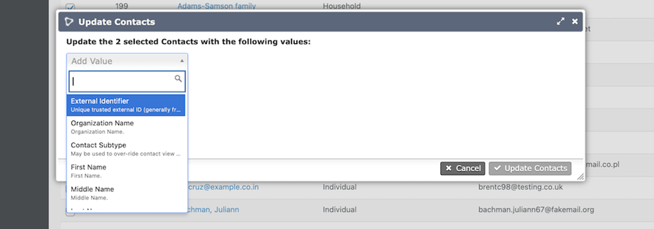
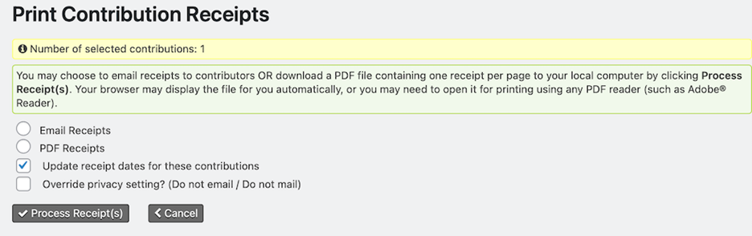
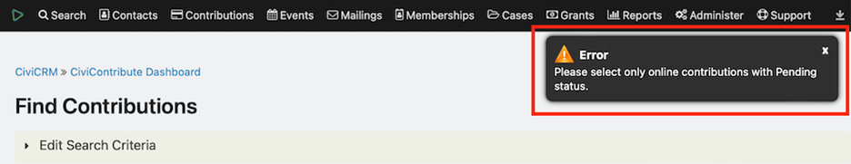

# Search result actions

You can take actions directly from search results. The available “Action” options depend on the type of information you searched for: a Contact search, for example, has different options from a Contribution search.

Whether you search for contacts or contact data using **Quick Search**, **Advanced Search**, **SearchKit**, or **Find Contacts**, you must select one or more results before options under “Action” become selectable.

## Contact search actions

The following “Action” options appear for Contact entity searches.

* **Add activity** - Add an [Activity](../organising-your-data/activities.md) to the selected contact records.
* **Communication preferences - alter** - Modify preferences by adding or removing options. For example, if “No bulk emails (User Opt Out)” is selected, the contact will be automatically excluded from future email communications out of CiviCRM. [Learn more about Communication Preferences](../organising-your-data/contacts.md#communication-preferences-and-privacy-options).

* **Dedupe - Merge 2 Contacts** - In addition to merging the contact data (address, phone, email) of two contacts, you may choose to move all or some of the related activity records (groups, contributions, memberships, etc.). This option will be grayed out and not selectable if more than two contacts are selected. [Learn more about Deduping and Merging Contacts](../common-workflows/deduping-and-merging.md).
* **Delete Contacts** - This will not permanently delete the contacts from CiviCRM. Should you delete contacts in error, they can be restored by searching for contacts in the trash via **Advanced Search**. [Learn more about deleting and restoring contacts](../the-user-interface/undelete.md).
* **Download Spreadsheet** - Select the file format of the data. The download includes the columns enabled in your Search.

* **Email - schedule/send via CiviMail** - Compose and send a mass-mailing to the 2 or more selected contacts. You will be able to add or exclude additional groups of contacts in the next step. [Learn more about CiviMail](../email/what-is-civimail.md).
* **Email - send now (to 50 or less)** - Emails will not be sent to contacts who have communication preferences set to “Do Not Email” or do not have a valid email address on file.
* **Email - unhold addresses** - When an email is on **Hold**, no future emails will be sent to it unless someone fixes it and removes the hold. This action allows you to remove the **Hold** from email addresses in bulk.
* **Export Contacts** - Export a predefined set of fields (export mapping), or create your own export mapping and save it for reuse. The software exports to CSV format, which can be easily opened in standard spreadsheet software or directly used for mail merges. [Learn more about Exporting Contacts](../common-workflows/exporting-your-contacts.md).
* **Group - add contacts** - Add contacts to an existing group or create a new group. [Learn more about Groups](../organising-your-data/groups-and-tags.md).
* **Group - remove contacts** - Select from your list of existing groups to remove contacts in bulk.
* **Mailing labels - print** - Select a label format from the dropdown list to generate labels for a bulk print communication directly from the system. [Learn more about postal mailings in CiviCRM](../common-workflows/postal-mail-communications.md).
* **Print/merge document** - Create merge letters directly from the interface. You can insert tokens representing fields in the database into your letter, optionally save it as a template, and output it to PDF, HTML, Word (.docx), or Open Document (.odt) format. [Learn more about Print/Merge Documents](../common-workflows/postal-mail-communications.md#print-merge-document).
* **Profile Update** - To update multiple contacts, you must select contacts of the same basic type (e.g. all Individuals OR all Organizations...).
* **Tag - Add/Remove Tags** - New tags cannot be created from this action. You can select from existing tags in the system. [Learn more about Tags](../organising-your-data/groups-and-tags.md#tags).
* **Update Contacts** - Select the data field(s) you’d like to update for all contacts selected. These changes will apply to all contacts selected.

## Contribution search actions

The following “Action” options appear for Contribution entity searches.

* **Delete contributions** - The delete operation cannot be undone and will delete all transactions and activity associated with the contributions selected.
* **Email - send now (to 50 or less)** - As long as you are contacting fewer than 50 recipients and you don't need to track whether recipients opened the email or clicked on any links, the Send Email action is quicker and easier than sending a mass mailing in CiviMail. [Learn more about small group emails](../email/what-you-need-to-know.md#when-to-use-the-send-email-action).
* **Export contributions** - Export a predefined set of fields (export mapping), or create your own export mapping and save it for reuse. The software exports to CSV format, which can be easily opened in standard spreadsheet software or directly used for mail merges.
* **Printing selected rows** - You must have a printer connected to your device. This option prints the selected search results.
* **Receipts - print or email** - You may choose to email receipts to contributors OR download a PDF file containing one receipt per page to your local computer by clicking Process Receipt(s).

* **Record payments for contributions** - This option will only work if you select contributions with Pending status. If the selected contributions have a status other than Pending, an error message will appear in the upper-right of the screen.

* **Thank-you letters - print or email** - Email thank you letters directly from CiviCRM or create pdf merge letters for the selected contacts. [Learn more about Print/Merge Documents](../organising-your-data/profiles.md#updating-multiple-records-at-the-same-time).
* **Update multiple contributions** - You will need to create a Profile containing the Contribution fields you want to edit before you can use Update multiple contributions. Navigate to Administer CiviCRM > Customize Data and Screens > CiviCRM Profile to configure a Profile. [Learn more about using Profiles for updating information](../organising-your-data/profiles.md#updating-multiple-records-at-the-same-time).

## Participant search actions

The following “Action” options appear for Participant entity searches.

* **Cancel registration** - Set the participant’s status to Canceled.
* **Delete participants from event** - This delete operation cannot be undone and will delete all transactions and activity associated with the selected participations. This action will not delete the participant’s contact record.
* **Email - send now (to 50 or less)** - As long as you are contacting fewer than 50 recipients and you don't need to track whether recipients opened the email or clicked on any links, the Send Email action is quicker and easier than sending a mass mailing in CiviMail. [Learn more about small group emails](../email/what-you-need-to-know.md#when-to-use-the-send-email-action).
* **Export participants** - Export a predefined set of fields (export mapping), or create your own export mapping and save it for reuse. The software exports to CSV format, which can be easily opened in standard spreadsheet software or directly used for mail merges.
* **Group - add contacts** - Add contacts to an existing group or create a new group. [Learn more about Groups](../organising-your-data/groups-and-tags.md).
* **Group - create smart group** - Smart groups are saved search results based on defined criteria, similar to a query. The system reruns the query using those criteria each time you open the smart group. This is particularly helpful for complex search criteria that you need to view regularly. Even if only a few contacts have been selected from the search results, all contacts that meet the criteria specified will be in the group. [Learn more about Smart Groups](../organising-your-data/smart-groups.md).
* **Name badges print** - Select the type of badge you require and a printable PDF will be generated with the names of the selected participants. Learn more about Event Badges.
* **PDF letter - print for participants** - Create merge letters directly from the interface. You can insert tokens representing fields in the database into your letter, optionally save it as a template, and output it to PDF, HTML, Word (.docx), or Open Document (.odt) format. [Learn more about Print/Merge documents](../common-workflows/postal-mail-communications.md#print-merge-document).
* **Participant status - change** - When using this feature emails will be sent to participants when the status is changed from one which belongs to the pending class (eg Pending (pay later), Pending from approval) to either Registered or Attended(positive class). Emails will also be sent if the status is changed to Expired or Canceled.
* **Print selected rows** - Print what is shown on the screen for the rows you have selected.
* **Update multiple participants** - Edit multiple fields for multiple participants in a table grid layout. You must create the profile set you wish to use before implementing this action. [Learn more about using Profiles for updating information](../organising-your-data/profiles.md#updating-multiple-records-at-the-same-time).

## Activities search actions

The following “Action” options appear for Activity entity searches.

* **Delete activities** - This delete operation cannot be undone.
* **Email - send now (to 50 or less)** - As long as you are contacting fewer than 50 recipients and you don't need to track whether recipients opened the email or clicked on any links, the Send Email action is quicker and easier than sending a mass mailing in CiviMail. [Learn more about small group emails](https://docs.civicrm.org/user/en/latest/email/what-you-need-to-know/#when-to-use-the-send-email-action).
* **Export activities** - Export a predefined set of fields (export mapping), or create your own export mapping and save it for reuse. The software exports to CSV format, which can be easily opened in standard spreadsheet software or directly used for mail merges.
* **Print selected rows** - Print what is shown on the screen for the rows you have selected.
* **Print/merge Document** - Create merge letters directly from the interface. You can insert tokens representing fields in the database into your letter, optionally save it as a template, and output it to PDF, HTML, Word (.docx), or Open Document (.odt) format. [Learn more about Print/Merge documents](https://docs.civicrm.org/user/en/latest/common-workflows/postal-mail-communications.md#print-merge-document).
* **Tag - add to activities** - Add one or multiple tags to Activity records.
* **Tag - remove from activities** - Remove one or more tags from Activity records.
* **Update multiple activities** - To use this action, you will first need to create a Profile containing the Activity fields you want to edit. [Learn more about using Profiles to update multiple activity records](../organising-your-data/profiles.md#updating-multiple-records-at-the-same-time).

## Member search actions

The following “Action” options appear for Member entity searches.

* **Delete Memberships** - This delete operation cannot be undone and will delete all transactions and activity associated with the memberships selected.
* **Email - send now (to 50 or less)** - As long as you are contacting fewer than 50 recipients and you don't need to track whether recipients opened the email or clicked on any links, the Send Email action is quicker and easier than sending a mass mailing in CiviMail. [Learn more about small group emails](https://docs.civicrm.org/user/en/latest/email/what-you-need-to-know/#when-to-use-the-send-email-action).
* **Export members** - Export a predefined set of fields (export mapping), or create your own export mapping and save it for reuse. The software exports to CSV format, which can be easily opened in standard spreadsheet software or directly used for mail merges.
* **Group - create smart group** - Create a saved search query that can be used for mailings or as a filter in future searches or reports. Even if only a few contacts have been selected from the search results, all contacts that meet the criteria specified will be in the group. [Learn more about Smart Groups](../organising-your-data/smart-groups.md).
* **Mailing labels - print** - Select a label format from the dropdown list to generate labels for a bulk print communication directly from the system. [Learn more about postal mailings in CiviCRM](../common-workflows/postal-mail-communications.md).
* **Print selected rows** - Print what is shown on the screen for the rows you have selected.
* **Print/merge document for memberships** - Create merge letters directly from the interface. You can insert tokens representing fields in the database into your letter, optionally save it as a template, and output it to PDF, HTML, Word (.docx), or Open Document (.odt) format. [Learn more about Print/Merge documents](../common-workflows/postal-mail-communications.md#print-merge-document).
* **Update multiple memberships** - To use this feature, you will first need to create a Profile containing the Membership fields you want to edit. [Learn more about using Profiles to update membership information](../organising-your-data/profiles.md#updating-multiple-records-at-the-same-time_1).

<!-- Source: searching/search-result-actions.md -->
