# Search for information in CiviCRM

CiviCRM offers several ways to find information you have stored. Begin with Quick search, Advanced Search, and component searches. For more advanced searches, consider [SearchKit](../searching/searchkit/what-is-searchkit.md) reports and custom searches.

## Overview

This page covers:

- **Quick search:** Find contacts quickly.
- **Advanced search:** Search contacts using a wide range of criteria.
- **Full-text search:** Search text fields in the database.
- **Component searches:** Search records associated with components, such as events, memberships, cases, and contributions.
- **Custom searches:** Use searches supplied by CiviCRM core or by your extensions.
- **Search actions:** Act on search results or, sometimes, report results. See [Search Result Actions](search-result-actions.md) for the primary actions available for the selected entity.
- **The contact summary pop-up:** View or change information shown when you hover over a contact icon in search results.
- **Wildcards:** Use `%` or `%_%` in searches.
- **Case sensitivity:** Understand how searches handle upper- and lowercase characters.
- **Default number of rows:** See how many results appear and how to change that number.
- **SearchKit:** Follow the link to [SearchKit](../searching/searchkit/what-is-searchkit.md).

## Searching and reporting

There are three main reasons to search:

- Find a specific contact. The Quick search box can find contacts by name, email address, or various other characteristics.
- Find contacts who meet criteria so you can act on their records. For example, find advisory group contacts to invite to a meeting, contacts whose memberships have recently expired to send renewal reminders, or contacts under 25 in a specific location to email about a nearby event.
- Produce an ad-hoc report.

Searching can be useful for ad-hoc reporting, but you cannot group results by particular criteria, summarize them, or easily produce graphs of them. For more advanced reporting, see [CiviReport](../reporting/what-is-civireport.md).

## Quick search

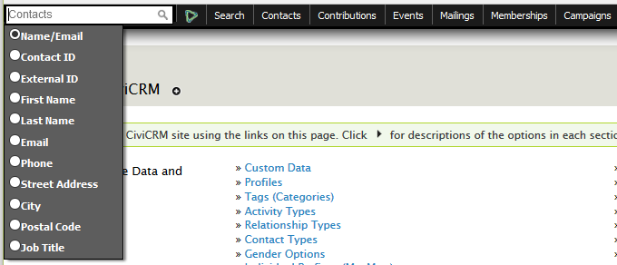

To find a specific contact, use the Quick search box in the navigation menu at the top left of the screen. You can search by several criteria. To modify the available criteria, go to **Administer > Customize Data and Screens > Search Preferences**. The *Search Preferences* page has options to hide basic contact fields that are not normally used in Quick search and to add custom field options.

Click in the Quick search box and start typing to use the default Name/Email search. Alternatively, click again to show other criteria in a dropdown list. Matching contacts appear below the box.

For example, if you search by Name/Email and have left automatic wildcard enabled in *Search Preferences*, entering “peter” finds:

- People whose first or last name is **Peter**.
- People with Peter elsewhere in their name, such as Mary**Peter**son.
- People with Peter in their email address, such as blue**peter**@gmail.com.
- Organisations with Peter in their name, such as Al**peter** Community Centre.

Often, the first few letters of a name are enough. If you do not see the contact, type more characters to refine the search, or press Return to convert it into an Advanced Search.

Quick search displays up to 10 results by default. To change this number, change *Autocomplete Results* on the *Search Preferences* screen.

CiviCRM also allows a nickname to be collected when entering a new contact. For example, “Joe” can be a nickname for “Joseph,” and “IBM” can be a nickname for “International Business Machines.” When you first install CiviCRM, searching for “Joe” will find “Joseph,” and searching for “IBM” will find “International Business Machines.”

You can change this behavior on the *Search Preferences* screen by changing *Include Nickname* to *yes*.

!!! note
    If you search by **phone**, enter the digits without formatting. The **phone** search uses a field containing only digits, with all non-numeric characters stripped out.

!!! tip
    To search by **first** and **last** name, use “Lastname, Firstname,” not “Firstname Lastname.” For example, use “Peterson, Mary,” not “Mary Peterson.”

## Advanced search

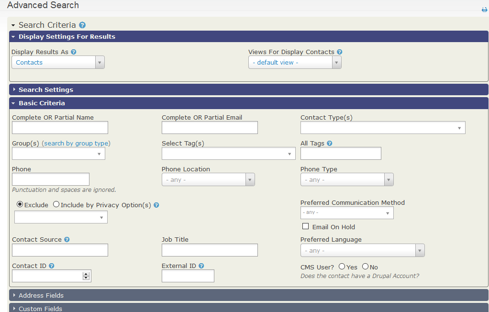

Advanced search lets you search across the information you have about contacts. You could find “all contacts in Venezuela” or “all advisory group members.” If you specify two or more categories of information, the search displays contacts matching all the categories—for example, advisory group members in Venezuela.

Open **Search > Advanced Search** from the navigation menu. Search criteria are grouped by type of data, such as addresses, notes, Contributions, and Events. Each group appears as a blue bar called an “accordion,” which expands when clicked. To search for people aged 16 to 18, for example, open **Demographics** and specify a birth date range.

### Display settings for results

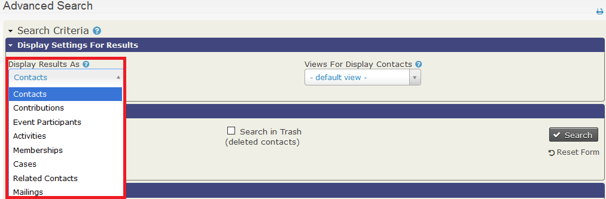

Advanced Search returns Contact records by default. To return another record type, select it from **Display Results As**. For example, you could search for Membership renewal activities from last week and display the results as Memberships. You could then export name, address, and Membership expiration date to create and post membership cards.

### Views for display contacts

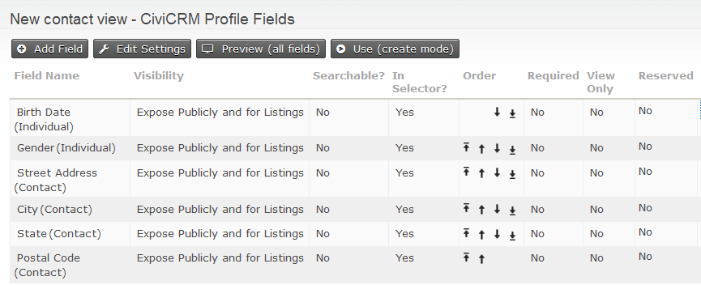

You can change the columns shown in Advanced search results. The default columns are Name, Street Address, City, State, Postal Code, Country, Email, and Phone.

To use different columns, create a Profile with the Search Views option selected. Set its fields to “Expose Publicly and for Listings” visibility and mark them as Results Columns. For example, to show Gender and Date of Birth but not Country, create a profile with birth date, gender, and address fields.

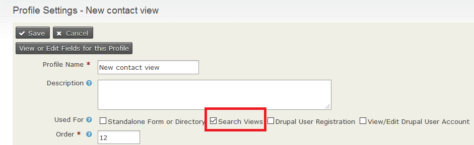

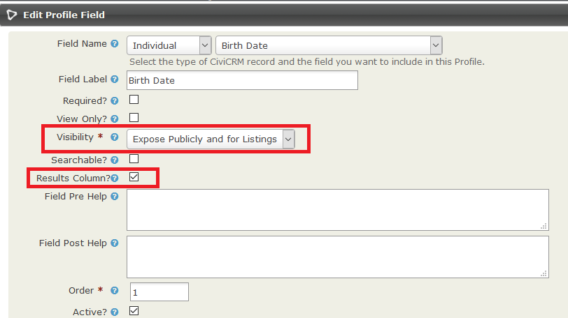

For more information about creating Profiles, see [Profiles](../organising-your-data/profiles.md) in *Organising Your Data*. You can combine a search view with the “Batch Update via Profile” action to view and update a chosen set of fields across multiple contact records.

### Search settings

**Search Operator** determines whether criteria are combined with AND or OR. For example, to find individuals who are in the Volunteers group **and** have a Volunteer Training activity, use AND. To find everyone who is in the group **or** has that activity, use OR.

**Search in Trash** lets you search for contacts that have been deleted but not permanently deleted. Deleting a contact moves the contact and all related data to trash. Only users with the relevant permission can search in trash and restore a contact from it.

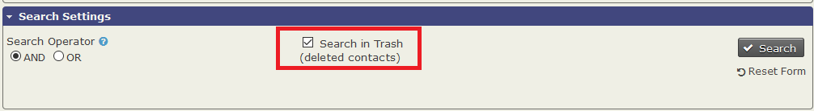

### The date range filter

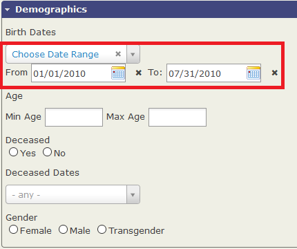

Most component searches include a date range filter. You can use:

- An absolute range, such as “1st Jan 2010” to “31 July 2010.”
- A relative range, such as “Previous week.”

Relative ranges are especially useful for searches you intend to save as Smart Groups: automatically populated groups configured to include contacts who share characteristics or activities. See [Groups and tags](../organising-your-data/groups-and-tags.md) in *Organising your data*.

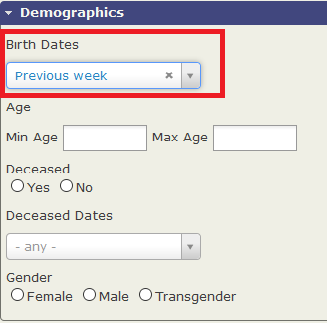

You might use a relative date range to find:

- Contacts who contributed in the last 7 days (Relative date range - “From 1 Week ago”).
- This (financial) year’s registered Event Participants (Relative date range - “This Year”).
- Contacts who are a certain age.

Relative date filters using the “week” interval assume Sunday is the first day of the week. This differs from conventions in Europe and many countries in the Asia/Pacific region, where Monday is considered the first day. To set the first day of the week, go to **Administer > Localization > Date Format**.

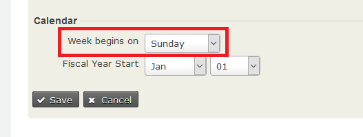

### Combining search criteria

Different criteria are combined by “ANDing” them. For example, selecting the tag “major donor” and the country “Mexico” returns major donors from Mexico, but not major donors outside Mexico or other contacts in Mexico. You can change the default search operator from AND to OR in Search Settings.

Within criteria groups that let you check more than one value, those options are also combined by “ANDing.” For example, you can search for contacts whose Preferred Communication Method is both Email *AND* SMS.

Values selected from a dropdown list that allows multiple selections are always combined with OR. For example, you could find contacts who live in Alaska or Arizona.

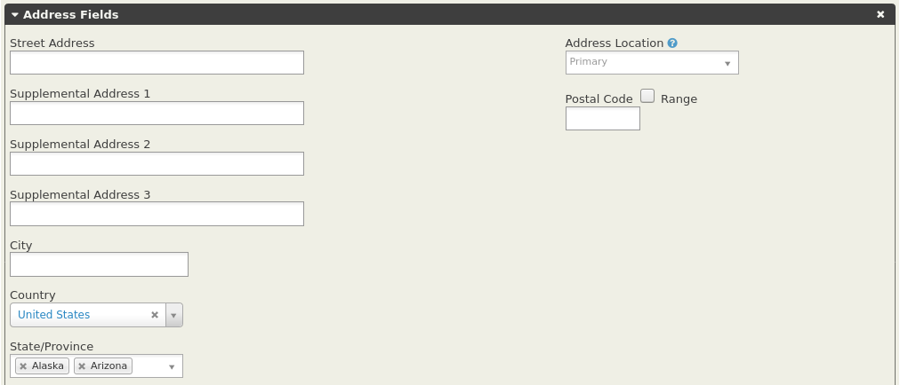

When you expand a dropdown section and make selections, a cross appears at the right end of its header to show that the panel is used in the search. To stop using Address Fields, closing the panel is not enough: click the cross on its header.

### Limitations of Advanced Search

The Advanced Search is an effective way to search for many things in CiviCRM. However, there is an issue with searches where Contacts are the client in more than one Case, and they are engaged in the same Activity Type in each of these Cases. The Advanced Search is currently not able to filter these Activities correctly by Case Type. This issue is expected to be resolved in the near future.

## Full-text search

Use Full-text search to search for text values in all fields of the database. For example, if you remember words you entered in an activity description but have forgotten the contact’s name, you can search for those words to find the contact and activity.

## Component searches

Most CiviCRM components provide a search for their own data, such as **Find contributions** and **Find members**. These forms work similarly to **Advanced Search**, but return rows of the component’s main objects rather than contacts. **Find Members** returns memberships, **Find Participants** returns event registrations, and **Find Contributions** returns contributions.

Each component search has its own Action list. See the *Component* chapters for details.

You can also use Advanced Search with **Display Results As** to search for component objects using criteria available in Advanced Search. For example, you could find event attendances from contacts who are also members.

## Search results actions

After results appear, an Actions box above them lets you select all records or specific records and act on the selection. See [search result actions](search-result-actions.md) for the available actions.

## The contact summary pop-up

Hover over the contact icon in the left column of a search result to see detailed information in a pop-up. To adjust its fields, modify the “Summary Overlay” profile at **Administer** > **Customize Data and Screens** > **Profiles**.

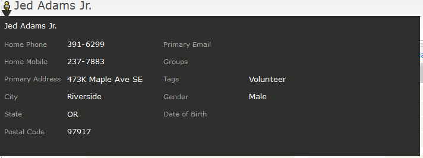

## The wildcard (%)

A wildcard represents any character: a letter, numeral, or punctuation mark. In CiviCRM, the wildcard is `%`; other applications may use symbols such as `*`.

Suppose you need to find a first name similar to “Michael,” possibly “Michelle” or “Michał.” Searching for “Mich%” finds these variations, including “Micheal.” You can place a wildcard before, after, or within a word. For example, searching on 'Mich%el' will exclude “Michał” and “Micheal” but still find “Michelle” and “Michael.”

Using `%` alone can produce unexpected results when a database value is empty rather than NULL: it also returns empty values. To find records with at least one character in a field, use `%_%` instead. This excludes empty and NULL results.

## Case sensitivity

Searches for character strings are not case-sensitive. Searching for 'brooklyn' can return 'Brooklyn' or 'BROOKLYN'. Entering “mi%el” in lowercase can also find contacts whose names contain an uppercase 'M'.

## Default number of rows to be returned

In CiviCRM Advanced Searches and reports, the number of rows displayed on screen was previously 50 by default.

As of CiviCRM version 5.39, System Administrators can change the number of rows displayed under **Administer** > **Customize Data and Screens** > **Search Preferences**. Avoid setting the number too high: a higher number makes the screen slower to load.

## SearchKit

**SearchKit** is more powerful than Advanced Search but requires more technical knowledge. It is suitable for site builders and power users. See [SearchKit](../searching/searchkit/what-is-searchkit.md).

<!-- Source: searching/searching.md -->
