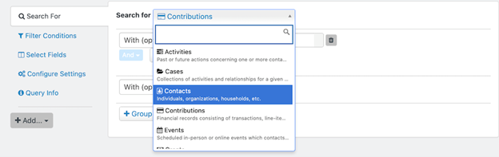
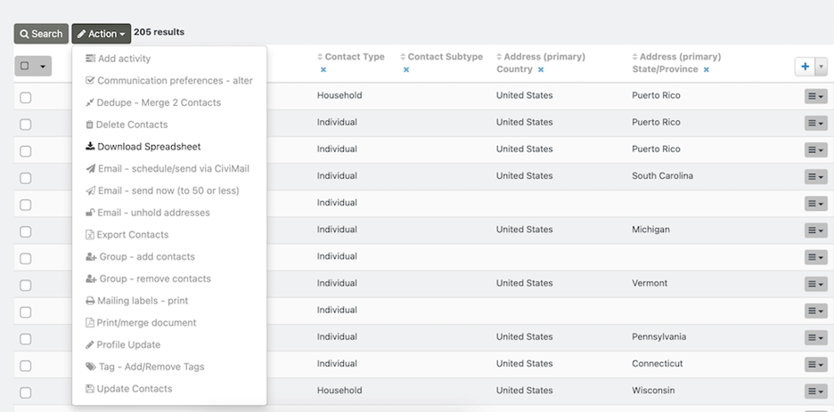
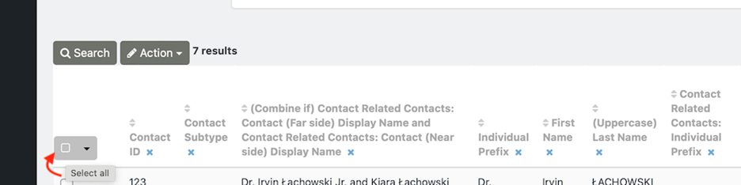
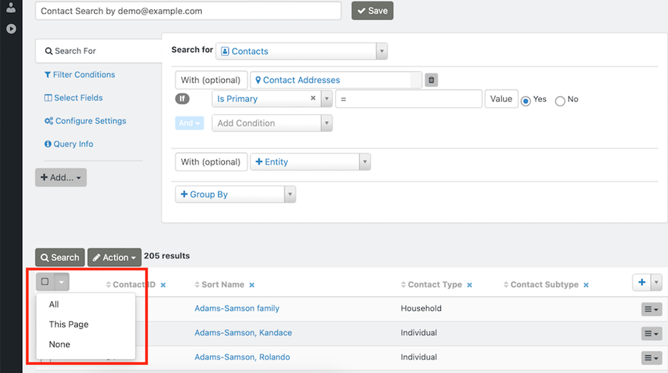

# Use actions on Search Kit results

After you build a search, the available actions depend on the entity selected. For example, searching for Contacts offers different “Action” options from searching for Contributions.

To make more options under “Action” selectable, select one or more search results. Otherwise, only “Download Spreadsheet” will display.

You can select individual results, click the dark gray box to select all results, or use the dropdown arrow at the upper-left of the results listing to select all results, all results on the page, or no results.

For descriptions of the primary actions available for each selected entity, see [Search Result Actions](../search-result-actions.md).

<!-- Source: searching/searchkit/actions.md -->
