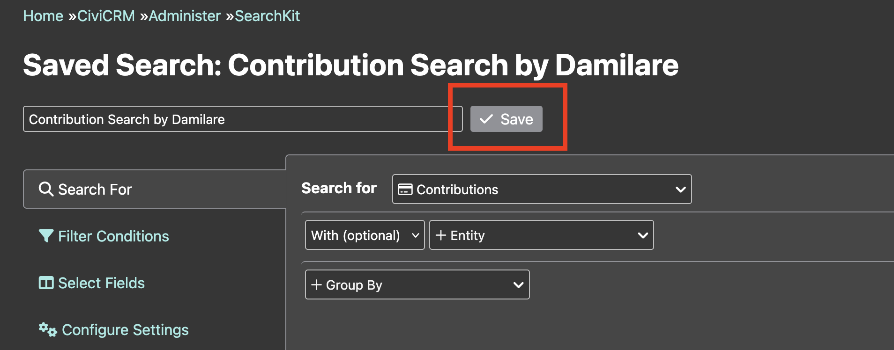
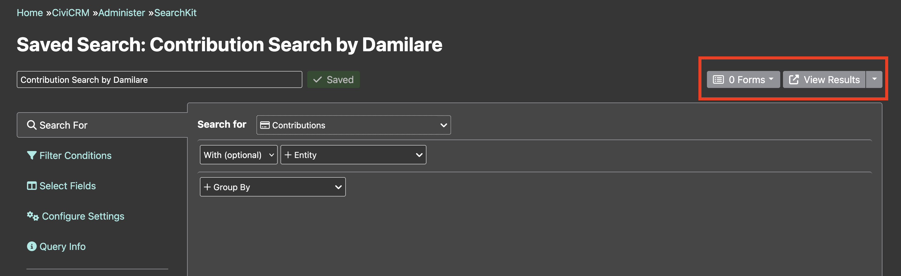
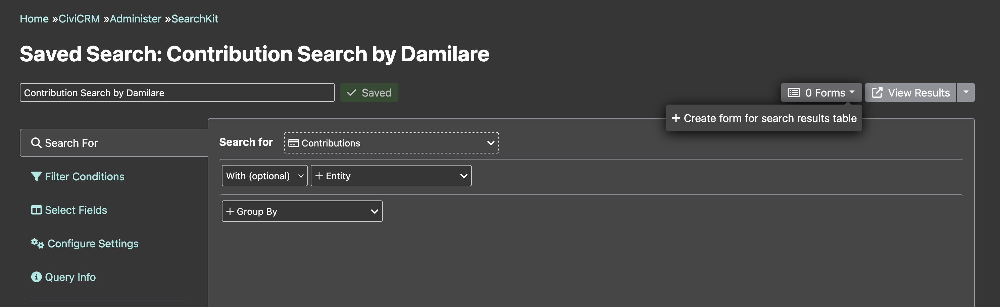
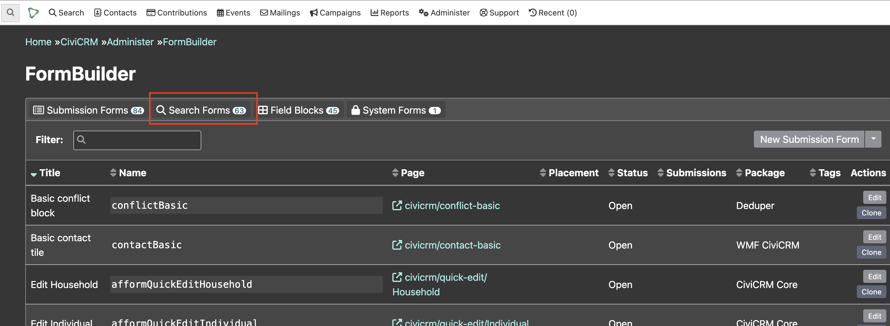
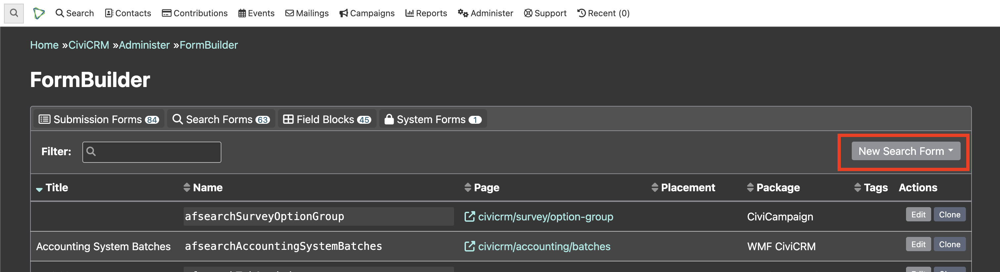
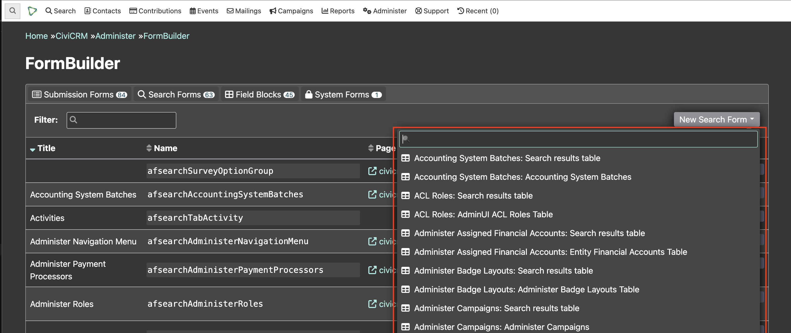
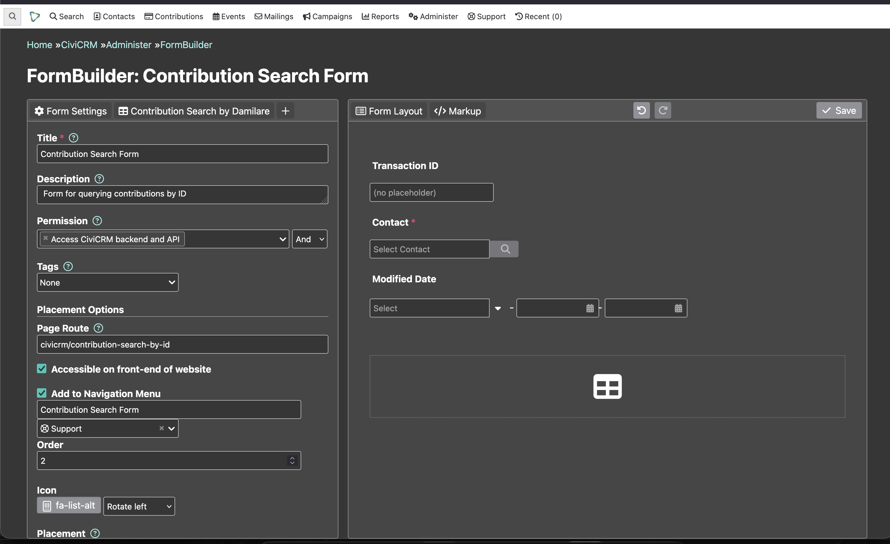

# Creating a FormBuilder interface for the Search Display

Once the Search Display has been created, FormBuilder is then used to create an interface to make this display available for users.

## Create the form
A SearchKit saved search is required to create a Search Form. The form can be created either directly from the SearchKit interface or from the FormBuilder interface.

### From the SearchKit table
1. Create a [SearchKit entity table](https://docs.civicrm.org/user/en/latest/searching/searchkit/what-is-searchkit/#forms) or reuse an existing SearchKit table.
2. After creating the search, enter an appropriate name for it and click **Save**. 
3. On successful save, two buttons will be displayed on the right side: **Forms** and **View Results**. 
4. Clicking **Forms** shows a list of existing FormBuilder forms and a button to create a new form using the saved search. Clicking that button navigates to the FormBuilder editor page. 

### From the Formbuilder UI
Search forms can also be created using existing SearchKit entity tables. The steps for this are as follows:
1. Navigate to the FormBuilder UI by selecting **Administer > Customize Data and Screens > FormBuilder**.
2. On the FormBuilder UI, click on the **Search Forms** tab to see the list of existing Search Forms and to create a new one. 
3. Clicking the **New Search** button shows a dropdown of existing SearchKit saved searches. 
4. Selecting the desired search will navigate to the FormBuilder editor page. 

## Configure the form settings

The form configuration screen can be broadly grouped into two parts:

1. a configuration pane (left) that contains:
    * the title (required and visible on the form)
    * the description (highly recommended for clarity)
    * the permission required to access the form
    * the url at which the form will be found (must start with `civicrm/`)
    * a checkbox as to whether the form should be accessible from the website front end
    * a checkbox to add the form to the navigation menu
    * a "Placement" drop-down where you can make the form available in a number of places, including the Contact Layout editor, the dashlets interface, a Contact summary tab or block, or to be accessed via tokens
2. a layout pane (right) that contains:
    * a placeholder for the SearchKit display in the right-hand window
    * a list of the fields that could be exposed as form filters
    * options for specifying hidden filters

### Search Form configuration UI
  

## URL filters in search forms

For search forms with pages you can make them get filter values from a special part of the URL. This means you can **link to filtered views** of the search form, e.g. from another search form (by using tokens in the Link URL field.)

When looking at the left-side panel with a search display tab selected while editing a form, there's an option called Filters. Select a field, e.g. *Hair color*, then select URL and then type a codename, e.g. `haircolor`. If the field you want is missing, it's because that field has not been added to the Search, so jump back and do that first.

To use this feature, the URL can be constructed like this:
`https://your.example.org/civicrm/path/to/your/searchformpage/#?haircolor=brown` i.e. appending `#?haircolor=brown`. If you had multiple such filters, you would add subsequent ones like `#?haircolor=brown&hairlength=short`.

When the field has a `:` in it that indicates that the field is a 'pseudoconstant'. The underlying database value is generally a number which maps to a name and label. In this case the database field `payment_instrument_id` is a number. In some cases we know the number instead, in which case we could use `payment_instrument_id=1` in our URL or `payment_instrument_id:name=Cash`. As well as being more readable and discoverable, this variant is more useful for implementers who work with multiple sites, since the actual ID numbers will likely change between sites, but the `name` is fixed.

You can get the exact field name needed by adding the filter on the form setup.

If the field is already filtered (e.g receive date before this week) then the URL filter will further narrow down the results rather than replace the existing filter.

The following formats are acceptable for dates:

- `receive_date=2021-09-23`
- `receive_date=20210923`
- `receive_date=20210923234040` (i.e. time is 23:40:40)
- `receive_date=this.month` (See [the list](../relative-date-formats.md))

You can also filter with the same value on one of a set of multiple fields by adding a hidden field to your form, adding additional fields with Combine multiple fields and then copying the resulting field name from the Markup tab to use in your url.
For example, if you want to filter on both first name and last name, you could add the first name field to your form, make it a hidden field, and then use Combine multiple fields to add the last name field to that field. Now you can filter on both fields at once by appending `#/?first_name,last_name=foo` to your form URL.

<!-- Source: searching/searchkit/connecting-searchkit-to-formbuilder.md -->
