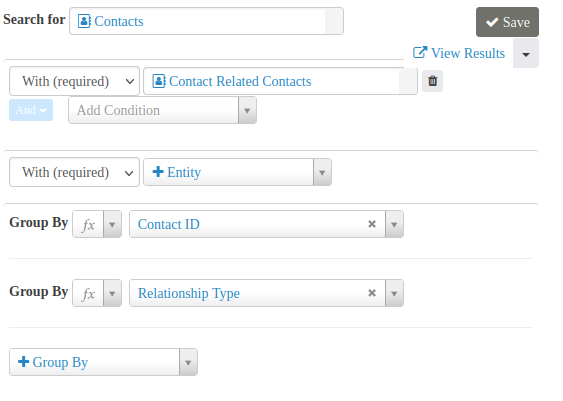
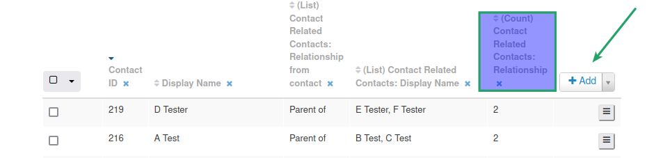
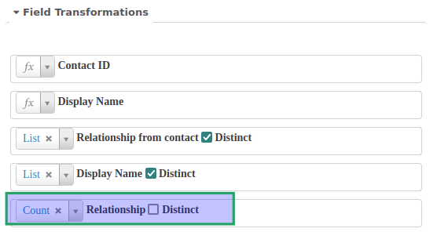
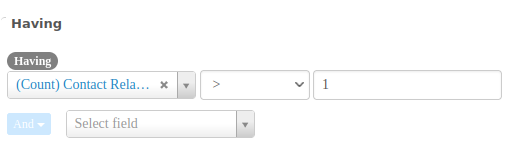

# Example: Listing Contacts who have relationships of the same type

You may want a list of contacts who have more than one (or any number) of the same relationship type. For example, a children’s summer camp could find contacts who have more than one child, then turn the results into a mailing list to offer enrollment discounts to multi-child families.

## Step 1: Create a new search and set initial criteria

1. Go to **Administer &gt; Search &gt; SearchKit** and click **New Search**.
1. Ensure that the default **Contacts** is selected as the primary entity to Search for.
1. Select **With (required)** and **Contact Related Contacts** on a new entity.
1. Click the **+Group By** button and group by both **Contact ID** and **Relationship Type**.

## Step 2: Add the Relationship column to the search

1. Below the criteria, click **+Add** and select **Contact Related Contacts: Relationship**.
1. Though not necessary, you may also add the **Contact Related Contacts: Relationship from contact** column to indicate the relationship type, especially if your search includes more than one type of relationship.

## Step 3: Transform the Relationship column

1. Click **Field Transformations** just below the **Having** drop down list.
1. Select **Count** as the transformation for **Relationship**.

## Step 4: Add a Having clause

1. Under **Having**, select **(Count) Contact Related Contact: Relationship** from the Select field drop down list.
1. For this scenario, select the greater than symbol (&gt;) and enter 1 in the field to its right.
1. Click **Search** to view your results. Name and save your search as well.

<!-- Source: searching/searchkit/example-contacts-with-same-type-relationships.md -->
