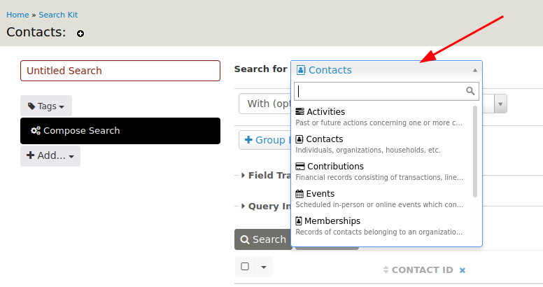
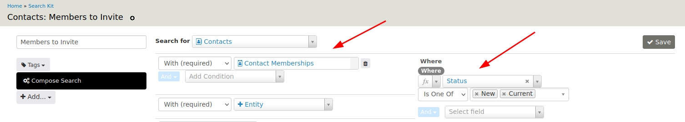
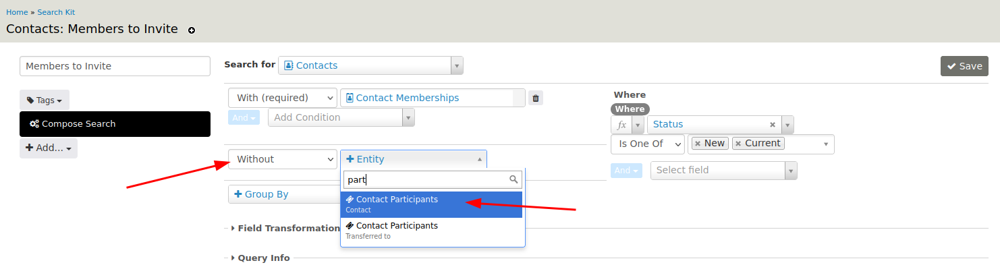
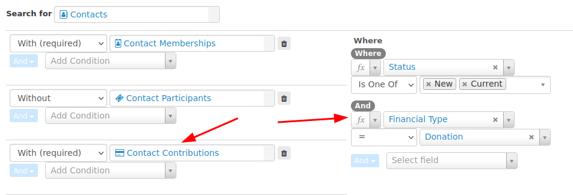
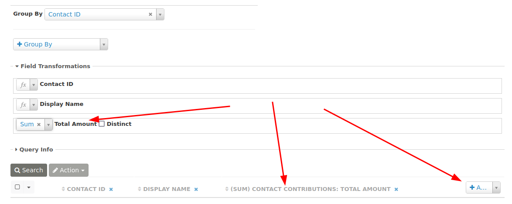
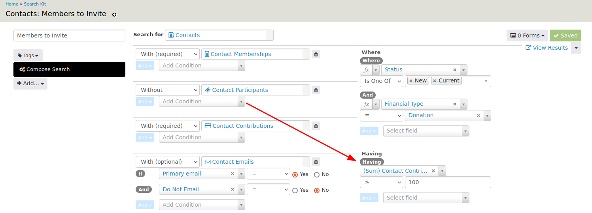
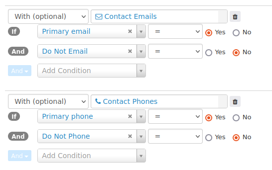
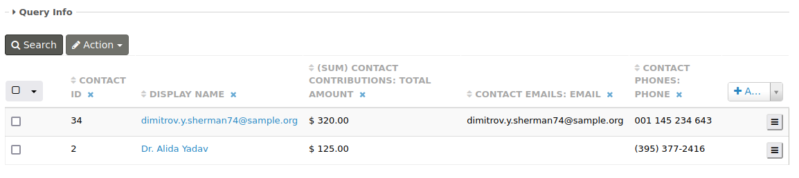
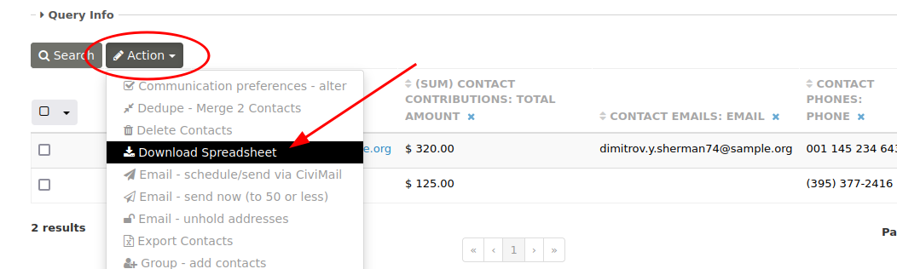

# Create an invitation list for donor members

This example builds an invitation list for members who are major donors and have not previously attended an event.

## Step 1: Select current members

On the SearchKit page, click **New Search** and choose a base entity in **Search for**. The base entity cannot be changed once the search has been saved.

You could start with Contacts and link Memberships, or start with Memberships and link Contacts. Because the goal is a list of contacts, select **Contacts** from **Search for**. Change **With (optional)** to **With (required)**, then select **Memberships** from **+Entity**.

To include only active members, go to **Where** and change Status to **is one of** New and Current.

Enter a name for the search and click **Save**. You can click **Search** to preview the results.

## Step 2: Find members with no event participant record

To find members who have never attended an event, look for contacts without a participant record. Change a second **With (optional)** field to **Without** and select Contact Participants.

## Step 3: Add donors and sum their contributions

Change a third **With (optional)** to **With (required)** and select Contact Contributions. Under **Where**, add a clause that sets Financial Type **=** Donation.

A contact may have multiple donations. To list each contact only once, select Contact ID from **Group By**.

Using Group By enables a Field Transformation, such as combine, count, or sum. To sum each contact's contributions, click **+Add** and select **Total Amount** to add it to the search results. Under **Field Transformation** above the results, select **Sum** from the drop-down menu next to the Total Amount field.

## Step 4: Filter for major donors

To include donors who have contributed at least a specified amount, add a condition on the sum of the total amount. Because the condition uses a field transformation, use **Having** instead of **Where**. Set (Sum) Contact Contibution to greater than or equal to the specified amount.

## Step 5: Add email and phone number

Add the contact's primary email and phone number as entities for the invitation list.

!!! Note:
    * Not every contact may have an email or phone number in the database, so **With (optional)** is recommended.
    * A contact may have specified that they do not want to be phoned or emailed. This is shown on their Contact Summary and needs to be taken into account.

The configured search results will likely look something like this:

## Step 6: Export as a CSV file

Click **Actions** above the search results to see available actions, including downloading the data as a spreadsheet (CSV file).

<!-- Source: searching/searchkit/example-donor-members-to-invite.md -->
