# Create a public membership list

An organization with several levels of membership may want filterable, searchable lists on its website populated by live data from CiviCRM. This tutorial uses SearchKit and FormBuilder to create a logo grid with tooltips and links to external websites, such as members' websites. Visitors can filter the grid by membership type.

## Step 1: Create a new search and define the data

Go to **Administer &gt; Search &gt; SearchKit** and click **New Search**. Then:

1. Give the search a title name (e.g. "Our Members") in the box labeled "Untitled Search".
2. Select Memberships from the **Search for** list.
3. Add a **With** for Membership Contact so that data can be pulled from the member's contact record (e.g. the display name to show in a tooltip).
4. Add a second **With** for Contact Websites to access the link to the member's homepage.

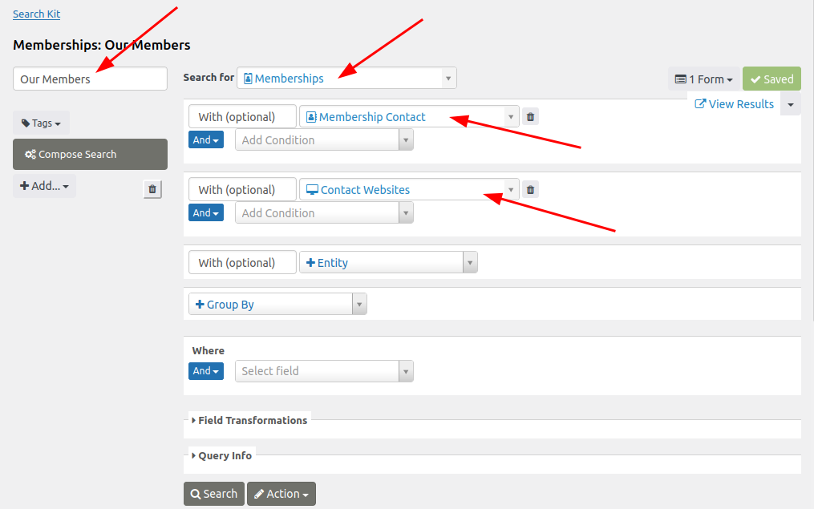

Tap **Search** to check the results. The criteria above returned six memberships. When you add Membership Contact and Contact Websites, SearchKit automatically adds some columns with data from these sources:

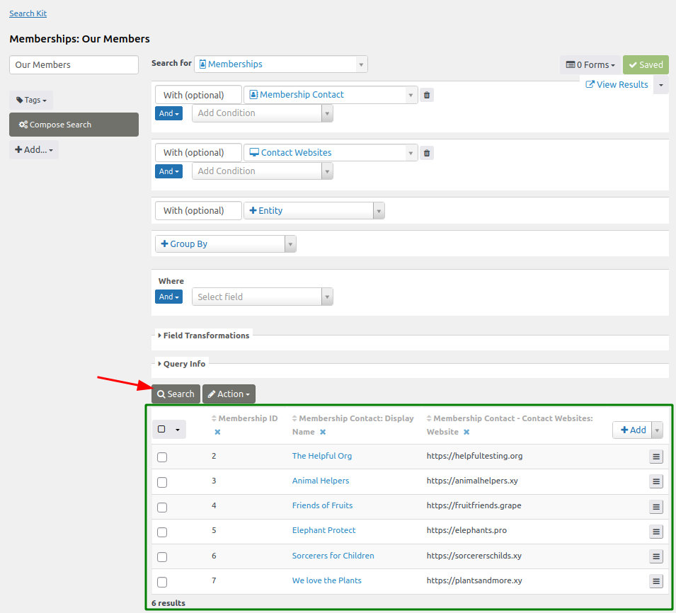

## Step 2: Add columns to output additional data

The displayed columns determine which data the search returns. To add a column for the logo URL:

1. Tap the **+Add** button at the top right of the results table.
2. Choose the column to display (e.g. Membership Contact: Image URL).
3. Refresh the results display by clicking **Search**.

This selection uses the standard contact image. Using custom fields, such as a different image, requires adding another data source first.

The results will now look like this:

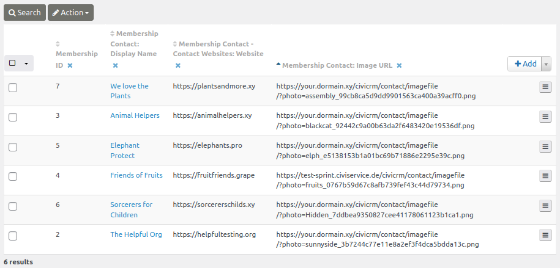

!!! Tip
    Don't forget to **Save** your work.

## Step 3: Add and configure a grid display

To format the search results, click the **+Add** button underneath the search's title field to add a display. Select a Grid display to organize the output into tiles.

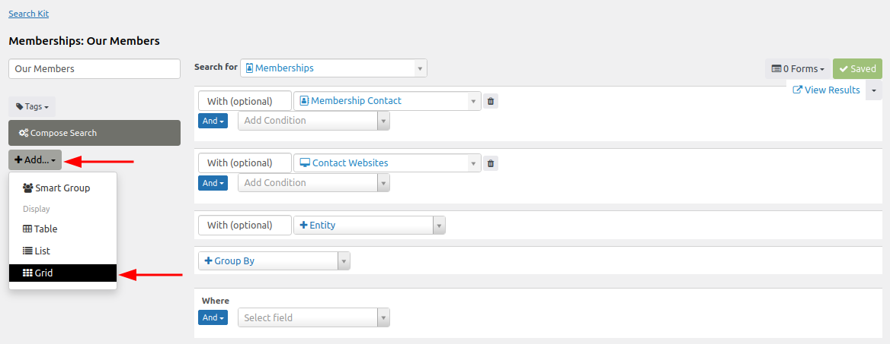

Give the display configuration a title (e.g. "Our Members"). By default, SearchKit adds all the search's fields (columns) to the new display. You can customize these fields, including by dragging and dropping them into a new order.

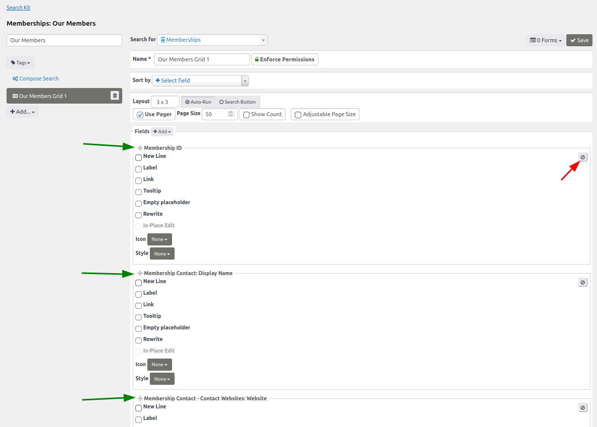

Click **Preview** to see the results in a 3x3 pattern grid below the button at the bottom of the page. At this stage, the display does not yet show the intended logos. To configure it:

1. **Remove** all items that are not needed by clicking the remove symbol (indicated by the red arrow in the screenshot above) in each item's section. Leave only Membership Contact: Image URL for this example.
2. Check the **Image** checkbox to display the logo as an image.
3. Optionally, set size attributes to make the logo sizes match (e.g. adjust the height to 200px).
4. Check the **Link** checkbox, select **'Other...'** from the dropdown menu, and select Membership Contact - Contact Websites: Website from the **token dropdown**.
5. **Attention:** remove `/civirm` from the front of the token:
   `civicrm/[Membership_Contact_contact_id_01_Contact_Website_contact_id_01.url]`
   so that it becomes:
   `[Membership_Contact_contact_id_01_Contact_Website_contact_id_01.url]`
   as the `/civicrm` portion would inhibit the url from reaching the member's external website.
6. Check the **Tooltip** checkbox and make sure the label that pops up to the right is a token for the Display Name.

Click **Refresh** to see the logos displayed as intended:

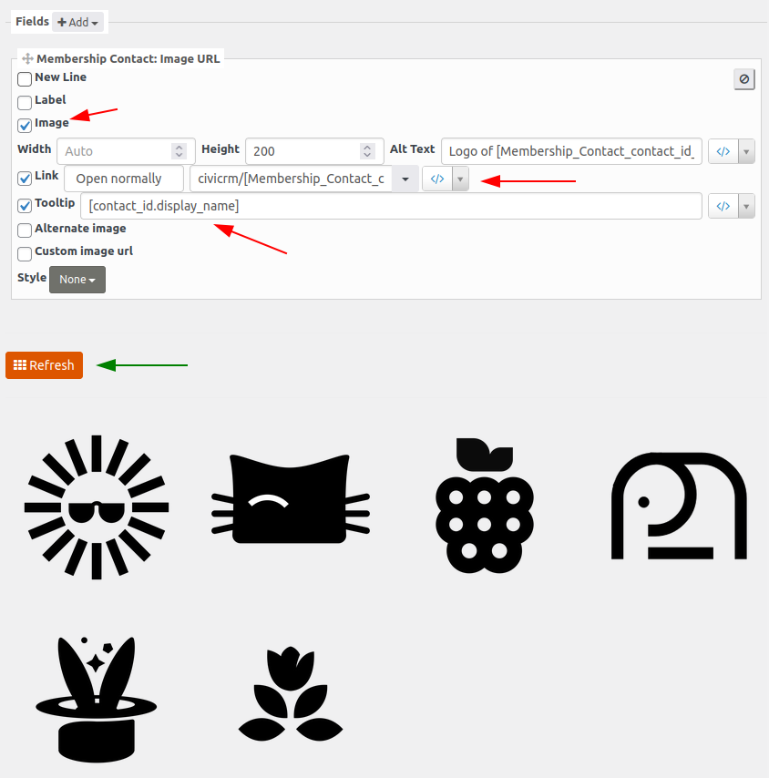

!!! Note
    This configuration will only show members who have logos associated with their record. To include those without logos, check the **Alternative image** box.

## Step 4: Add and configure a form

To show the results on a public website, create a Form. Return to the SearchKit dashboard and click **Forms &gt; + Create Form for Our Members Grid**:

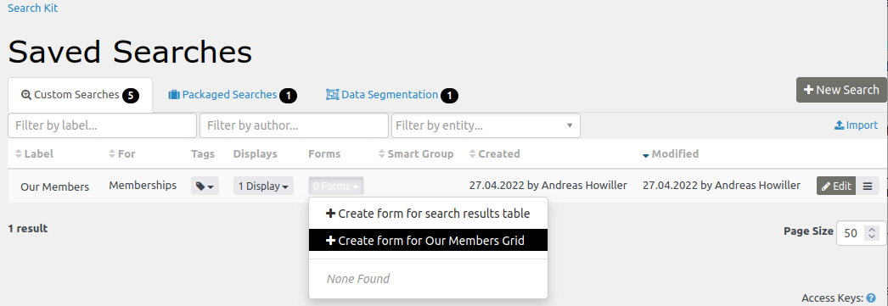

Then:

1. Give the Form a name and a description.
2. Enter the URL for the page on which you want the results displayed (e.g. 'civicrm/members').

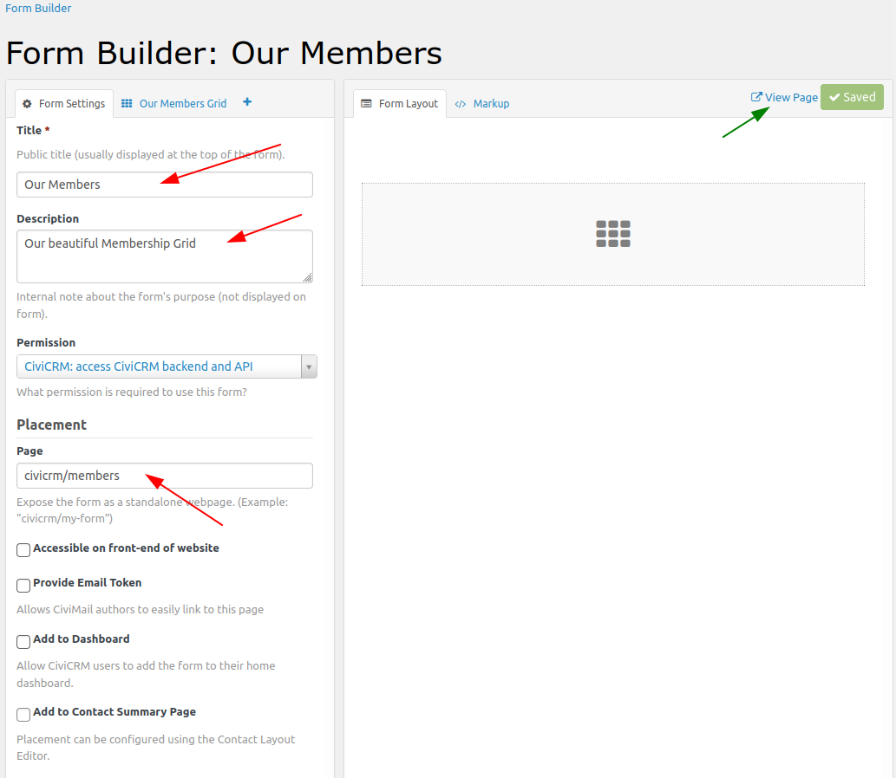

After clicking **Save**, the link **View Page** will appear. This link shows the fully formatted results grid.

To filter which membership types are shown, switch from the **Form Settings** tab to the **Our Members Grid** tab and drag the item Membership Type into the **Form Layout** tab.

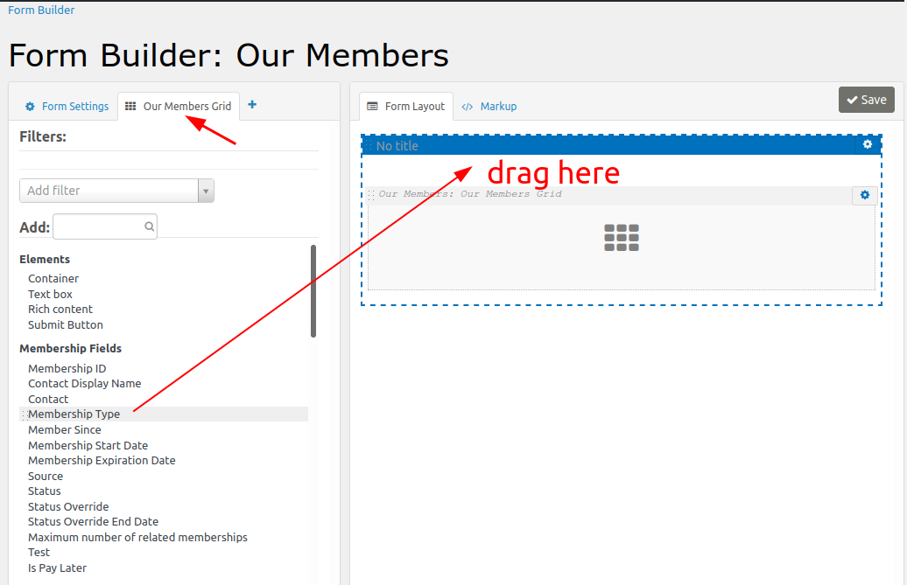

Then:

1. Change the preset of the filter so that it shows the desired membership types.
2. Change the layout details, such as the title of a container element.

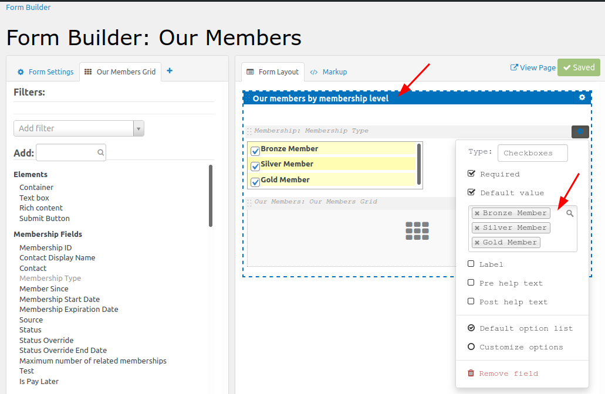

So long as you are logged into your CiviCRM account, the specified URL (e.g. your.civicrm.tdl/civicrm/members/) will display the configured Form.

## Step 5: Set permissions

To make the form accessible to anonymous users, return to the search's display configuration and unlock the **Enforce Permissions** button by clicking it. Once clicked, the button will read **Bypass Permissions**, as shown below.

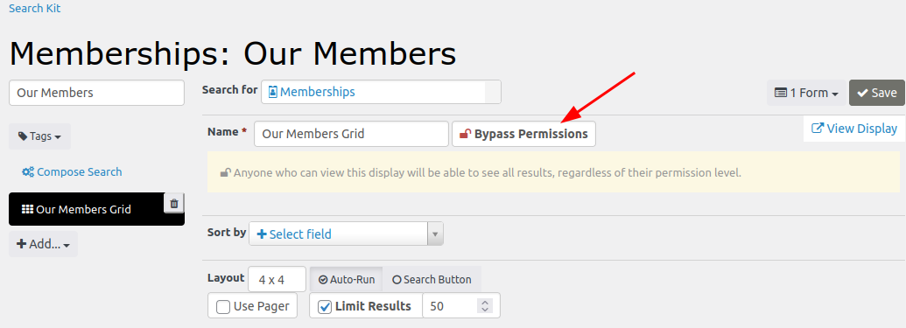

**Save** before going back to the Form configuration.

To make the page containing the results grid viewable on a public website:

1. Remove all restrictions by selecting 'Generic: Allow all users (including anonymous)' from the dropdown list.
2. Check the **Accessible on front-end of website** box.

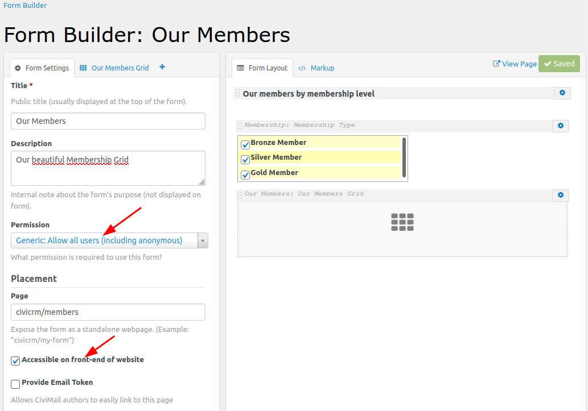

Users, whether logged in or not, will now be able to view and filter the form.

<!-- Source: searching/searchkit/example-membership-listing.md -->
