---
title: Example: Upcoming Events
category: tutorial
topic: searchkit
subtopic: upcoming-events
component: SearchKit
audiences:
  - administrators
level: intermediate
journey_stage: plan-and-configure
summary: Build an upcoming events overview with participant counts, links, optional filters, and a navigation menu item.
extensions: []
related: []
review_priority: high
review_notes:
  - Entity settings and participant filters needed to reproduce the search are shown in images but are not fully specified in the text.
source_path: searching/searchkit/example-upcoming-events.md
official_url: https://docs.civicrm.org/user/en/latest/searching/searchkit/example-upcoming-events/
---

# Example: Upcoming Events

When you click the **Event** tab from the toolbar and then select **Manage Events**, the default event overview looks like this:

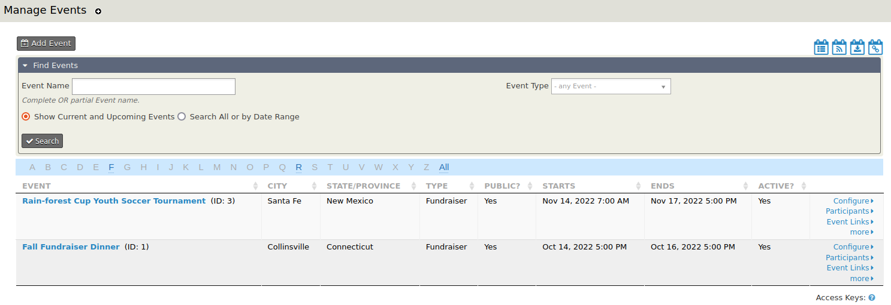

SearchKit provides the option to create an alternative to the Manage Event overview screen that can be customized in many ways:

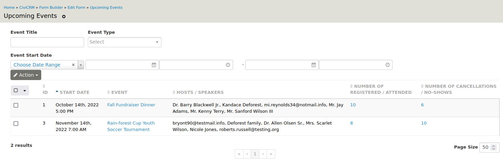

This SearchKit-built overview includes:

- A clickable event title that leads to the event's Info and Settings page
- A list of speakers and hosts for each event
- The number of registered/attended participants
- The number of cancellations/no-shows
- Clickable registered/attended and cancellations/no-shows numbers that lead to lists of participants with those statuses

The following steps show how to create this overview.

## Step 1: Create a new search

Go to **Administer > Search > SearchKit** and click **New Search**.

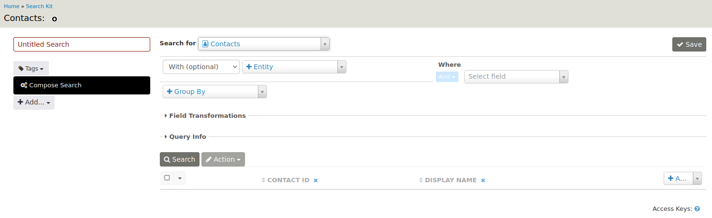

1. Enter a name for the search, such as Upcoming Events.
2. Select Events from the **Search for** list.
3. In the **Where** section, use the drop-down fields to select **Event Start Date**, then **>=**, then **Now**. You can also **Pick a Date** or tailor the search with other options.

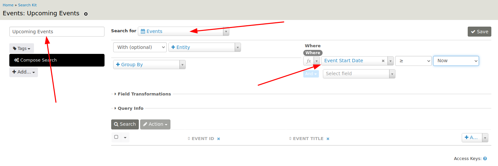

!!! Tip
    Don't forget to **Save** your work.

Click **Search** to view the result.

## Step 2: Add event columns

By default, the results show the event ID and event title. For this example, also add the event start date by selecting that column from the list on the right-hand side.

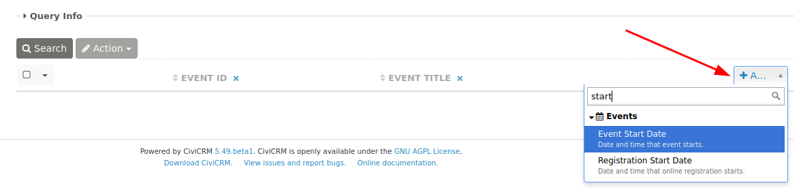

## Step 3: Add participant information

The search currently shows only event information. To show the event's hosts and speakers, add the participants entity:

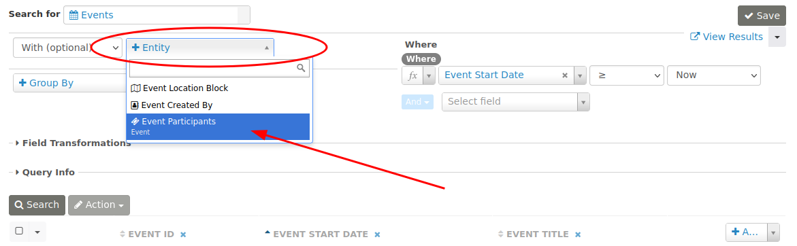

Add a filter on role in **Where**:

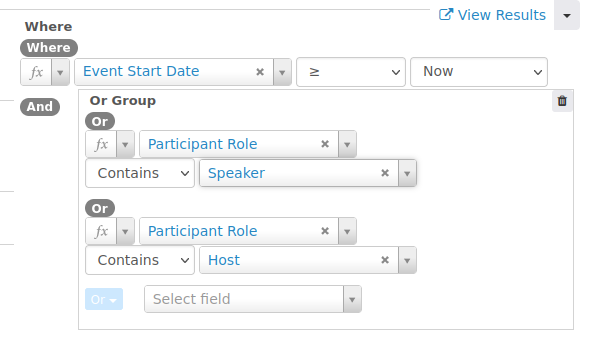

Use Contains because a participant can have multiple roles, which are stored in the participant role field. The participant role should be either Speaker or Host.

Finally, add the Participant Contact entity to show the names of speakers and hosts. The search now looks like this:

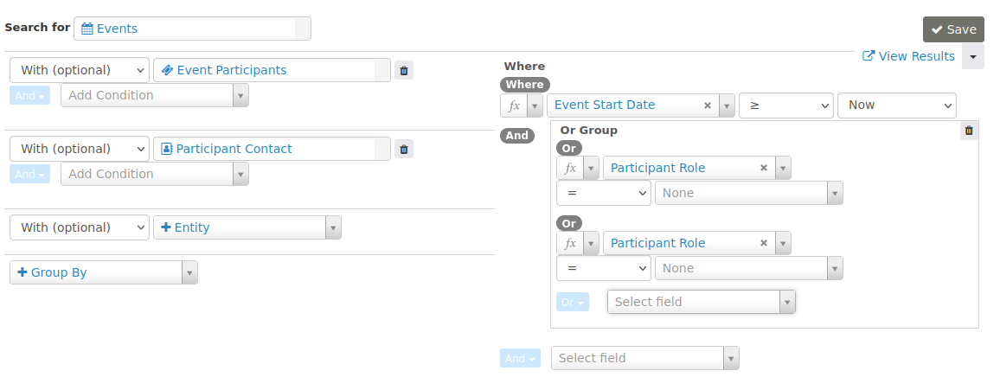

## Step 4: Group on event ID

If you run the search now, an event appears multiple times when it has more than one speaker or host. Group on event ID to avoid this:

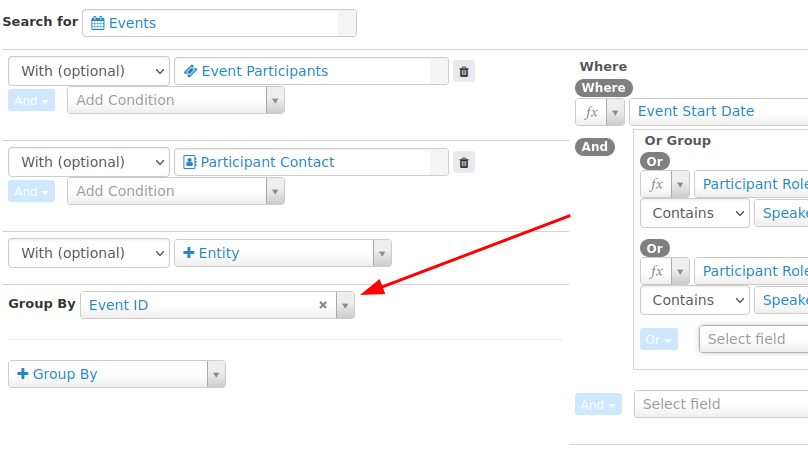

Use a field transformation to display the speakers and hosts as a comma-separated list:

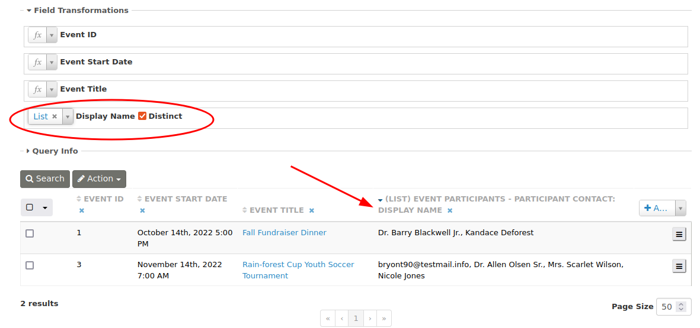

## Step 5: Add the number of participants

To add the number of participants, use the **Count** field transformation on Participant ID. Using it now would count only hosts and speakers because of the filter in **Where**.

Add Event Participants again as an entity:

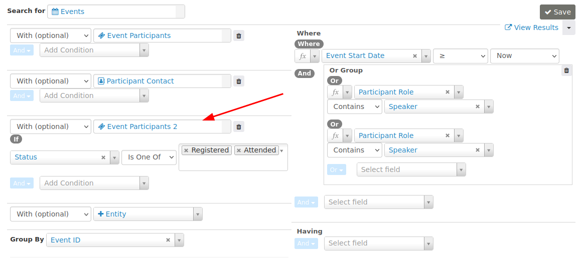

To display a count of no-shows and cancellations, add another Event Participants entity:

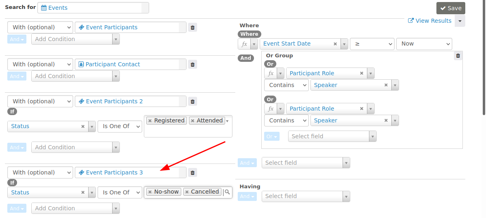

Click **Add** on the upper right side of the search results display to add the Participant ID (2 and 3) columns. Under **Field Transformations**, select **Count** and check the **Distinct** box next to the Participant ID (2 and 3) labels:

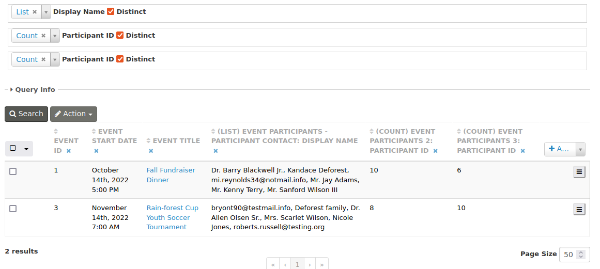

## Step 6: Change column names and sort order

To change the column names, first create a table display. Click **Add...** on the left side of the form, under **Compose Search**, and select **Table**.

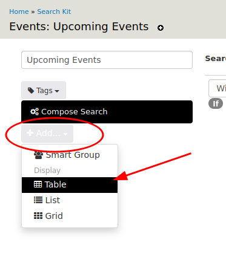

Give the display a name and add a Sort By:

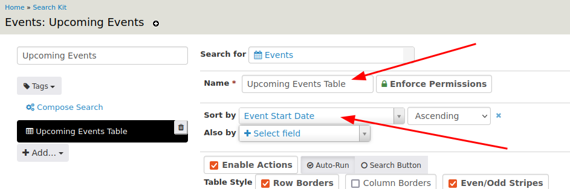

Scroll down and give the columns meaningful names in the Header fields. The preview might now look like this:

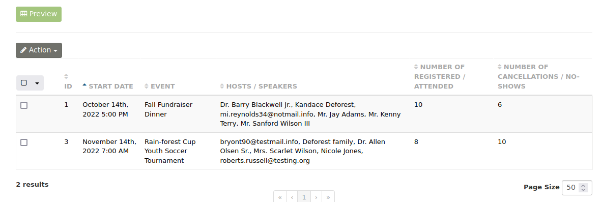

## Step 7: Make the values clickable

Add a **Link** to each participant count's respective overview page:

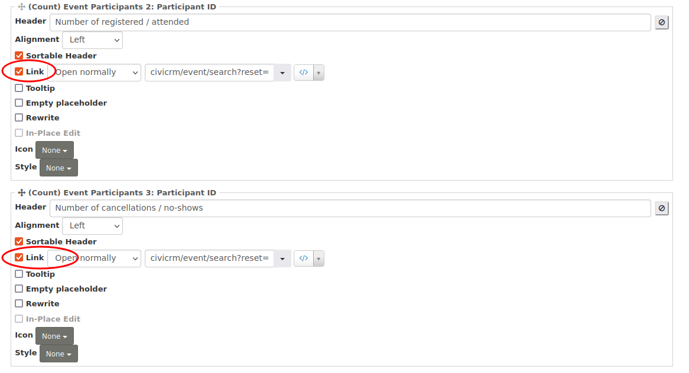

For the registered/attended count, enter:

- civicrm/event/search?reset=1&amp;force=1&amp;event=[id]&amp;status=true

For the cancelled/no-show count, enter:

- civicrm/event/search?reset=1&amp;force=1&amp;event=[id]&amp;status=false

You can also add a **Link** to the event title:

- civicrm/event/manage/settings?reset=1&amp;action=update&amp;id=[id]

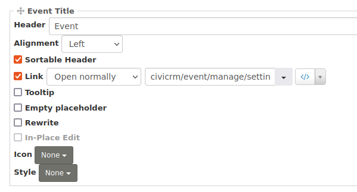

This link leads to the event's Info and Settings page. The result looks like this:

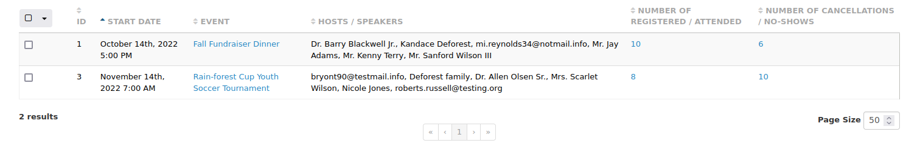

## Step 8: Add optional filtering

You can add a form above the upcoming events list for optional filtering. Use the button in the upper right corner of the search:

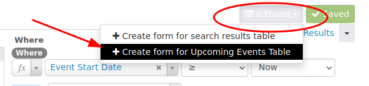

This opens FormBuilder. Give the form a name and a page link:

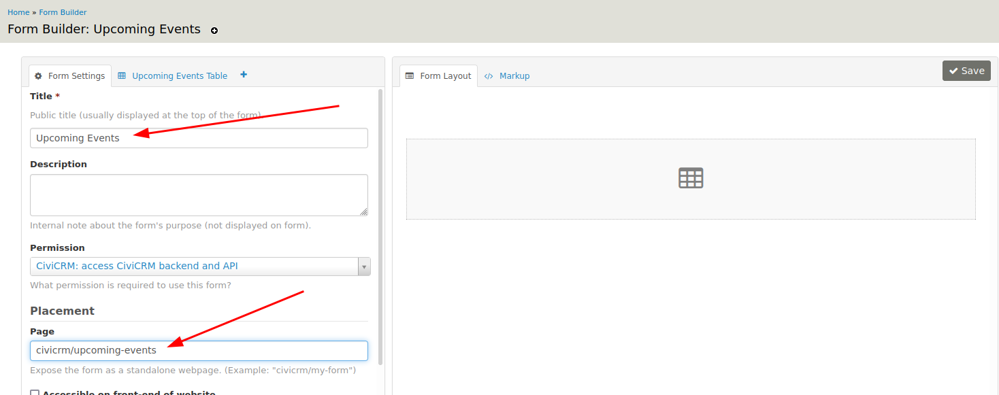

Click the **Upcoming Events Table** tab. Drag and drop the form elements into the form layout pane:

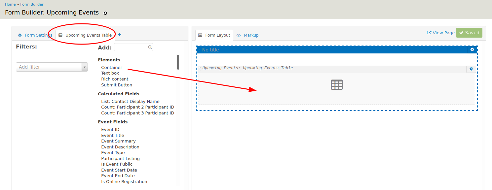

You may want to add a Container first to lay out the other form elements:

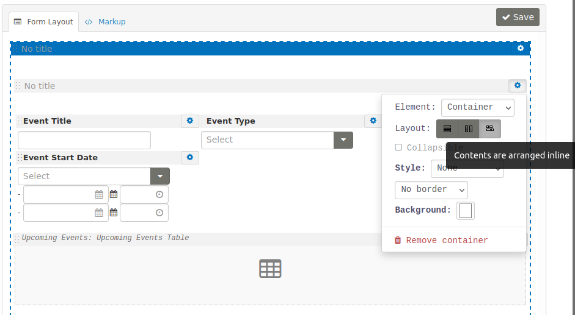

## Step 9: Add the overview to the navigation menu

The page link specified for the form in the previous step is **civicrm/upcoming-events**. You can create a navigation menu item with this link.

See **Administer > Customize Data and Screens > Navigation Menu**.

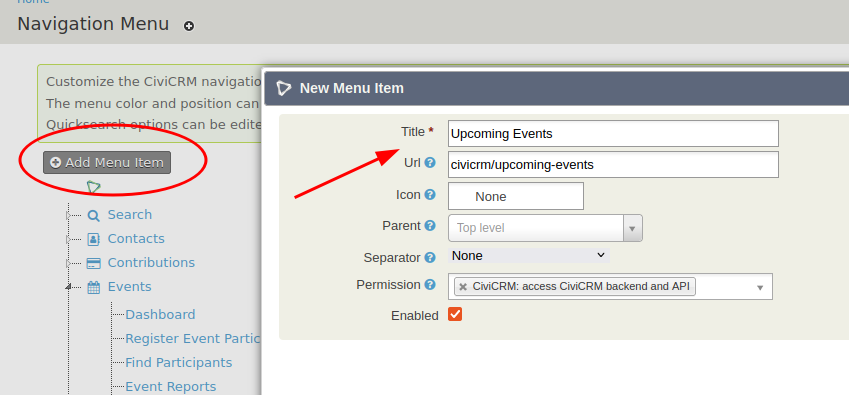

Users can then access the upcoming events from the menu:

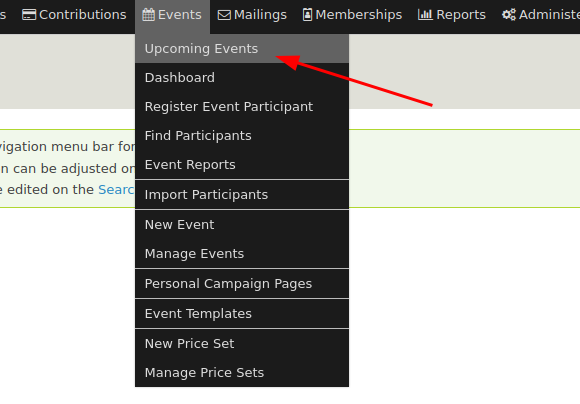

The menu item leads to the finalized search form:

<!-- Source: searching/searchkit/example-upcoming-events.md -->
