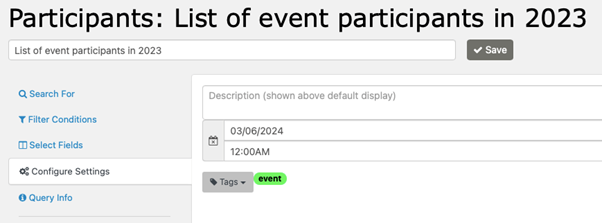
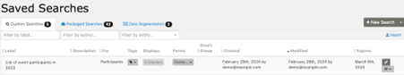

# Expiration date

Some searches are useful only for a defined period. You can set a date for a saved search to be removed from the list instead of manually cleaning up saved searches.

## How expiration works

The expiration date is set:

The search is given an expiration date:

Searches are not deleted after the expiry date; they are only hidden from the display. They can only be restored to the display by deleting the expiry date via the API explorer or SQL statement.

<!-- Source: searching/searchkit/expiration_date.md -->
