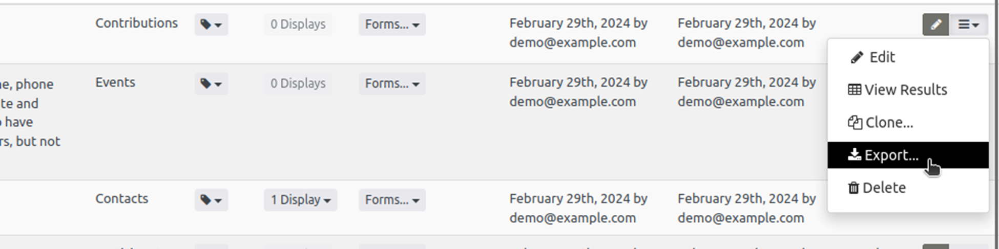
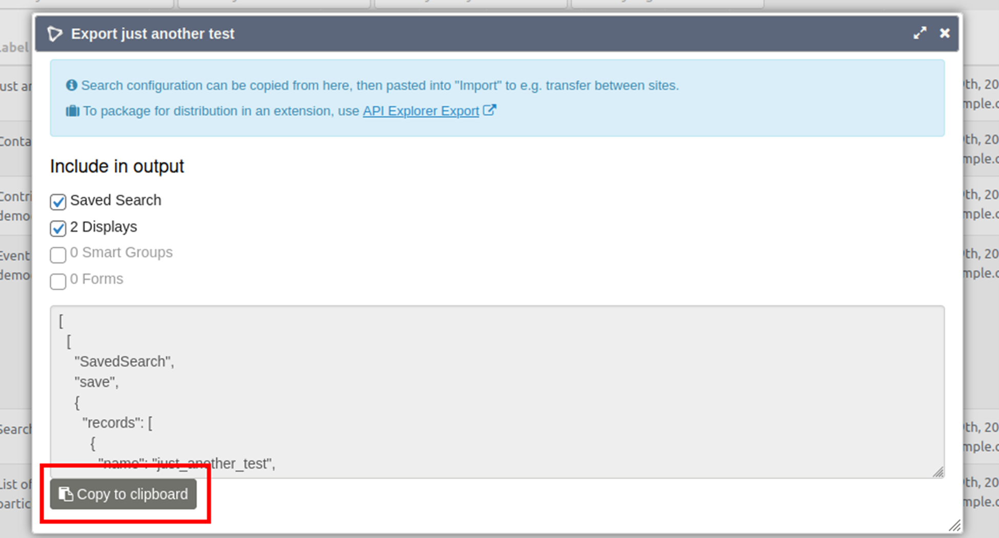
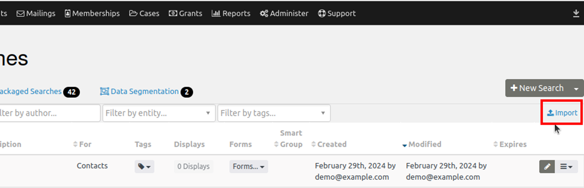

# Export and import SearchKit searches

You can export saved SearchKit searches to share them with others, and import searches that have been shared with you. This requires some comfort with moving code around, but not with creating it. You can do it all through the graphical interface.

## Export a saved search

Export is available only after you have saved your SearchKit query.

1. Visit the main SearchKit page and choose “Export” from the additional actions menu (☰) beside your saved search.

   

2. In the export window, copy the coded version of your search to your clipboard. If you have created associated displays, groups or forms, you can include them in the export.

   

If you want to include the saved search in a custom extension, use “API Explorer Export” instead. Its link is at the top of the export window.

Once you have copied the SearchKit query, you can save it in a file for future reference, import it into another site, or send it to someone else to use and modify on their system.

## Import a saved search

1. Go to the default SearchKit page and click the “Import” link just under the “New Search” button in the top right corner.

   

2. Paste the exported search into the empty box and submit it. You’ll return to the main screen, where you can see the newly imported search.

<!-- Source: searching/searchkit/export-import.md -->
