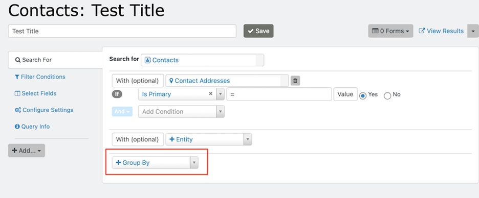

# Group by

“Group By” organizes data around one or more common elements of the selected entity. When you execute the search, the results display one row per value of the selected “Group By” fields.

For example, searches of Contacts can group results by **Created Date**, **Contact Subtype**, and **Location** information, among other options. Searches of **Contributions** can group results by **Contribution Date**, **Amount**, and **Payment Method**, among other options.

## Analyze grouped results

“Group By” can help you analyze patterns and relationships in your data by counting, totalling or averaging numeric information, or concatenating data in other fields.

For example, if you’re looking at contacts and their addresses, you can group the results by **Country**.

In this use case, the results display a count of contacts per **Country**, because search results display one row per element selected.

If you add more than one “Group By” option, additional rows will display upon clicking “Search” for the elements selected. For example, if you group results of your search by **Country** and “**Address (primary) State/Province**”, one row will display for each State/Province of data in the system.

You can drag search result columns left or right to change their display order. If you change the order of the columns, click “Search” again for your results to display.

<!-- Source: searching/searchkit/group_by.md -->
