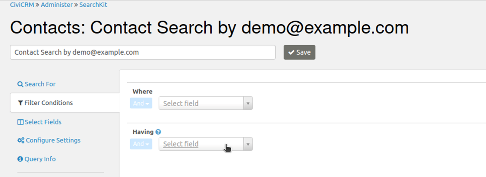
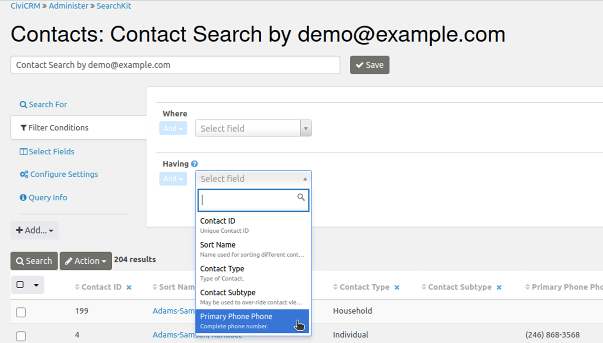
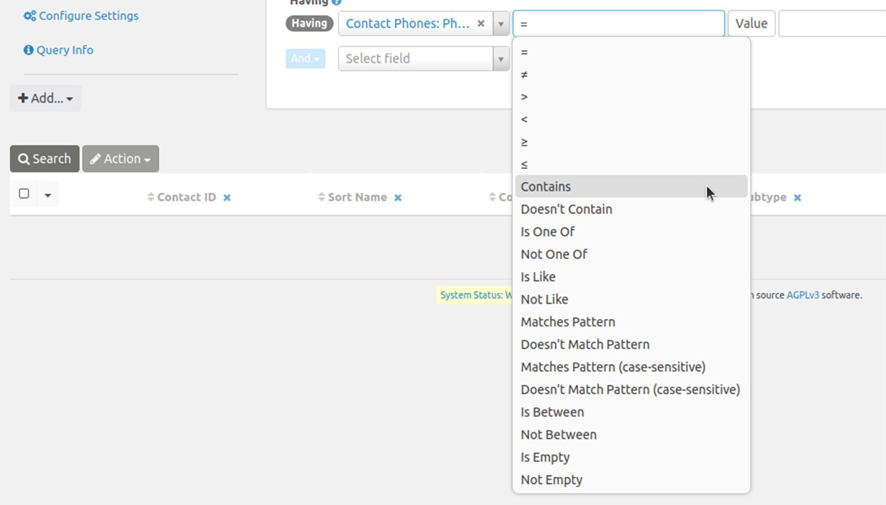
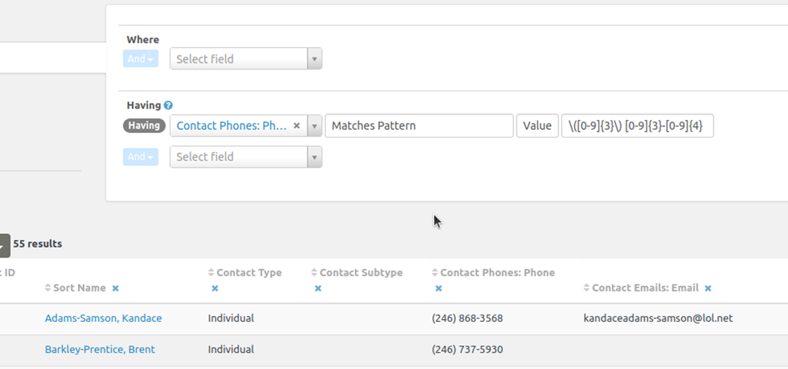
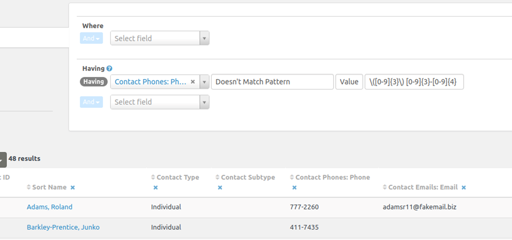
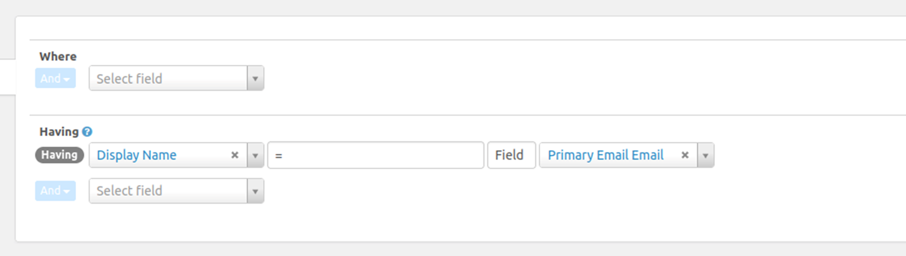

# Filter Search Kit results with Having

Having filters the data in the result set. Unlike Where, which filters data before it is returned from the database, Having filters the results displayed in the table. This allows you to filter aggregate data or transform field values.

## Select a result field

After building a search results set from an initial Entity selection and any additional Entity selections using With/Without, you can use Where and Having to further filter and manipulate the results. Both options are in the “Filter Conditions” tab at left.

The available fields differ: Where lets you select any field in the CiviCRM database, while Having lets you select only fields included in the results.

## Choose an operator and comparison value

Once you have chosen the result field to filter on, select an operator and comparison values.

In general, the operators work like the similarly named SQL operators:

- **Matches Pattern** matches a regular expression pattern.
- **Is Like** matches a complete field. To find part of a field, you usually need wildcards, such as %search term%.
- **Contains** is useful for searching serialized fields, which store multiple values together. For example, **Contact Subtype** could be **Parent**, **Volunteer**, or **Staff**. **Contains** matches a full value such as **Parent**, not part of a value.

Negated operators such as **Not Like**, **≠**, or **Doesn't Contain** won't match **NULL** fields that have no value. They only match fields that have a value and whose value doesn't match the criteria. If you want **NULL** fields as well, you can search for **≠searchterm** or **Is Empty**.

## Filter by a pattern

This example filters the displayed results to show only phone numbers that match a regular expression describing a particular format.

Reverse the filter to find records with phone numbers that do not match the pattern and may need fixing.

‘Glob-matching’ with % or * can get you a long way, but regular expressions are more flexible and powerful for filtering results. There are many good tutorials online.

## Compare two fields

Although you will most often filter against a value you provide, you can also compare one field with another. This example displays rows where the display name and email address are the same.

<!-- Source: searching/searchkit/having.md -->
