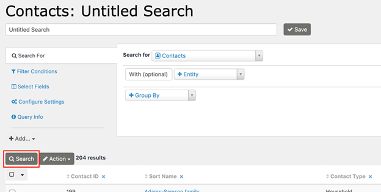

# Search button

Click this button to preview and refresh your search results.

## Description

You must explicitly use the search button whenever you want to see results. The results display will be cleared each time you make a change to the settings.

<!-- Source: searching/searchkit/search_button.md -->
