# Example Soft Credit Search and Display

This example creates a Soft Credit search and a table display.

!!! Note "A little background on Soft Credits"
    Soft Credits in CiviCRM are a way to keep track of someone you should also thank for a contribution other than the donor. For example, if I ask people to donate for my birthday and John Doe contributes 25 euro I can get recognition for that with a soft credit. For more information read the [Soft Credits section](../../contributions/soft-credits.md).

The search combines data from the contact who has the Soft Credit, the contact who made the contribution, and the contribution itself. This can show who the best contribution solicitors are. The result will look like this:

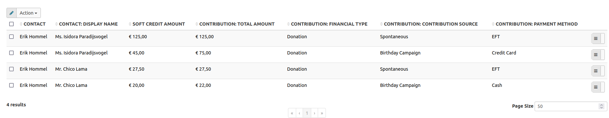

## Start from saved searches

Navigate to SearchKit from the **Search** menu. The saved searches page shows existing searches:

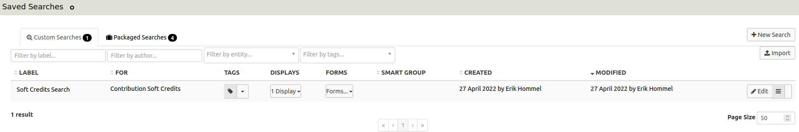

The Soft Credit example is already on the list, but this example creates a new search step by step. Click **New Search**.

## Create the search

The **New Search** button opens an empty search form:

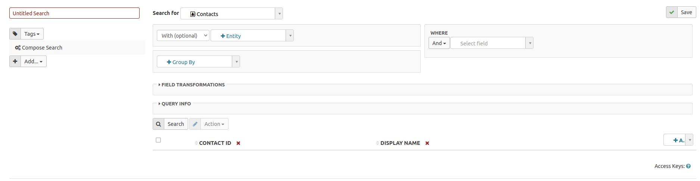

On the left, enter a name in the text box that shows **Untitled Search**. This example uses “Soft Credit Example Search”.

Below the name, you can add a tag to categorize the search—for example, with other Fundraising searches.

The **Add** selection box below the tags is covered in [Adding a display](#adding-a-display).

### Select entities

At the middle top of the form, choose which entity to search. Initially, the value is Contacts:

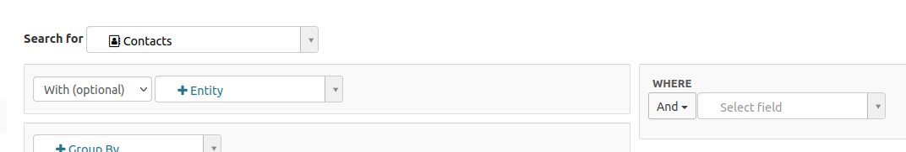

The list of available entities is extensive.

For this example, the Contribution Soft Credits entity is initially selected. This returns the contacts who have the Soft Credit, the ID of the linked contribution, the Soft Credit amount (which can differ from the contribution amount), and the Soft Credit type.

To include information about the contribution and the contact who made it, specify those entities too. Click the **+Entity** select menu next to **With (optional)** to add them. SearchKit works out how to link them: it uses the contribution ID to link to the Contribution and the contact ID in the contribution to link to Contact.

You can add further conditions. This example limits contributions to those with a financial type of Donation, filtering out payments for Memberships or Events. Use the **Where** box to limit the contributions to a date range of 1 Jan 2021 to 30 April 2022.

The selected entities and conditions look like this:

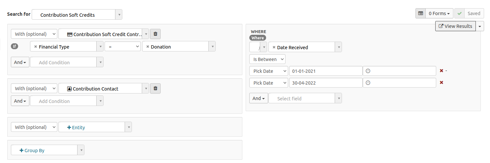

The **Group By** box is not used in this example. It lets you group results, such as by **Contact Display Name**.

### Select fields

At the bottom of the form, select which fields to display in the results. The default selection typically includes an ID and sometimes a name:

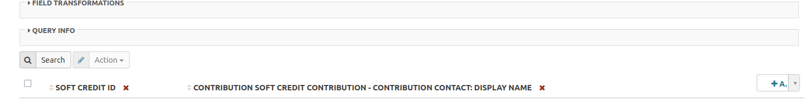

Click **Search** above the field names to run the search and display its data.

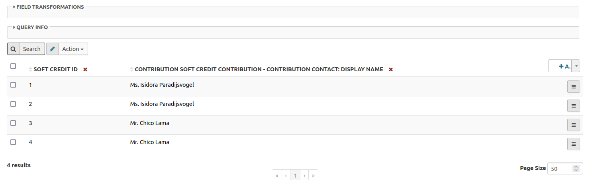

Next to **Search**, the **Action** box offers several actions. Its default is to download the results as a CSV file. This standard action can be switched off, which will be shown later.

Use **Add** on the right side of the form to choose more fields from the selected entities:

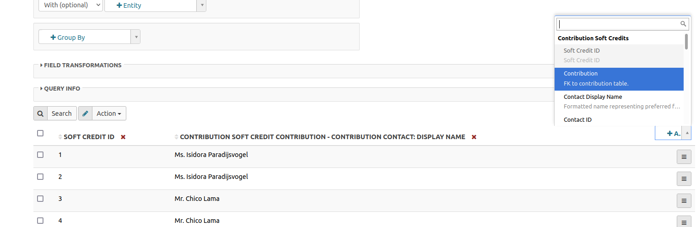

In this example, remove Soft Credit ID, keep the name of the Soft Credit contact, and add:

- the soft credit amount
- the soft credit type
- the name of the contributing contact
- the contribution total amount
- the contribution date
- the contribution source
- the contribution status
- the contribution payment method

Click **Search** again to see the updated results:

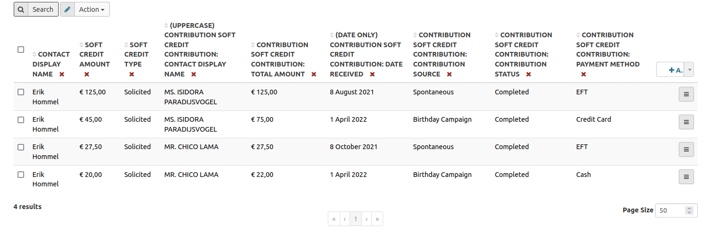

### Transform fields

Expand **Field Transformations**, just below the entities section. It lists the fields included in the search and offers functions to transform each one.

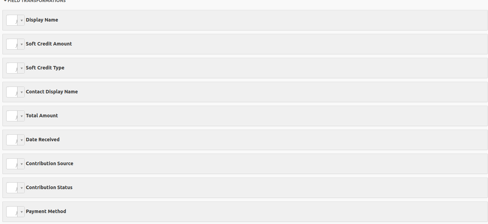

To make the Contact stand out, select the Uppercase function next to the Contribution Contact Name label. To exclude the timestamp when the contribution was received, select Date Only next to the Contribution Receive Date label.

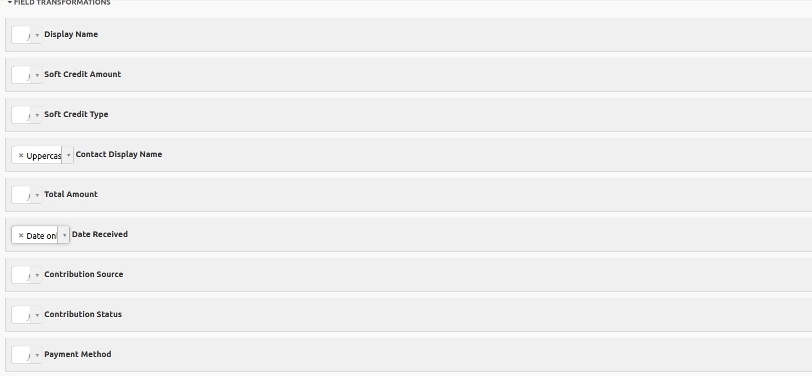

Click **Search** to view the transformed results:

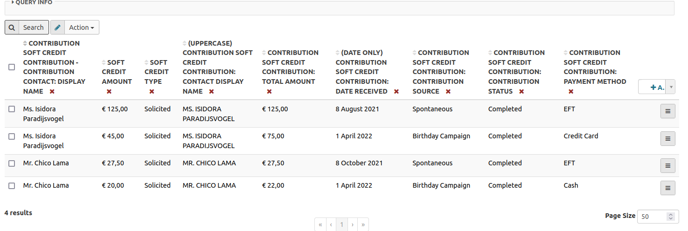

### Look at the query

Below **Field Transformations**, **Query Info** shows the technical translation of the selected entities and fields. It is useful for developers and can be ignored if you do not need the technical details.

For the Soft Credit example, the query is displayed as:

```
{
  "version": 4,
  "select": [
    "ContributionSoft_Contribution_contribution_id_01_Contribution_Contact_contact_id_01.display_name",
    "amount",
    "soft_credit_type_id:label",
    "UPPER(ContributionSoft_Contribution_contribution_id_01.contact_id.display_name) AS UPPER_ContributionSoft_Contribution_contribution_id_01_contact_id_display_name",
    "ContributionSoft_Contribution_contribution_id_01.total_amount",
    "DATE(ContributionSoft_Contribution_contribution_id_01.receive_date) AS DATE_ContributionSoft_Contribution_contribution_id_01_receive_date",
    "ContributionSoft_Contribution_contribution_id_01.source",
    "ContributionSoft_Contribution_contribution_id_01.contribution_status_id:label",
    "ContributionSoft_Contribution_contribution_id_01.payment_instrument_id:label"
  ],
  "orderBy": [],
  "where": [
    [
      "ContributionSoft_Contribution_contribution_id_01.receive_date",
      "BETWEEN",
      [
        "2021-01-01 11:09:00",
        "2022-04-30"
      ]
    ]
  ],
  "groupBy": [],
  "join": [
    [
      "Contribution AS ContributionSoft_Contribution_contribution_id_01",
      "LEFT",
      [
        "contribution_id",
        "=",
        "ContributionSoft_Contribution_contribution_id_01.id"
      ],
      [
        "ContributionSoft_Contribution_contribution_id_01.financial_type_id:name",
        "=",
        "\"Donation\""
      ]
    ],
    [
      "Contact AS ContributionSoft_Contribution_contribution_id_01_Contribution_Contact_contact_id_01",
      "LEFT",
      [
        "ContributionSoft_Contribution_contribution_id_01.contact_id",
        "=",
        "ContributionSoft_Contribution_contribution_id_01_Contribution_Contact_contact_id_01.id"
      ]
    ]
  ],
  "having": []
}
```

### View results

Click **Save** in the upper right. Once the search is saved, **View Results** appears underneath **Save**. You can view results while customizing the search or after completing it.

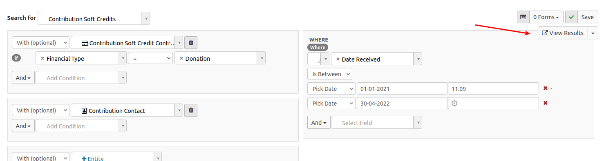

## Adding a display

Once you have specified the search criteria and selected the result fields, click **Add...** on the left side of the form to choose a display.

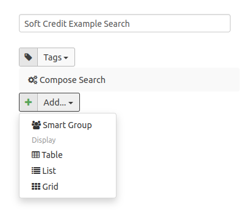

Available display types include:

- **Smart Group**: creates a smart group of the search results
- **Table**: shows the results as an overview in table form
- **List**: shows the results as a (vertical) list
- **Grid**: shows the results as an unformatted grid

This example uses **Table**, the most common option. Select **Table** to open its form:

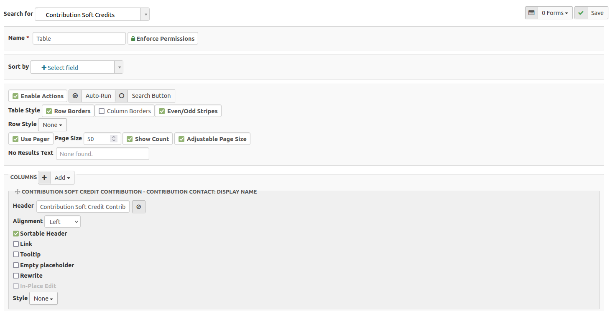

Give the table a name, then click **Save** in the upper right corner.

!!! Tip
    Do not forget to press **Save** regularly when building your search or table so you do not lose your progress!

In **Sort by**, select the fields by which to sort the table. Fields can be sorted in ascending or descending order.

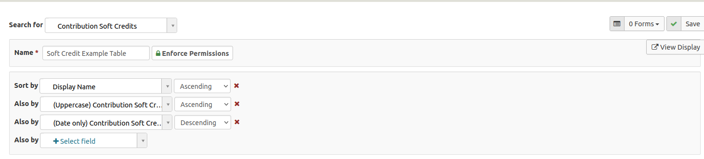

In the section below, you can **Enable Actions** on the table; set the **Page Size**, which determines how many results show per page; set the table style; choose the text shown when there are no results; and choose whether the search runs automatically. In this example, the text for no results has been changed and the other settings retain their default values:

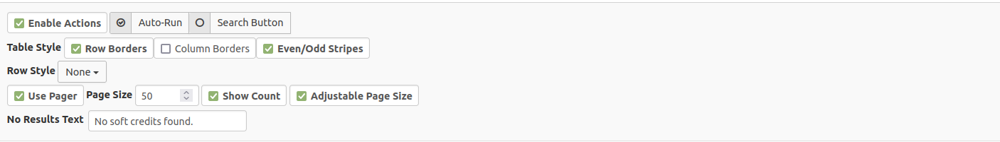

The next section lists all fields in the search. To change their order, click and hold a column’s handle, then move it:

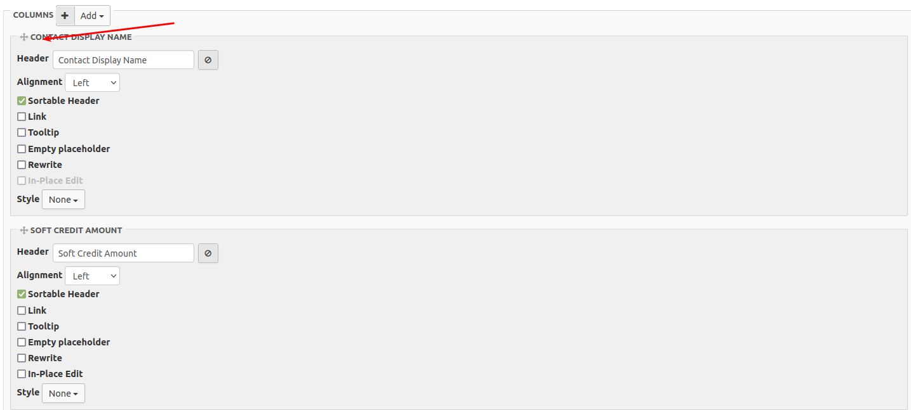

To remove a column, click its remove icon:

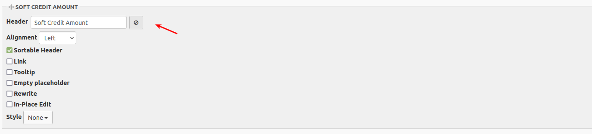

You can change each column’s heading and alignment, and enable inline editing.

To add a field from the defined search that is not yet displayed in the table, click **Add** at the top of the column list. You can also use this button to add a link, button, menu, or a bit of custom code.

In this example, add a menu for:

- viewing the soft credit contact
- viewing the contribution contact
- viewing the contribution

Click **Add**, then select **Menu**:

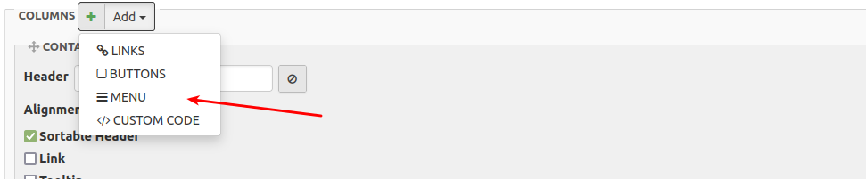

A new menu column appears at the bottom of the list. You can edit the menu:

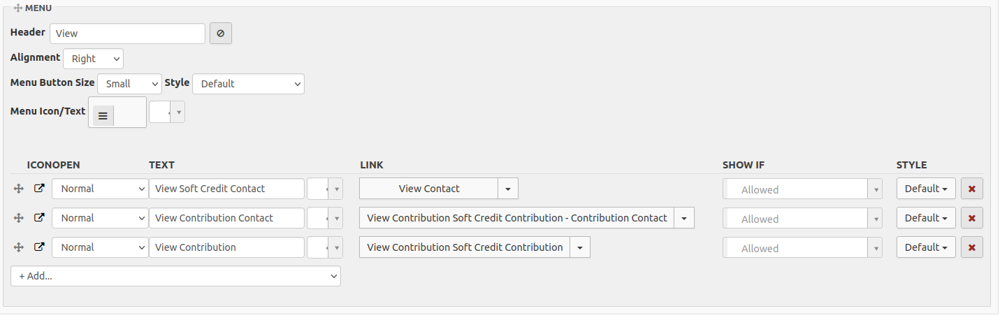

Clicking **Add...** within the menu section gives you suggestions based on the selected entities.

Click **View Results** to see the final table:

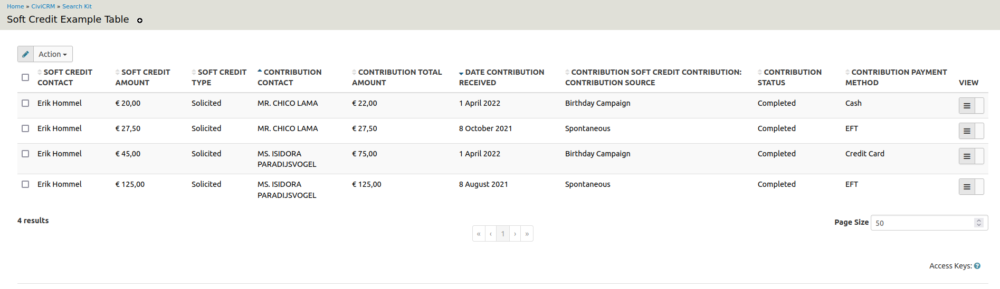

To make a menu option for the table, copy the URL from the browser:

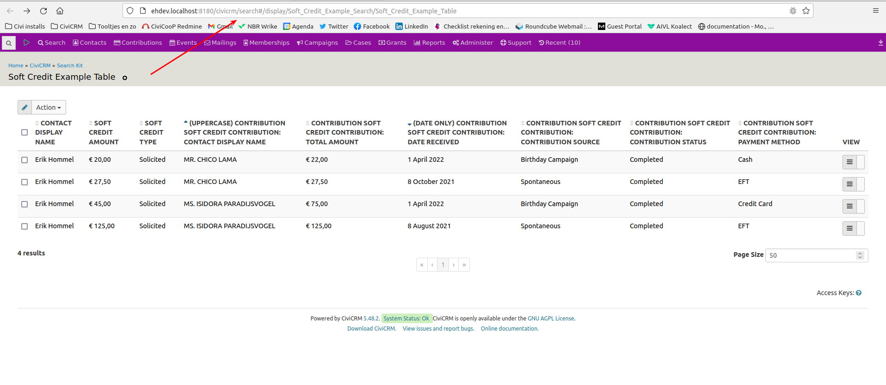

Navigate to **Administer > Customize Data and Screens > Navigation Menu** and click **Add Menu Item**:

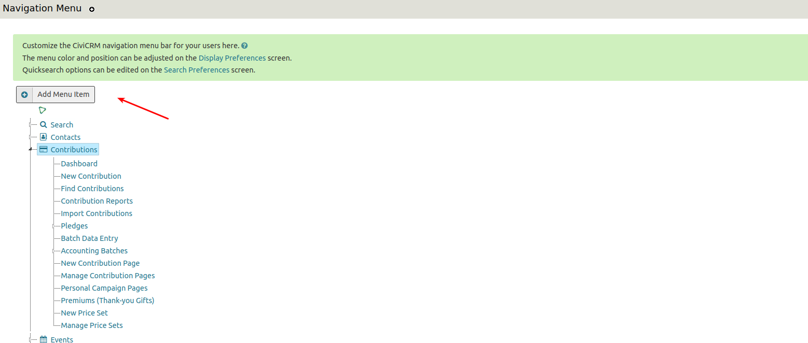

Enter all the options and paste in the copied URL, starting with _civicrm/_ onwards.

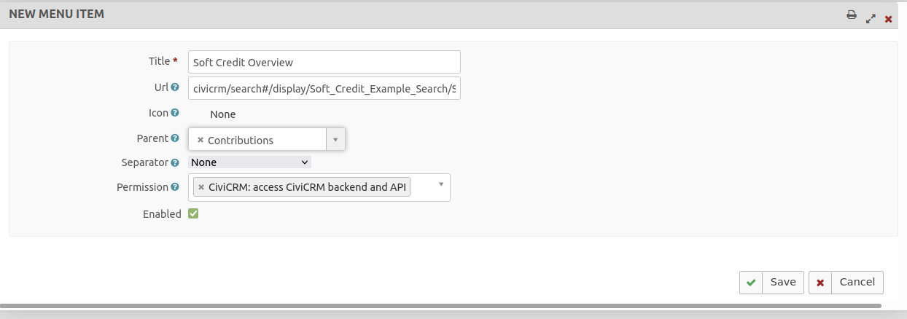

<!-- Source: searching/searchkit/soft-credit-example.md -->
