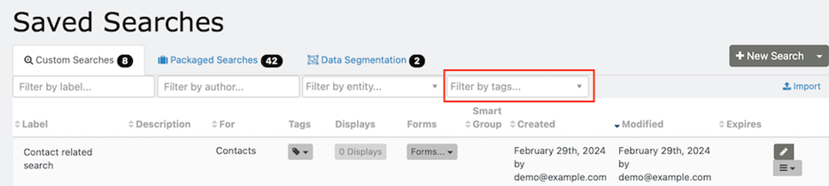
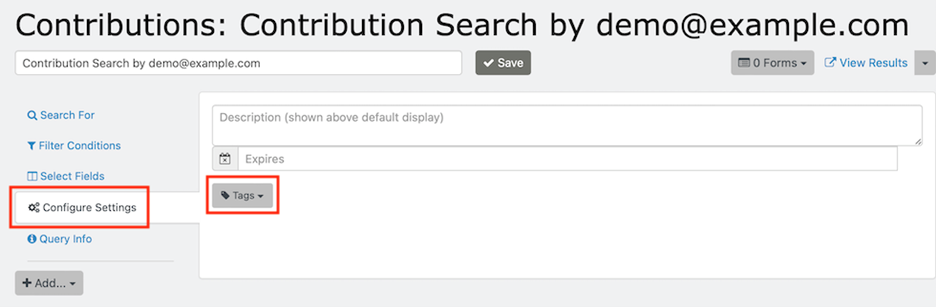
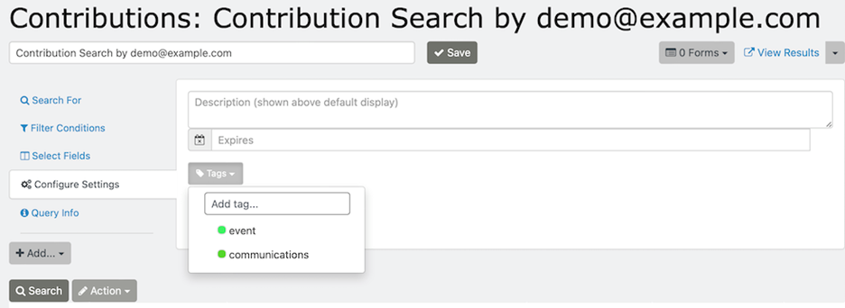
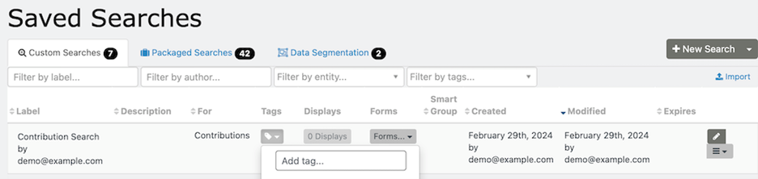
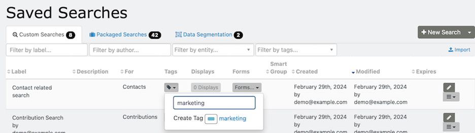

# Tags

Tags categorize data in CiviCRM. In SearchKit, you can use them to categorize searches, such as by Department or Initiative. Tags can be enabled for one or more of the following: Contact, Activity, Case, File, and SavedSearch.

As you add Saved Searches, tags can help you find them. On the SearchKit landing page, select one or more tags using “Filter by tags…” in the upper right of the saved-search listing.

You can add tags to SearchKit searches in three ways:

- When creating a new search
- When editing an existing search
- From the Saved Searches main screen

## Add tags when creating or editing a search

1. Click “Configure Settings” in the left sidebar menu to show the Tags box.

   

2. Click the Tags box to select existing tags or add new tags.

   

## Add tags from the Saved Search landing page

1. Click the tag icon with the down arrow.

   

2. Begin typing in the “Add tag…” tag field. Matching results will appear, or you can select “Create Tag.” This adds a new tag to CiviCRM enabled for “SavedSearch,” allowing it to be used elsewhere in the system, such as from Advanced Search.

   

Learn more about [working with tags](../../organising-your-data/groups-and-tags.md#working-with-tags).

<!-- Source: searching/searchkit/tags.md -->
