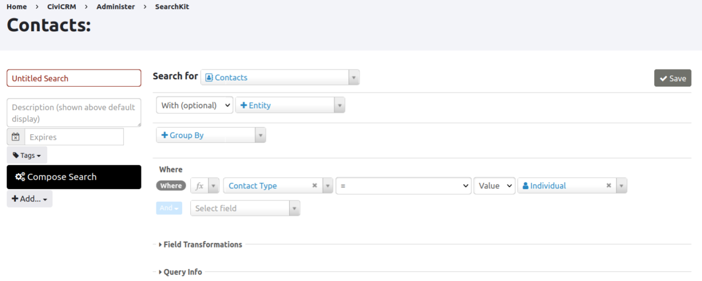
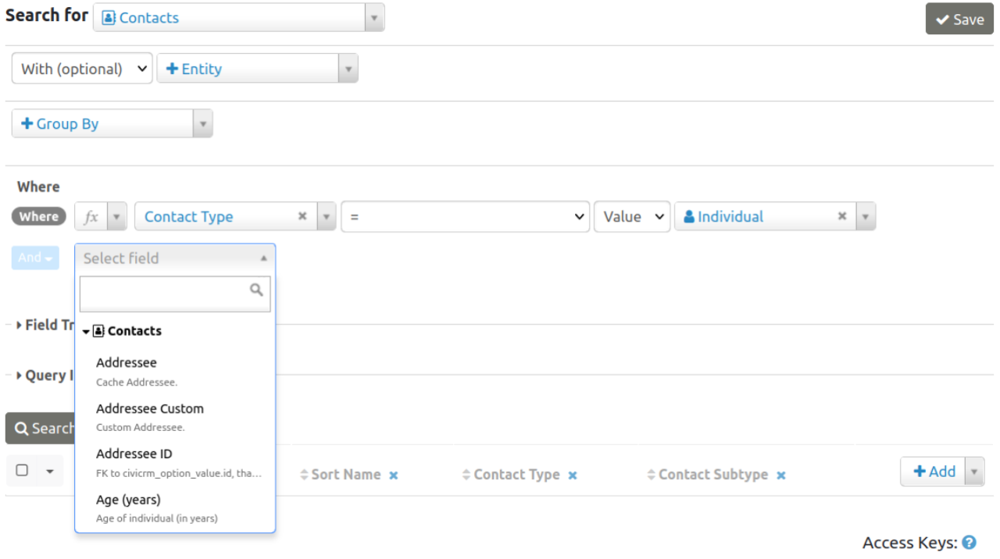
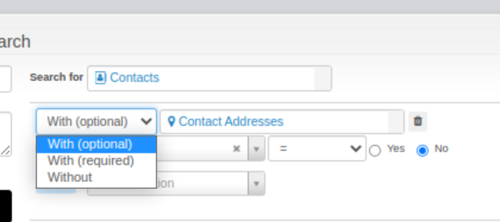
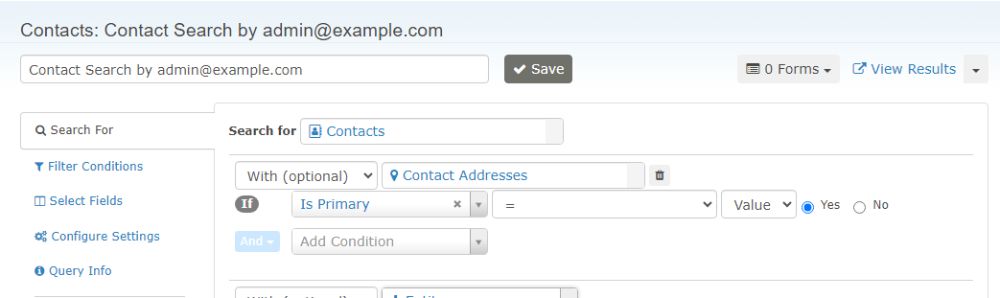
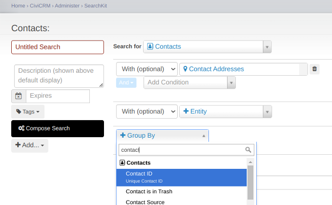
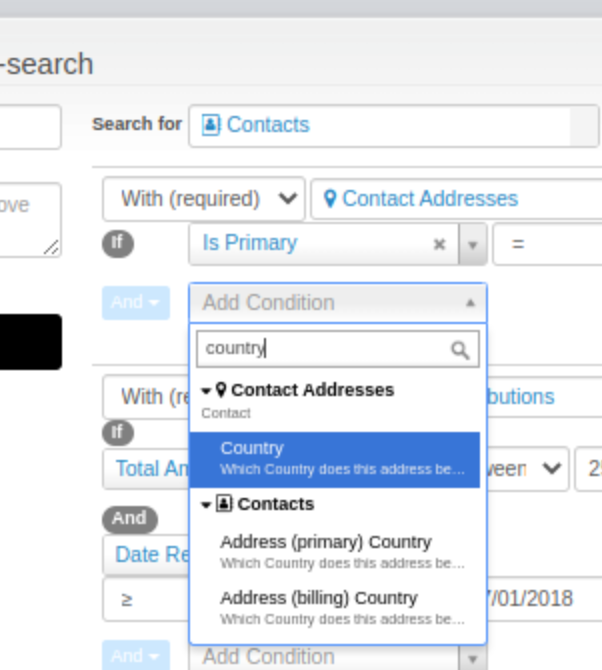

# What is SearchKit?

## About

SearchKit is a search query builder with extensive options for displaying results. It is appropriate for site builders, power users and developers, but non-technical staff are likely to need training or to spend significant time learning the interface.

Alternatively, a more experienced user or developer may create [Search Displays](search-displays.md) and make them available to other users via the menu system or as a dashlet on the main CiviCRM screen.

Searches built and saved in SearchKit can be targeted for use by different roles of staff users as well as unauthenticated end users.

## Getting started

You can access SearchKit under the menu **Search &gt; SearchKit**.

(On older versions of CiviCRM the SearchKit extension might not be enabled by default. You (or your site admin) may need to enable it. Navigate to **Administer &gt; System Settings &gt; Extensions**. Beside SearchKit, select the **Install** link then select the **Install** button.)

## Concepts and terminology

Getting familiar with SearchKit requires some understanding of its components and concepts. There are a number of recipes in this documentation for you to work through, but some introduction is needed.

### You find 'Entities'

An entity is a technical word for a 'thing'. In most cases, the 'thing' (Entity) you want to search for will be something like a Contact, a Contribution, etc. You start your search by selecting the entity you want to search for, or one of the several you want to find:

Within your search, you can select fields to display. Some appear by default when you click Search. Then you can add others by clicking on the +Add on the right of the list of fields in your selected results, and selecting more fields.

You can delete fields from appearing in the search results by clicking on the x beside the field name in the header row containing field titles of the search results.

### Filters / criteria / where

The Where section is where you define the criteria that relate to your entity.

In general, the operators are the same as the similarly-named SQL operators. Here are a few tips:

- `Matches Pattern` will match a regular expressions pattern.
- `Is Like` matches a complete field, so you usually want to use it with wildcards if you want to find parts of the field, like `%search term%`.
- `Contains` is useful for searching in serialized fields (fields that store multiple values together, such as Contact Subtype which could be `Parent,Volunteer,Staff`). It matches only a full value like `Parent`, not parts of a value.
- Negated operators such as `Not Like`, `≠` or `Doesn't Contain` won't match NULL fields that have no value. They only match fields that have a value and the value doesn't match the criteria. If you want NULL fields as well, you can search for `≠ searchterm OR Is Empty`.

This is particularly important for custom fields, where the custom field group row might not exist in the database at all if there are no values. For example, if you're filtering a `Yes or No` field and want to get all the entities that are not `Yes`, you need to use the `Is Empty` operator (which will find both NULL values and `No`, i.e. FALSE/0 values) rather than `≠ Yes`.

### With/Without (Joins)

In SearchKit, when you include more than one type of information (referred to as 'entities'), it's known as a join. In the user interface it is represented with the options "with" or "without".

Adding an additional entity can change the number of rows in your results. For instance, consider a search that includes 'Contacts with (optional) Addresses'. The results will display differently based on the number of addresses associated with each contact.

- If a contact has no address or just one, they will appear in the results as a single row.
- If a contact has multiple addresses, there will be a separate row for each address.

Here's an example with Timmy and his parents:

|Display Name|Location Type|Street Address|Is Primary|
|------------|-------------|--------------|----------|
|Timmy|Home|Sesame Street|Yes|
|Timmy's Mum|Home|Sesame Street|Yes|
|Timmy's Mum|Work|Downing Street|No|
|Timmy's Dad|||

In this table (if you attach the addresses using the option "With optional" to the contacts):

- Timmy appears once as he has only one known address.
- Timmy's Mum appears twice, once for each of her two addresses (Home and Work).
- Timmy's Dad appears without any address details.

There are three options for joins in SearchKit: with (required), with (optional), and without. Each of these options significantly alters the search results:

- With (required): This option ensures that only those contacts with the specified additional information (like an address) are shown in the results.
- With (optional): Using this option, all contacts are shown in the results, but additional information is included where available.
- Without: This option includes only those contacts that do not have the specified additional information.

The choice of join option directly influences which contacts and what information is displayed in your search results.

### Group by

If, as in the above join example, you have one row per address but you just want one per contact, you can use Group By to group the rows, such that you only have one per contact.

### Sorting results

You can sort results in SearchKit by clicking on the column headers. To sort by multiple columns, hold down shift while clicking additional column headers.

### Addresses, emails & phones are a bit magic - that's mostly good

Normally a contact has a primary address, a primary email and a primary phone. We know there is only one of each of these and they are really useful so you can include them without having to join in an address table. However, if you DO include an address join you will see both fields from the 'Contact Entity' (primary country) and the joined address and you need to match the field you pick up with the 'Entity name' (ie what is in the box next to Required). Here 'Contact Addresses' are the non-primary ones joined in and 'Address (primary) Country' is the primary address.

### Forms

Forms are where you can configure for SearchKits to be shown as dashlets or in the menu. This is also where you configure filters.

## SearchKit and other CiviCRM search functionality

SearchKit fully replaces the old, more limited, Search Builder.

It is more powerful than Advanced Search, and covers some extra parts of CiviCRM. However, many users may continue to prefer to use Advanced Search and searches like **Search &gt; Find Contacts** and **Events &gt; Find Participants**. We are no longer adding new features to these but they will be part of CiviCRM for the forseeable future.

The upper left Quick Search continues to be more convenient for quickly retrieving records based on part of an email or name or other single term.

<!-- cividoc:popular-extensions:start -->
## Popular extensions

These are widely used extensions in the relevant category of the official CiviCRM Extensions Directory. Usage is a popularity signal, not a compatibility or suitability guarantee.

- [Extended Reports](https://civicrm.org/extensions/extended-reports) — reported usage: 2,399
- [SearchKit Tokens](https://civicrm.org/extensions/searchkit-tokens) — reported usage: 1,733
- [Chart Kit](https://civicrm.org/extensions/chart-kit) — reported usage: 1,187
- [Export to native Excel](https://civicrm.org/extensions/export-native-excel) — reported usage: 959
- [Civisualize](https://civicrm.org/extensions/civisualize-missing-data-visualization-extension) — reported usage: 718

[All extensions for this component](https://civicrm.org/extensions?category=126)

Check development status, current CiviCRM compatibility, CMS requirements, and release notes before installation.

Usage snapshot reviewed: 2026-10-13.
<!-- cividoc:popular-extensions:end -->

<!-- Source: searching/searchkit/what-is-searchkit.md -->
