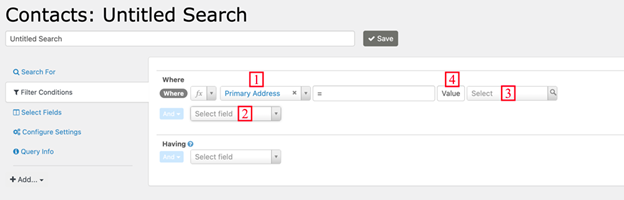
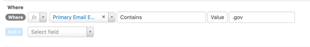
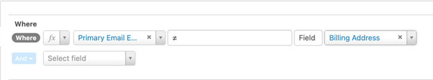

# Where

**Where** filters data in the database before it is returned to SearchKit. To filter data after it is returned from the database, use [Having](having.md).

## Description

A Where comparison has four main components:

1. The element you want to compare.
2. The “operator.”
3. The value (or field) to compare against.
4. Whether to compare with a value or a field.

In general, the operators are the same as the similarly-named arithmetic or SQL operators.

- **Matches Pattern** matches a regular expression pattern.
- **Is Like** matches a complete field, so you usually want to use it with wildcards to find parts of the field, like **%search term%**.
- **Contains** is useful for searching in serialized fields (fields that store multiple values together, such as *Contact Subtype*, which could be **Parent**, **Volunteer**, **Staff**). It matches only a full value like **Parent**, not parts of a value.
- Negated operators such as **Not Like**, **≠**, or **Doesn&#39;t Contain** won&#39;t match **NULL** fields that have no value. They only match fields that have a value and the value doesn&#39;t match the criteria. If you want **NULL** fields as well, you can search for **≠ searchterm** OR **Is Empty**.

This example only includes contacts whose email address contains ‘.gov’:

This example includes contacts whose primary address is not the same as their billing address:

<!-- Source: searching/searchkit/where.md -->
