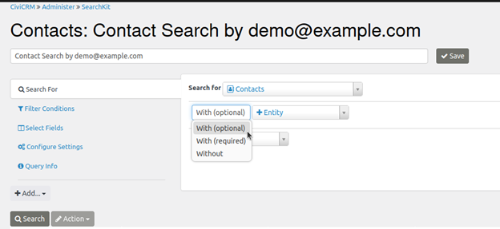
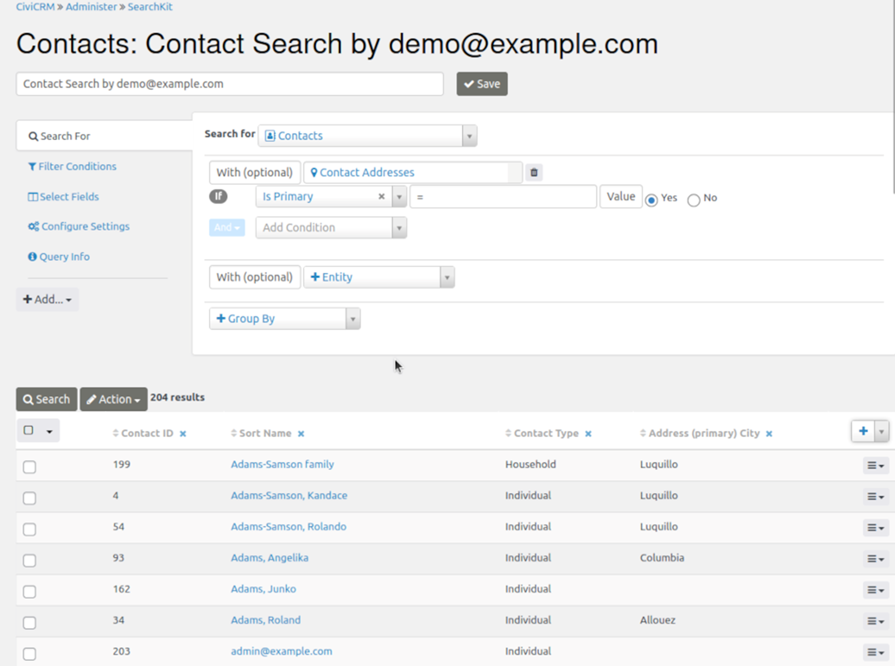
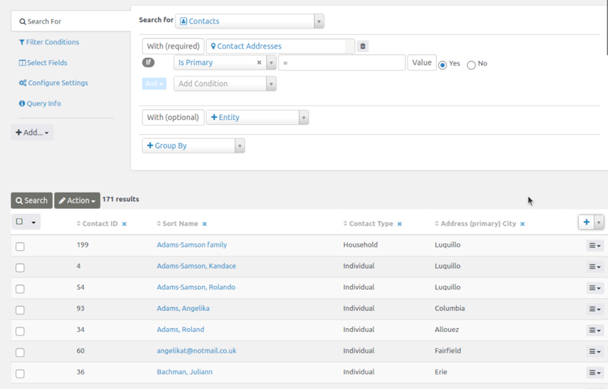
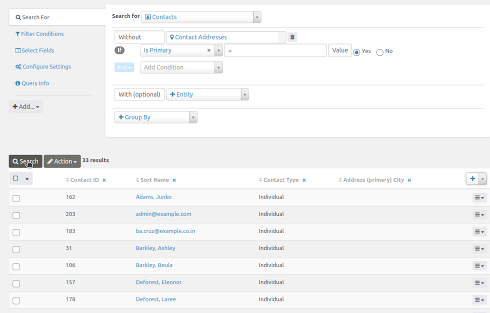

# With (Optional) / With (Required) / Without

When creating a new search, you first choose a starting entity. You can then add zero or more entities to include their fields as columns or to adjust which rows the search returns. For example, you might start with contacts and add addresses.

Each additional entity is *joined* to the starting entity and any entities already added. The join can be **With (optional)**, **With (required)**, or **Without**. Your choice determines which rows are returned: you might use a join to find contacts who have bought tickets for the Annual General Meeting, or contacts who have not yet bought tickets.

## With (optional)

**With (optional)** returns rows from the earlier entity or entities even when there is no match in the new entity. For Contacts With (optional) Contact Addresses, a Contact with no addresses still has a row in the results. Its Contact Addresses fields are empty/NULL.

## With (required)

**With (required)** returns rows only when the earlier entity or entities have a match in the new entity. Contacts With (required) Contact Addresses excludes Contacts with no addresses and returns a row for every combination of a Contact and one of its addresses.

## Without

**Without** returns rows only when the earlier entity or entities have no match in the new entity. Contacts Without Contact Addresses returns a row for each Contact with no Contact Address.

For each entity you add, the choice of **With (optional)**, **With (required)**, or **Without** determines whether rows are added to or removed from the search results.

<!-- Source: searching/searchkit/with_without.md -->
