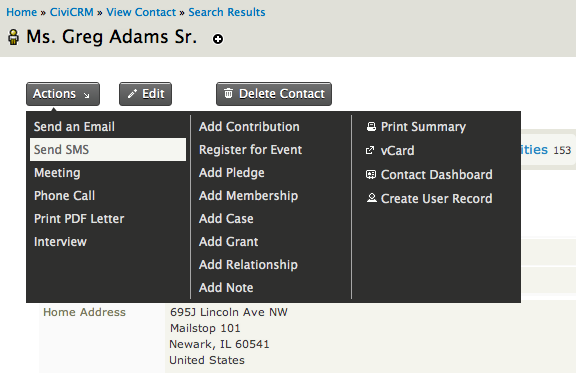
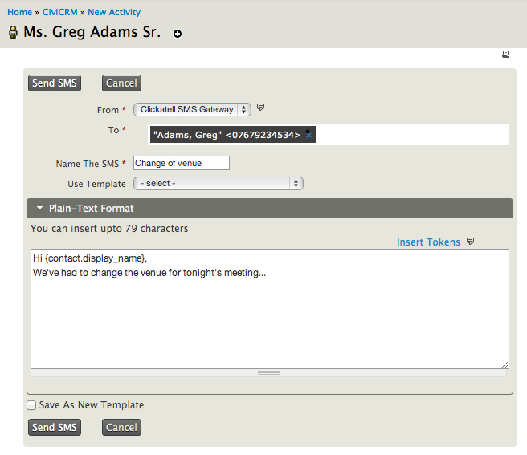
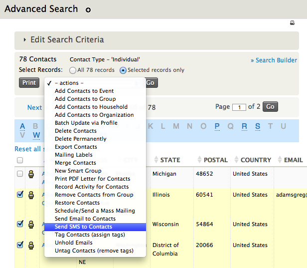
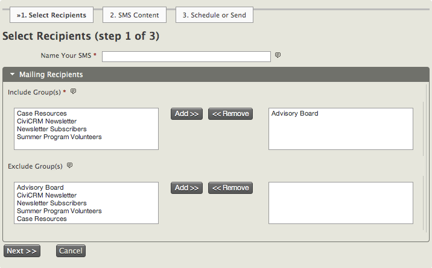
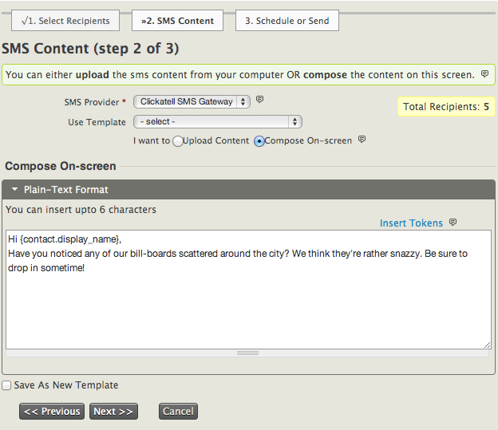
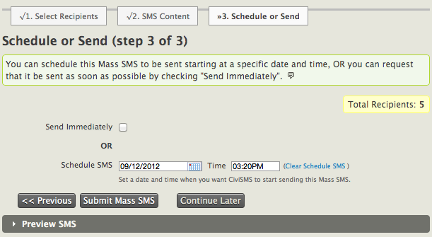

# Everyday SMS tasks

These instructions assume that you have already configured an SMS provider in CiviCRM. If you have yet to set up an SMS gateway, read the *Set-up* section in this chapter first.

SMS messages can be sent to mailing lists, the results of an advanced search, or individuals chosen manually.

## Send a text message to individuals

To send a text message to an existing individual, open the contact's profile, click **Actions**, and select **Send SMS**. You can also create an SMS in the activities tab of a contact from the -new activity- drop-down menu.

On the page that appears, complete the message fields:

- **From**: Choose the SMS provider you would like to send a message from.
- **To**: This field automatically populates with the mobile number of the contacts you selected on the previous screen. To add further recipients, type their name after the first number and select a name from the suggestion list. Contacts without mobile numbers will not appear in the list (the phone number type must be "Mobile").
- **Name the SMS**: This appears as the SMS activity against the recipients' profiles. Give it a name that helps distinguish it later, such as "Change of email address request".
- **Use Template**: If an SMS template has been created in the past, you may insert it here to save time. For more information, see *Set-up* in the *Email* chapter.
- **Plain-Text Format**: Enter up to 160 characters of message content. As with emails, you can insert [tokens](../common-workflows/tokens-and-mail-merge.md) to pull information about the contact into the message.
- **Save as New Template**: If you wish to reuse the message text regularly, save it as a template.

Once the SMS has been sent, a confirmation message appears and an SMS activity is posted against the recipient's contact profile. To see it, open the contact, go to the **Activity** tab, and find an activity of the type "Text Message (SMS)". Click **View** in the last column for more details, including the message content and campaign.

## Send a mass SMS

To send a personalised SMS to many people at once, first identify the recipients. You can select contacts from advanced search results for a one-time message, or use a mailing list when sending to the same group regularly.

### Select recipients from an advanced search

Run an advanced search for the criteria your participants must fall into. Select some or all of the contacts in the results list and choose "Send SMS to Contacts" in the Actions drop-down menu. Please note that the activity type this method creates will be "Text Message (SMS).

### Use mailing lists for a bulk SMS

If you have not built a mailing list before, or would like a refresher, read the *Set-up* section in the *Email* chapter.

To begin writing a bulk SMS, go to **Mailings &gt; New SMS**. Complete these three steps:

1. **Naming your SMS and selecting recipients**: Give the text message a name. It appears as the SMS activity against every recipient's contact profile, so a clear subject will help identify the content later. Move the mailing lists you wish to include from the Include Group(s) box on the left to the right using **Add**. You can also specify groups you do not want to include. Contacts who fall into both groups will not be sent a message—for example, if they have already received a similar SMS under the group you have chosen not to include. Click **Next**.

    

2. **SMS Content**: Select an available SMS Provider and decide whether to use an existing mailing template for the content of your SMS (see *Set-up* in the *Email* chapter).

    Write the message in the Compose On-Screen section or upload it from a text file. The character limit for both is 160 (the length of one text message). You may also insert [tokens](../common-workflows/tokens-and-mail-merge.md) to personalise the SMS with information about each contact. If you would like to reuse the message later, tick **Save as New Template** before going to the next screen.

    

3. **Schedule or Send**: Send the message immediately or schedule it to be sent automatically at a future date and time. To save your progress without choosing either option, click **Continue Later**. To return to the message, go to **Mailings &gt; Draft and Unschedule Mailings**, tick **Is SMS**, and click **Search**. In the list of unsent text messages, click **Continue** against the message you wish to complete.

    Click the "Preview SMS" banner at the bottom to check the content, or click "Submit Mass SMS" to send your message.

    

<!-- Source: sms-text-messaging/everyday-tasks.md -->
