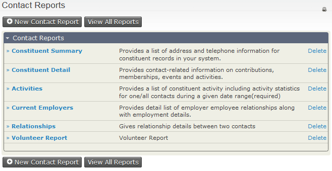
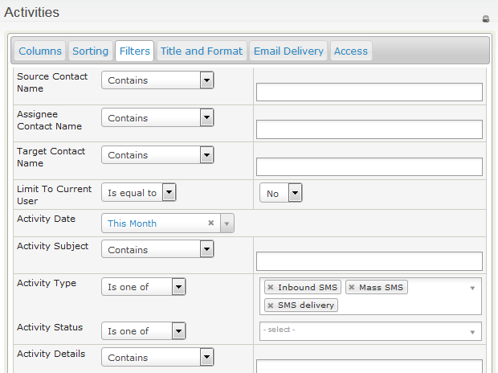

# Reports and analysis (SMS)

## Report on all text message activity

To report on all SMS activity recorded in CiviCRM, run the **Activities** report from **Reports &gt; Contact Reports**.

The SMS activity types are Inbound SMS, Mass SMS and SMS delivery. Filter by SMS activity type, then refine the results by:

- message status (e.g. completed/scheduled)
- date and time
- which group or tag the recipient is in
- characteristics of the recipients themselves, such as their name and location.

To update the results, click **Preview Report** at the bottom of the Filters window.

<!-- Source: sms-text-messaging/reports-and-analysis-sms.md -->
