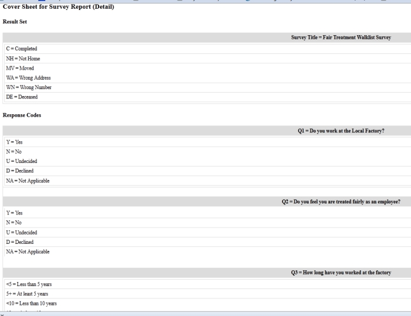

# Create an address list for Surveys of type Walklist

Surveys let you print walk lists for volunteers or staff who conduct surveys while door-knocking.

Door-knocking canvass activities may be part of a larger campaign, so you may want to set up a Campaign if you haven't done so already.

## Create your WalkList report

1. Go to **Reports > Create Templates from Reports > Survey Report (Detail)**.
2. In the **Display Columns** area, check the boxes for **Street Number, Street Name, Street Unit, Survey Responses**.
3. In the **Group By Columns** area, check the boxes for **Street Name, Odd/Even Street Number**.
4. In the **Set Filters** area, select your survey name in **Survey**. For **Respondent Status**, select **Is Equal to** and **Reserved** from the dropdown menus.
5. Click **Preview Report**, then **Print Preview**.
6. **Print your report.** The printout includes a cover sheet with the survey questions (both label and value). The report is sorted by street name and odd and even street numbers. See [Set up](set-up.md) for more information.

## Conduct your door-knock canvass

Your organisers and volunteers can now door-knock and collect responses on their WalkList report sheets.

## Record responses from the canvass

At the end of each day or evening of canvassing, each organiser or volunteer can record responses directly into CiviCRM.

1. Go to **Campaigns > Interview Respondents**.
2. Enter the name of your survey and the name of the target group you surveyed during the canvass. You may also enter the street name if you want to work with a smaller group of contacts.
3. On the **Find Respondents to Interview** screen, select the contacts for whom you want to record responses.
4. Click **Go**.
5. Enter the responses and results according to your WalkList sheet responses, then click **Record Response**.

<!-- Source: survey/everyday-tasks-part2.md -->
